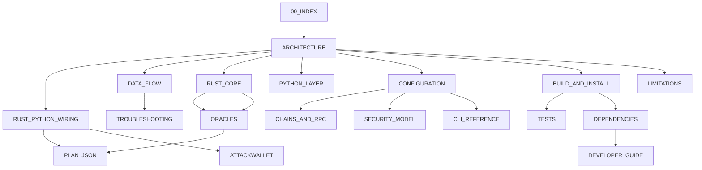

# 00 INDEX — ForkSploit technical documentation

> **⚠️ USE AT YOUR OWN RISK — THE AUTHORS ACCEPT NO LIABILITY.**
> **ForkSploit is provided "AS IS", without warranty of any kind. It signs and
> sends real transactions and can move real funds. You use it entirely at your
> own risk and under your own full responsibility; the authors and copyright
> holders accept NO liability whatsoever for any consequences of its use, misuse
> or inability to use it. See [`DISCLAIMER.md`](../DISCLAIMER.md).**

This directory contains the complete technical documentation of the ForkSploit
system (Rust core + Python execution layer). Each document is standalone and
cross-linked.

**Language:** English; symbol, file and flag names are kept in their original
form.

**The source of truth is the code.** Every claim carries a reference
`path/to/file.rs::symbol` or a reproducible command. Anything not measured is
marked **unmeasured**; anything not verified in code is marked **unverified**.

---

## Index of documents

| Document | What it contains |
|----------|-------------|
| [ARCHITECTURE.md](ARCHITECTURE.md) | the two-layer architecture, the big picture, the boundary between the layers, diagrams |
| [RUST_PYTHON_WIRING.md](RUST_PYTHON_WIRING.md) | HOW/WHERE the layers are connected: the fuzzer argv, `ETH_RPC_URL`, the `plan.json` schema, `load_findings`, the pre-flight gate, the feedback loop, exit codes |
| [DATA_FLOW.md](DATA_FLOW.md) | the whole flow from command to on-chain proof, step by step with `file::symbol` |
| [RUST_CORE.md](RUST_CORE.md) | the Rust core module by module, constants, `EvmArgs`, a dependency diagram |
| [PYTHON_LAYER.md](PYTHON_LAYER.md) | the Python execution layer module by module, functions, constants |
| [PLAN_JSON.md](PLAN_JSON.md) | reference for the `*.plan.json` schema (all fields, source, rules) |
| [ORACLES.md](ORACLES.md) | catalogue of all 47 oracles and bug types, confidence levels, presets |
| [ATTACKWALLET.md](ATTACKWALLET.md) | the `AttackWallet.sol` contract and the W1–W5 execution model |
| [CONFIGURATION.md](CONFIGURATION.md) | all configuration, flags, environment variables, files, constants |
| [CHAINS_AND_RPC.md](CHAINS_AND_RPC.md) | chains, RPC, network identity, testnet/mainnet split |
| [SECURITY_MODEL.md](SECURITY_MODEL.md) | operator control, locked profit, wallet policy, limitations |
| [BUILD_AND_INSTALL.md](BUILD_AND_INSTALL.md) | prerequisites, build, Docker, CI |
| [CLI_REFERENCE.md](CLI_REFERENCE.md) | CLI reference: the `forksploit evm` binary, Python scripts, `forksploit.sh` |
| [TESTS.md](TESTS.md) | the test map: what runs, what is skipped and why |
| [TROUBLESHOOTING.md](TROUBLESHOOTING.md) | statuses, exit codes, typical errors |
| [DEPENDENCIES.md](DEPENDENCIES.md) | external and internal dependencies, execution order, diagrams |
| [DEVELOPER_GUIDE.md](DEVELOPER_GUIDE.md) | how to contribute, conventions, R1 |
| [LIMITATIONS.md](LIMITATIONS.md) | what the system cannot do (from the code) and why |
| [project/](project/) | project and process documents: plan, limitations, blockers, task spec, backtesting, release notes |

---

## Documentation map

## A short summary of each document

**ARCHITECTURE.md** — ForkSploit is a two-layer system: the Rust core discovers
vulnerabilities and synthesizes plans; Python executes and proves. The boundary
is process- and file-based. Rust never signs; Python never decides whether a
pattern is a vulnerability. It contains the big-picture diagram, the boundary
diagram and the dependency diagram.

**RUST_PYTHON_WIRING.md** — documents every point of contact between the layers:
the exact argv that `auto_pipeline.run_fuzzer` builds, `ETH_RPC_URL`, the file
contract (`*.plan.json`, `*.t.sol`, `*.s.sol`, `vuln_info.jsonl`, `coverage.txt`),
`strategy_layer.load_findings`, the pre-flight gate, the write-back of gas fields
and exit codes.

**DATA_FLOW.md** — 8 steps from the CLI entry to the measured on-chain proof,
with `file::symbol` for each step and a sequence diagram.

**RUST_CORE.md** — entry point, constants (`src/const.rs`), `EvmArgs` (all
flags), target loading, `FuzzHost`, the confidence level, oracles, concolic,
`ForkSploitFuzzer`, `solution/*`, helper modules.

**PYTHON_LAYER.md** — every module in `onchain_scripts/`: purpose, functions,
constants, dependencies, contact with the other layer.

**PLAN_JSON.md** — the full `*.plan.json` schema: all fields, their source in the
code, the rules (control leak → `sim-review`, `atomic_replayable`, `owner_gated`),
the difference between `steps` and `full_trace_steps`, and the fields Python adds.

**ORACLES.md** — a table of all 47 oracles with `bug_idx` constants, `OracleType`,
bug types and confidence levels; the `all`/`high_confidence` presets; the
declarative invariant oracle.

**ATTACKWALLET.md** — the only on-chain primitive: functions, state, the W1–W5
model, the locked `safeWallet`, reentrancy arm/disarm, flashloan, Flashbots
bundle.

**CONFIGURATION.md** — environment variables, all configuration files with
schemas, constants (Rust and Python), the Python pipeline flags, Rust feature
flags.

**CHAINS_AND_RPC.md** — the list of 25 `Chain` variants (24 networks + `local`),
the default RPCs (21 entries), `TESTNET_CHAINS`, identity verification,
Flashbots/privacy, Aave/WETH, `rpc_overrides.json`.

**SECURITY_MODEL.md** — the three wallet roles, the policy, locked profit,
operator control, the pre-flight as security, locked gas, front-running
protection.

**BUILD_AND_INSTALL.md** — prerequisites, `cargo build --release`, doctor, Python
installation, Docker (3 variants), CI (rust + python), release.

**CLI_REFERENCE.md** — all flags of the Rust binary, `forksploit.sh`, the Python
scripts (auto/batch/monitor/dashboard/wallet_policy/gas_oracle/triage/...).

**TESTS.md** — the test suites, the known failures (10 Rust network tests),
important tests, the Python tests and the measured result in this environment,
the integration harness, fixtures.

**TROUBLESHOOTING.md** — execution statuses, exit codes, typical errors with
causes and fixes, a status decision diagram.

**DEPENDENCIES.md** — external Rust/Python dependencies with versions, external
tools, internal dependencies, startup order, a diagram.

**DEVELOPER_GUIDE.md** — rule R1, setup, commands before a PR, code conventions,
where things belong, documentation.

**LIMITATIONS.md** — what the system cannot do: gas metering, mempool, narrow
concolic (no `keccak256`), one transaction per input, the harvest heuristic,
best-effort pre-flight, dead testnets, flashloan/flashbots limitations.

---

## How this documentation was verified

The procedure (rule R1):

1. **Reading the code** in this order: Rust (`src/main.rs`, `src/const.rs`,
   `src/evm/mod.rs`, `src/evm/oracle.rs`, `src/evm/host.rs`, `src/evm/solution/*`,
   `src/fuzzer.rs`, `src/fuzzers/evm_fuzzer.rs`, `src/evm/oracles/*`,
   `src/evm/concolic/*`, `src/evm/onchain/endpoints.rs`,
   `src/evm/contract_utils.rs`, `src/evm/multicore.rs`,
   `src/evm/setup.rs`, `src/evm/auto_setup.rs`, `src/evm/oracles/invariant.rs`),
   then Python (`onchain_scripts/auto_pipeline.py`, `batch_pipeline.py`,
   `strategy_layer.py`, `chains.py`, `wallet_policy.py`, `gas_utils.py`,
   `gas_oracle.py`, `proxy_resolver.py`, `flashbots_bundle.py`,
   `dashboard_server.py`, `monitor.py`, `triage_findings.py`,
   `materialize_plan.py`, `contracts/AttackWallet.sol`), then CI/Docker/scripts
   (`Cargo.toml`, `rust-toolchain.toml`, `Dockerfile`, `.github/workflows/*.yml`,
   `forksploit.sh`, `integration_test.py`).
2. **Symbol inventory:** each claim names a `file::symbol`.
3. **Verification with commands** (measured in this environment):
   * `git status` → `docs/` is the only change; `git diff --stat README.md`
     is **empty** (README is unchanged at the time of the original Slovenian
     documentation).
   * `ls src/evm/oracles/*.rs | grep -v mod.rs | wc -l` → `47`;
     `grep -c "BUG_IDX" src/evm/oracles/mod.rs` → `47`.
   * `python -m pytest -q -p no:cacheprovider` in `onchain_scripts/` →
     `24 failed, 212 passed, 14 skipped`; `pytest --collect-only` → `250`.
     All failures are in `test_forksploit_wizard.py` due to the missing
     `target/release/forksploit` (see [TESTS.md](TESTS.md) §3).
   * `bash forksploit.sh --doctor --no-install` → exit code `0`, prints
     `PRE-FLIGHT ENVIRONMENT CHECK (doctor)`.
   * `git rev-parse --is-shallow-repository` → `true` (a shallow clone).
4. **Cross-checking:** where an existing `.md` and the code disagree, the code
   wins and the discrepancy is recorded (see below).

### Recorded discrepancies between the existing .md and the code

* **The templates mention non-existent flags.** The generated `.t.sol`/`.s.sol`
  (`src/evm/solution/foundry_test.hbs`, `foundry_script.hbs`,
  `foundry_script_reentrancy.hbs`) mention
  `forksploit evm -o -t … -c … -f -i -p …` in a comment. `EvmArgs`
  (`src/evm/mod.rs`) **has no** `-o` or `-p`. The command in the comment is
  stale. Recorded in [TROUBLESHOOTING.md](TROUBLESHOOTING.md) §3.12 and
  [CLI_REFERENCE.md](CLI_REFERENCE.md) §12.
* **`-o`/`-p` also in the existing `.md`.** Where the existing documentation
  cites these flags, the code wins: these flags do not exist.
* **`-f` is `--flashloan`, not `--fetch-tx-data`.** Clap derives the short form
  from the field name, so `-f` belongs to the `flashloan` field
  (`src/evm/mod.rs`), and `fetch_tx_data` has **no** short form. Existing
  comments in `auto_pipeline.py` describe `-f` as "fetch tx data", which is
  wrong. Recorded in [TROUBLESHOOTING.md](TROUBLESHOOTING.md) §3.13.
* **Stale constant name.** `auto_pipeline.py` cites
  `FUND_EXTRACTION_BUG_TYPES (src/evm/solution/mod.rs)`, but in Rust the
  constant is `CONFIRMED_EXPLOITABLE_BUG_TYPES`. Recorded in
  [TROUBLESHOOTING.md](TROUBLESHOOTING.md) §3.14.

---

## Checklist (task §10)

* [x] `docs/` contains all mandatory documents from point 4.
* [x] Every document has at least one diagram (Mermaid and/or ASCII) where it
      makes sense.
* [x] The Rust↔Python wiring is documented with `file::symbol` references
      (the fuzzer argv, `ETH_RPC_URL`, the `plan.json` schema, `load_findings`)
      in [RUST_PYTHON_WIRING.md](RUST_PYTHON_WIRING.md).
* [x] The data flow from command to on-chain proof is drawn and consistent with
      the code ([DATA_FLOW.md](DATA_FLOW.md)).
* [x] All key data (flags, env, configuration, constants, chains) is given with
      exact values and locations in the code
      ([CONFIGURATION.md](CONFIGURATION.md), [CLI_REFERENCE.md](CLI_REFERENCE.md),
      [CHAINS_AND_RPC.md](CHAINS_AND_RPC.md)).
* [x] `00_INDEX.md` links all documents.
* [x] Anything not measured is marked "unmeasured"; anything not verified in
      code is marked "unverified".

---

## Open / unmeasured

* **Unmeasured in this environment:** `cargo build --release` and `cargo test
  --release` were not run (Rust is not installed); the Rust test numbers are from
  `AGENTS.md`.
* **Unverified:** `integration_test.py` and
  `onchain_scripts/contracts/proof_w1_w2_w3.sh` were not run in this
  environment.
* **Unmeasured:** no performance measurement (exec/s, reach depth, gas usage) is
  part of this documentation; where one is cited in the code, it is marked as an
  observation, not as a measurement of this documentation.
