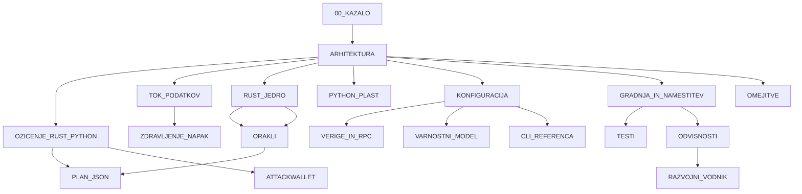

# 00 KAZALO — tehnična dokumentacija ForkSploit

Ta mapa vsebuje popolno tehnično dokumentacijo sistema ForkSploit (Rust jedro
+ Python izvršilna plast). Vsak dokument je samostojen in medsebojno povezan.

**Jezik:** slovenščina; imena simbolov, datotek in zastavic ostanejo v
izvirniku.

**Izvor resnice je koda.** Vsaka trditev nosi sklic `pot/do/datoteke.rs::simbol`
ali ponovljiv ukaz. Kar ni izmerjeno, je označeno kot **neizmerjeno**; kar ni
preverjeno v kodi, kot **nepreverjeno**.

---

## Kazalo dokumentov

| Dokument | Kaj vsebuje |
|----------|-------------|
| [ARHITEKTURA.md](ARHITEKTURA.md) | dvoplastna arhitektura, velika slika, meja med plastema, diagrami |
| [OZICENJE_RUST_PYTHON.md](OZICENJE_RUST_PYTHON.md) | KAKO/KJE sta plasti povezani: argv fuzzerja, `ETH_RPC_URL`, shema `plan.json`, `load_findings`, pre-flight vrata, povratna zanka, exit kode |
| [TOK_PODATKOV.md](TOK_PODATKOV.md) | celoten tok od ukaza do dokaza na verigi, korak za korakom z `datoteka::simbol` |
| [RUST_JEDRO.md](RUST_JEDRO.md) | Rust jedro po modulih, konstante, `EvmArgs`, diagram odvisnosti |
| [PYTHON_PLAST.md](PYTHON_PLAST.md) | Python izvršilna plast po modulih, funkcije, konstante |
| [PLAN_JSON.md](PLAN_JSON.md) | referenca sheme `*.plan.json` (vsa polja, vir, pravila) |
| [ORAKLI.md](ORAKLI.md) | katalog vseh 47 oraklov in bug tipov, nivoji zaupanja, preseti |
| [ATTACKWALLET.md](ATTACKWALLET.md) | pogodba `AttackWallet.sol` in model izvajanja W1–W5 |
| [KONFIGURACIJA.md](KONFIGURACIJA.md) | vse konfiguracije, zastavice, okoljske spremenljivke, datoteke, konstante |
| [VERIGE_IN_RPC.md](VERIGE_IN_RPC.md) | verige, RPC, identiteta omrežja, testnet/mainnet delitev |
| [VARNOSTNI_MODEL.md](VARNOSTNI_MODEL.md) | nadzor operaterja, zaklenjen profit, politika denarnic, omejitve |
| [GRADNJA_IN_NAMESTITEV.md](GRADNJA_IN_NAMESTITEV.md) | predpogoji, build, Docker, CI |
| [CLI_REFERENCA.md](CLI_REFERENCA.md) | CLI referenca: binarij `forksploit evm`, Python skripti, `forksploit.sh` |
| [TESTI.md](TESTI.md) | testna mapa: kaj teče, kaj je preskočeno in zakaj |
| [ZDRAVLJENJE_NAPAK.md](ZDRAVLJENJE_NAPAK.md) | statusi, izhodne kode, tipične napake |
| [ODVISNOSTI.md](ODVISNOSTI.md) | zunanje in notranje odvisnosti, vrstni red izvajanja, diagrami |
| [RAZVOJNI_VODNIK.md](RAZVOJNI_VODNIK.md) | kako prispevati, konvencije, R1 |
| [OMEJITVE.md](OMEJITVE.md) | kaj sistem ne zna (iz kode) in zakaj |

---

## Zemljevid dokumentacije

## Kratki povzetek vsakega dokumenta

**ARHITEKTURA.md** — ForkSploit je dvoplastni sistem: Rust jedro odkriva
ranljivosti in sintetizira plane; Python izvaja in dokazuje. Meja je
procesna + datotečna. Rust nikoli ne podpisuje; Python nikoli ne odloča o
ranljivosti. Vsebuje diagram velike slike, diagram meje in diagram odvisnosti.

**OZICENJE_RUST_PYTHON.md** — dokumentira vsak stik med plastema: točen argv,
ki ga zgradi `auto_pipeline.run_fuzzer`, `ETH_RPC_URL`, datotečni kontrakt
(`*.plan.json`, `*.t.sol`, `*.s.sol`, `vuln_info.jsonl`, `coverage.txt`),
`strategy_layer.load_findings`, pre-flight vrata, povratno pisanje plinskih
polj in exit kode.

**TOK_PODATKOV.md** — 8 korakov od CLI vstopa do merjenega dokaza na verigi,
z `datoteka::simbol` za vsak korak in diagramom zaporedja.

**RUST_JEDRO.md** — vstopna točka, konstante (`src/const.rs`), `EvmArgs`
(vse zastavice), naložitev tarče, `FuzzHost`, nivo zaupanja, orakli, concolic,
`ForkSploitFuzzer`, `solution/*`, pomožni moduli.

**PYTHON_PLAST.md** — vsak modul `onchain_scripts/`: namen, funkcije,
konstante, odvisnosti, dotik druge plasti.

**PLAN_JSON.md** — polna shema `*.plan.json`: vsa polja, vir v kodi, pravila
(control leak → `sim-review`, `atomic_replayable`, `owner_gated`), razlika
`steps` vs `full_trace_steps`, polja, ki jih doda Python.

**ORAKLI.md** — tabela vseh 47 oraklov z `bug_idx` konstantami, `OracleType`,
bug tipi in nivoji zaupanja; preseta `all`/`high_confidence`; deklarativni
invariantni oracle.

**ATTACKWALLET.md** — edini on-chain primitiv: funkcije, stanje, model W1–W5,
zaklenjen `safeWallet`, reentrancy arm/disarm, flashloan, Flashbots bundle.

**KONFIGURACIJA.md** — okoljske spremenljivke, vse konfiguracijske datoteke s
shemami, konstante (Rust in Python), zastavice Python pipeline-a, Rust feature
zastavice.

**VERIGE_IN_RPC.md** — seznam 25 variant `Chain` (24 omrežij + `local`), privzeti RPC (21 vnosov), `TESTNET_CHAINS`,
preverjanje identitete, Flashbots/zasebnost, Aave/WETH, `rpc_overrides.json`.

**VARNOSTNI_MODEL.md** — tri vloge denarnic, politika, zaklenjen profit,
nadzor operaterja, pre-flight kot varnost, zaklenjen plin, zaščita pred
front-runningom.

**GRADNJA_IN_NAMESTITEV.md** — predpogoji, `cargo build --release`, doctor,
Python namestitev, Docker (3 variante), CI (rust + python), release.

**CLI_REFERENCA.md** — vse zastavice Rust binarija, `forksploit.sh`, Python
skriptov (auto/batch/monitor/dashboard/wallet_policy/gas_oracle/triage/...).

**TESTI.md** — sklopi testov, znane neuspešne (10 Rust omrežnih), pomembni
testi, Python testi in izmerjen rezultat v tem okolju, integracijski harness,
fixture-i.

**ZDRAVLJENJE_NAPAK.md** — statusi izvedbe, izhodne kode, tipične napake z
vzroki in rešitvami, diagram odločanja o statusu.

**ODVISNOSTI.md** — zunanje Rust/Python odvisnosti z različicami, zunanja
orodja, notranje odvisnosti, vrstni red zagona, diagram.

**RAZVOJNI_VODNIK.md** — pravilo R1, postavitev, ukazi pred PR, konvencije
kode, kam kaj spada, dokumentacija.

**OMEJITVE.md** — kar sistem ne zna: gas metering, mempool, ozek concolic
(brez `keccak256`), ena transakcija na vnos, harvest heuristika, best-effort
pre-flight, mrtve testne mreže, flashloan/flashbots omejitve.

---

## Kako je bila ta dokumentacija preverjena

Postopek (pravilo R1):

1. **Branje kode** v tem vrstnem redu: Rust (`src/main.rs`, `src/const.rs`,
   `src/evm/mod.rs`, `src/evm/oracle.rs`, `src/evm/host.rs`, `src/evm/solution/*`,
   `src/fuzzer.rs`, `src/fuzzers/evm_fuzzer.rs`, `src/evm/oracles/*`,
   `src/evm/concolic/*`, `src/evm/onchain/endpoints.rs`,
   `src/evm/contract_utils.rs`, `src/evm/multicore.rs`,
   `src/evm/setup.rs`, `src/evm/auto_setup.rs`, `src/evm/oracles/invariant.rs`),
   nato Python (`onchain_scripts/auto_pipeline.py`, `batch_pipeline.py`,
   `strategy_layer.py`, `chains.py`, `wallet_policy.py`, `gas_utils.py`,
   `gas_oracle.py`, `proxy_resolver.py`, `flashbots_bundle.py`,
   `dashboard_server.py`, `monitor.py`, `triage_findings.py`,
   `materialize_plan.py`, `contracts/AttackWallet.sol`), nato CI/Docker/skripte
   (`Cargo.toml`, `rust-toolchain.toml`, `Dockerfile`, `.github/workflows/*.yml`,
   `forksploit.sh`, `integration_test.py`).
2. **Inventar simbolov:** za vsako trditev je naveden `datoteka::simbol`.
3. **Preverjanje z ukazi** (izmerjeno v tem okolju):
   * `git status` → `docs/` je edina sprememba; `git diff --stat README.md`
     je **prazen** (README ni spremenjen).
   * `ls src/evm/oracles/*.rs | grep -v mod.rs | wc -l` → `47`;
     `grep -c "BUG_IDX" src/evm/oracles/mod.rs` → `47`.
   * `python -m pytest -q -p no:cacheprovider` v `onchain_scripts/` →
     `24 failed, 212 passed, 14 skipped`; `pytest --collect-only` → `250`.
     Vsi neuspehi so v `test_forksploit_wizard.py` zaradi manjkajočega
     `target/release/forksploit` (glej [TESTI.md](TESTI.md) §3).
   * `bash forksploit.sh --doctor --no-install` → izhodna koda `0`, izpiše
     `PREDLETNO PREVERJANJE OKOLJA (doctor)`.
   * `git rev-parse --is-shallow-repository` → `true` (plitva klon).
4. **Navzkrižno preverjanje:** kjer se obstoječi `.md` in koda razhajata,
   velja koda, razhajanje pa je zabeleženo (glej spodaj).

### Zabeležena razhajanja med obstoječimi .md in kodo

* **Predloge navajajo neobstoječe zastavice.** Generirane `.t.sol`/`.s.sol`
  (`src/evm/solution/foundry_test.hbs`, `foundry_script.hbs`,
  `foundry_script_reentrancy.hbs`) v komentarju navajajo
  `forksploit evm -o -t … -c … -f -i -p …`. `EvmArgs` (`src/evm/mod.rs`)
  **nima** `-o` ali `-p`. Ukaz v komentarju je zastarel. Zabeleženo v
  [ZDRAVLJENJE_NAPAK.md](ZDRAVLJENJE_NAPAK.md) §3.12 in
  [CLI_REFERENCA.md](CLI_REFERENCA.md) §12.
* **`-o`/`-p` tudi v obstoječih `.md`.** Kjer obstoječa dokumentacija navaja
  te zastavice, velja koda: teh zastavic ni.
* **`-f` je `--flashloan`, ne `--fetch-tx-data`.** Clap izpelje kratko obliko
  iz imena polja, zato `-f` pripada polju `flashloan`
  (`src/evm/mod.rs`), `fetch_tx_data` pa kratke oblike **nima**. Obstoječi
  komentarji v `auto_pipeline.py` opisujejo `-f` kot "fetch tx data", kar ne
  drži. Zabeleženo v [ZDRAVLJENJE_NAPAK.md](ZDRAVLJENJE_NAPAK.md) §3.13.
* **Zastarelo ime konstante.** `auto_pipeline.py` navaja
  `FUND_EXTRACTION_BUG_TYPES (src/evm/solution/mod.rs)`, a v Rustu je
  konstanta `CONFIRMED_EXPLOITABLE_BUG_TYPES`. Zabeleženo v
  [ZDRAVLJENJE_NAPAK.md](ZDRAVLJENJE_NAPAK.md) §3.14.

---

## Kontrolni seznam (nalog §10)

* [x] `docs/` vsebuje vse obvezne dokumente iz točke 4.
* [x] Vsak dokument ima vsaj en diagram (Mermaid in/ali ASCII), kjer je
      smiselno.
* [x] Ožičenje Rust↔Python je dokumentirano z `datoteka::simbol` sklici
      (argv fuzzerja, `ETH_RPC_URL`, shema `plan.json`, `load_findings`) v
      [OZICENJE_RUST_PYTHON.md](OZICENJE_RUST_PYTHON.md).
* [x] Tok podatkov od ukaza do dokaza na verigi je narisan in skladen s kodo
      ([TOK_PODATKOV.md](TOK_PODATKOV.md)).
* [x] Vsi ključni podatki (zastavice, env, konfiguracije, konstante, verige)
      so navedeni z natančnimi vrednostmi in lokacijami v kodi
      ([KONFIGURACIJA.md](KONFIGURACIJA.md), [CLI_REFERENCA.md](CLI_REFERENCA.md),
      [VERIGE_IN_RPC.md](VERIGE_IN_RPC.md)).
* [x] `README.md` ni spremenjen (`git diff --stat README.md` je prazen).
* [x] `00_KAZALO.md` povezuje vse dokumente.
* [x] Kar ni izmerjeno, je označeno kot "neizmerjeno"; kar ni preverjeno v
      kodi, kot "nepreverjeno".

---

## Odprto / neizmerjeno

* **Neizmerjeno v tem okolju:** `cargo build --release` in `cargo test
  --release` nista bila pognana (Rust ni nameščen); številke Rust testov so iz
  `AGENTS.md`.
* **Nepreverjeno:** `integration_test.py` in
  `onchain_scripts/contracts/proof_w1_w2_w3.sh` v tem okolju nista bila
  pognana.
* **Neizmerjeno:** nobena zmogljivostna meritev (exec/s, globina dosega,
  poraba plina) ni del te dokumentacije; kjer so v kodi navedene, so
  označene kot opažanja, ne kot meritve te dokumentacije.
