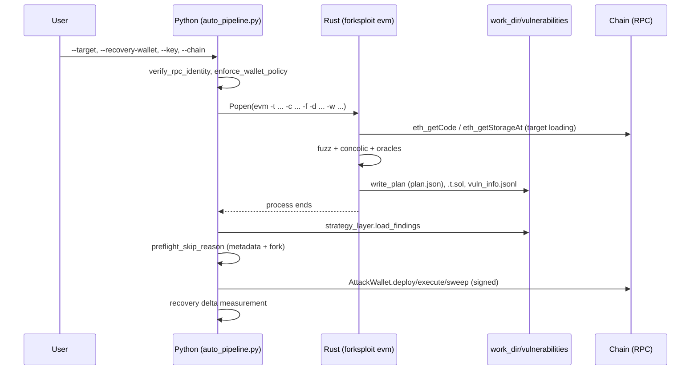

# ARCHITECTURE — ForkSploit's two-layer architecture

> This document is standalone. Related documents:
> [RUST_CORE.md](RUST_CORE.md), [PYTHON_LAYER.md](PYTHON_LAYER.md),
> [RUST_PYTHON_WIRING.md](RUST_PYTHON_WIRING.md), [DATA_FLOW.md](DATA_FLOW.md),
> [00_INDEX.md](00_INDEX.md).

## 1. What the system is

ForkSploit is a two-layer system for EVM smart contracts. It consists of:

1. **Rust core** (`src/`) — a bytecode-level, coverage-guided fuzzer over
   `revm`, with concolic (Z3) solving and 47 oracle modules. On a hit it emits a
   machine-readable, reproducible `*.plan.json` and a reproduction `.t.sol`.
   Rust **never signs and never sends** transactions.
2. **Python execution layer** (`onchain_scripts/`) — reads every plan, merges
   them into a single ordered multi-step plan, executes it through one reused
   `AttackWallet` contract (deploy + real calls, an Aave V3 flashloan when
   needed) and sweeps the found funds to the locked recovery wallet. Python
   **never decides** whether a pattern is a vulnerability.

The source of truth for the claims in this document is exclusively the code.
Every claim carries a `path/to/file.rs::symbol` reference.

## 2. The big picture

```
┌──────────────────────────────────────────────────────────────────────────────┐
│                              USER                                             │
│   ./forksploit.sh   (interactive entry)  OR  python3 auto_pipeline.py         │
└───────────────────────────────┬──────────────────────────────────────────────┘
                                │  (1) wizard / CLI arguments
                                ▼
┌──────────────────────────────────────────────────────────────────────────────┐
│  PYTHON EXECUTION LAYER  (onchain_scripts/)                                   │
│                                                                                │
│  chains.py            chains, RPC, network identity                            │
│  wallet_policy.py     locks the funding/recovery wallet                        │
│  auto_pipeline.py     orchestration: register → fund → fuzz → exploit → recover │
│  ├── run_fuzzer()     ── launches the Rust binary as a subprocess ─┐           │
│  ├── strategy_layer   reads *.plan.json, merges flat/reentrancy plans          │
│  ├── gas_utils.py     gas limits, budget, MAX_GAS_LIMIT                        │
│  ├── gas_oracle.py    official gas-price oracle (Etherscan/Blockscout)         │
│  ├── proxy_resolver   EIP-1967/1822/1167/7702 expansion                        │
│  ├── flashbots_bundle atomic bundle for ETH mainnet                            │
│  └── contracts/AttackWallet.sol   the only on-chain primitive                 │
└───────────────────────────────────────────────┬──────────────────────────────┘
                                                │  (2) subprocess, ETH_RPC_URL env
                                                ▼
┌──────────────────────────────────────────────────────────────────────────────┐
│  RUST CORE  (target/release/forksploit evm …)                                 │
│                                                                                │
│  src/main.rs            clap CLI: the `evm` subcommand                         │
│  src/evm/mod.rs         EvmArgs, OracleType, from_strs, concolic cap           │
│  src/evm/contract_utils target loading (glob/address/fork/config/setup)        │
│  src/evm/vm.rs          EVMExecutor over revm (no gas metering)                │
│  src/evm/host.rs        FuzzHost: calls, control leak, address harvest         │
│  src/evm/middlewares/*  observers during execution                             │
│  src/evm/oracles/*      ~48 oracles → EVMBugResult                             │
│  src/evm/concolic/*     Z3 solving (bounded worker pool)                       │
│  src/fuzzer.rs          ForkSploitFuzzer: loop, finding dump                   │
│  src/evm/solution/*     plan.json + .t.sol/.s.sol templates                    │
│                                                                                │
│  OUTPUT:  work_dir/vulnerabilities/*.plan.json                                 │
│           work_dir/vulnerabilities/*.t.sol, *.s.sol                            │
│           work_dir/vuln_info.jsonl, coverage.txt, traces/                      │
└───────────────────────────────────────────────┬──────────────────────────────┘
                                                │  (3) file contract
                                                ▼
┌──────────────────────────────────────────────────────────────────────────────┐
│  PYTHON: read plans → pre-flight gate → execution → extraction                │
│  execute_plan() / gated_execute_plan()  (auto_pipeline.py)                     │
│  → AttackWallet.execute / executeBatch / flashloan / sweep                     │
│  → recovery wallet (locked in AttackWallet.safeWallet)                         │
└──────────────────────────────────────────────────────────────────────────────┘
```

## 3. The boundary between the layers

The boundary is **file-based** and **process-based**, not in-process:

| Direction | Mechanism | Proof |
|------|-----------|-------|
| Python → Rust | `subprocess.Popen` with argv, `ETH_RPC_URL` in the environment | `onchain_scripts/auto_pipeline.py::run_fuzzer` |
| Rust → Python | files in `work_dir/vulnerabilities/` | `src/fuzzer.rs::ForkSploitFuzzer::evaluate_input_events`, `src/evm/solution/script_generator.rs::write_plan` |
| Python → chain | `AttackWallet` via signed transactions | `onchain_scripts/auto_pipeline.py::execute_plan` |

The key separation-of-responsibility rule:

* **Rust = discovery + plan synthesis.** Rust never signs and never sends. Its
  only output is files and log output.
* **Python = execution + proof + extraction.** Python never decides whether a
  pattern is a vulnerability. That decision (the `sim-confirmed`/`sim-review`
  confidence level) is made by Rust in `src/evm/oracle.rs::classify_confidence`.
  Python only reads that label and uses it as a filter.

Proof of the separation: searching the Rust code finds no signing. Transactions
are assembled exclusively in Python (`eth_account.Account.from_key`,
`acct.sign_transaction` in `onchain_scripts/auto_pipeline.py::send_call`).

## 4. Responsibilities by layer

### 4.1 Rust core

| Module | Responsibility | Key symbol |
|-------|-------------|----------------|
| `src/main.rs` | CLI entry, the `evm` subcommand | `main`, `Cli` |
| `src/const.rs` | Global constants, concolic cap | `MAX_CONCOLIC_THREADS`, `max_concolic_threads`, `MAX_INPUT_SIZE` |
| `src/evm/mod.rs` | `EvmArgs` (all flags), oracle selection | `EvmArgs`, `OracleType::from_strs`, `resolve_concolic_num_threads` |
| `src/evm/contract_utils.rs` | Target loading + proxy expansion | `ContractLoader::from_glob/from_address/from_fork/from_setup`, `expand_proxy_targets` |
| `src/evm/vm.rs` | Executor over `revm` | `EVMExecutor`, `EVMState` |
| `src/evm/host.rs` | Calls, control leak, address harvest from storage | `FuzzHost`, `control_leak_bypassed`, `record_harvested_storage_address` |
| `src/evm/oracle.rs` | Finding confidence level | `classify_confidence`, `effective_confidence`, `EVMBugResult` |
| `src/evm/oracles/*` | Vulnerability detectors | `Oracle` trait, ~48 modules |
| `src/evm/concolic/*` | Z3 solving | `ConcolicStage`, `threaded_solve` |
| `src/fuzzer.rs` | Fuzz loop, finding dump | `ForkSploitFuzzer`, `vuln_file_base`, `ORACLE_OUTPUT` |
| `src/evm/solution/*` | plan.json + Solidity synthesis | `generate_test_with_full_trace`, `build_plan_meta`, `write_plan` |

### 4.2 Python execution layer

| Module | Responsibility | Key symbol |
|-------|-------------|----------------|
| `auto_pipeline.py` | Orchestration of one target | `main`, `run_fuzzer`, `execute_plan`, `preflight_skip_reason` |
| `batch_pipeline.py` | The same flow for many targets | `main`, `run_one_target` |
| `strategy_layer.py` | Reading + merging plans | `load_findings`, `compose_plan`, `run_chain_attempts` |
| `chains.py` | Chains, RPC, identity | `verify_rpc_identity`, `require_mainnet_confirmation`, `NetworkProfile` |
| `wallet_policy.py` | Wallet locking | `enforce_wallet_policy`, `register_policy` |
| `gas_utils.py` | Gas | `MAX_GAS_LIMIT`, `estimate_gas_limit`, `GasBudget`, `gas_fit` |
| `gas_oracle.py` | Official gas-price oracle | `resolve_fee_fields`, `fetch_official_gas_quote` |
| `proxy_resolver.py` | Python mirror of proxy expansion | `resolve_proxy_chain`, `discover_implementations` |
| `flashbots_bundle.py` | Atomic bundle | `call_bundle`, `submit_bundle_and_wait`, `RELAY_URLS` |
| `contracts/AttackWallet.sol` | On-chain primitive | `execute`, `executeBatch`, `sweep`, `sweepToken` |
| `dashboard_server.py` | GUI server | `api_state`, `api_run`, `/api/state` |
| `monitor.py` | Post-deploy surface monitoring | `watch_target`, `attempt_rescue` |

## 5. Who calls whom (dependencies)

```
forksploit.sh
   └─(exec)→ auto_pipeline.py  or  batch_pipeline.py
                 │
                 ├─ chains.py ──────────── (RPC, identity)
                 ├─ wallet_policy.py ───── (wallet locking)
                 ├─ proxy_resolver.py ──── (proxy expansion)
                 ├─ gas_utils.py ───────── (gas)
                 │    └─ chains.py
                 ├─ gas_oracle.py ──────── (official gas oracle)
                 ├─ flashbots_bundle.py ── (atomic bundle)
                 ├─ strategy_layer.py ──── (plan.json reading/merging)
                 └─(Popen)→ target/release/forksploit evm …
                              │
                              ├─ src/main.rs → src/evm/mod.rs::evm_main
                              │     ├─ contract_utils (target loading)
                              │     ├─ auto_setup (--auto-setup)
                              │     └─ fuzzers/evm_fuzzer.rs::evm_fuzzer
                              │            ├─ corpus_initializer
                              │            ├─ host + middlewares
                              │            ├─ oracles
                              │            ├─ concolic
                              │            └─ fuzzer.rs::ForkSploitFuzzer
                              │                    └─ solution/script_generator
                              │                            └─ write_plan → *.plan.json
                              └─ (output: files)
```

## 6. What the system is and is not

**It is:**
* An EVM-only bytecode fuzzer with concolic help.
* A tool for discovering and **proving** vulnerabilities on a real chain
  (a measured increase of funds in the recovery wallet).
* A two-layer system with a clear boundary: Rust discovers, Python executes.

**It is not:**
* It does not support MoveVM/Sui (there is no such module in the code; only
  `src/generic_vm` for EVM exists).
* It has no telemetry.
* It has no hand-written invariant oracle except the declarative one
  (`src/evm/oracles/invariant.rs`, `--invariants`).
* It does not decide automatically on the "right" fix for a contract.

More detailed limitations are in [LIMITATIONS.md](LIMITATIONS.md).

## 7. Diagram of the boundary between the layers (sequence)



## 8. Open / unmeasured

* The diagrams in this document are drawn by hand from the code; they are not
  generated automatically and are not checked with a tool.
* **Unmeasured:** no part of this document cites performance measurements; this
  is an architectural description, not a measurement.
* The "47 oracles" figure comes from counting the files `src/evm/oracles/*.rs`
  without `mod.rs` (47) and 47 oracle `BUG_IDX` constants in
  `src/evm/oracles/mod.rs`. The exact number should be read from the code, not
  from this document.
