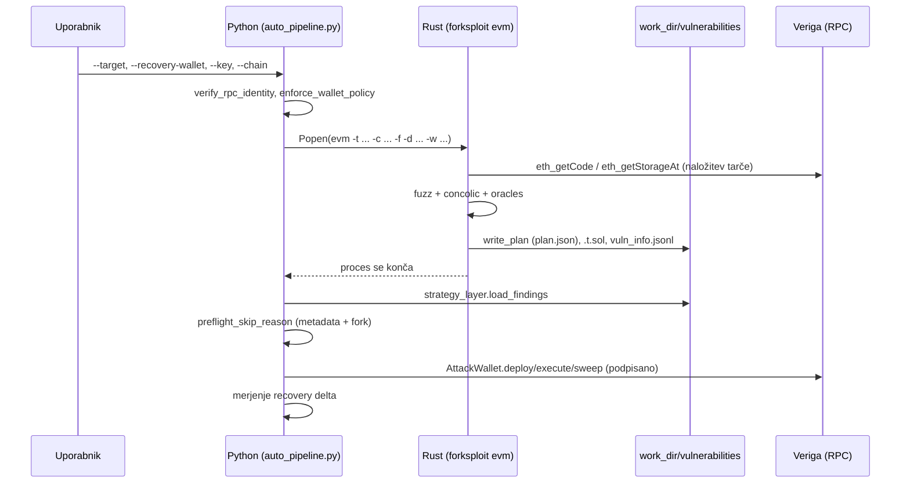

# ARHITEKTURA — dvoplastna arhitektura ForkSploit

> Ta dokument je samostojen. Sorodni dokumenti:
> [RUST_JEDRO.md](RUST_JEDRO.md), [PYTHON_PLAST.md](PYTHON_PLAST.md),
> [OZICENJE_RUST_PYTHON.md](OZICENJE_RUST_PYTHON.md), [TOK_PODATKOV.md](TOK_PODATKOV.md),
> [00_KAZALO.md](00_KAZALO.md).

## 1. Kaj sistem je

ForkSploit je dvoplastni sistem za EVM pametne pogodbe. Sestavljata ga:

1. **Rust jedro** (`src/`) — bajtkodni, pokritostno voden fuzzer nad `revm`,
   z concolic (Z3) reševanjem in 47 oraklskimi moduli. Na zadetek izpiše
   strojno berljiv, ponovljiv `*.plan.json` in reprodukcijski `.t.sol`.
   Rust **nikoli ne podpisuje in nikoli ne pošilja** transakcij.
2. **Python izvršilna plast** (`onchain_scripts/`) — prebere vsak plan, jih
   združi v en urejen večstopenjski plan, izvede prek ene same ponovno
   uporabljene pogodbe `AttackWallet` (deploy + realni klici, Aave V3
   flashloan kadar je potrebno) in pobriše najdena sredstva na zaklenjeno
   recovery denarnico. Python **nikoli ne odloča**, ali je vzorec ranljivost.

Izvor resnice za trditve v tem dokumentu je izključno koda. Vsaka trditev nosi
sklic `pot/do/datoteke.rs::simbol`.

## 2. Velika slika

```
┌──────────────────────────────────────────────────────────────────────────────┐
│                              UPORABNIK                                        │
│   ./forksploit.sh   (interaktivni vstop)  ALI  python3 auto_pipeline.py       │
└───────────────────────────────┬──────────────────────────────────────────────┘
                                │  (1) wizard / CLI argumenti
                                ▼
┌──────────────────────────────────────────────────────────────────────────────┐
│  PYTHON IZVRŠILNA PLAST  (onchain_scripts/)                                   │
│                                                                                │
│  chains.py            verige, RPC, identiteta omrežja                          │
│  wallet_policy.py     zaklep funding/recovery denarnice                        │
│  auto_pipeline.py     orkestracija: register → fund → fuzz → exploit → recover │
│  ├── run_fuzzer()     ── požene Rust binarij kot podproces ────────┐           │
│  ├── strategy_layer   bere *.plan.json, združuje ploske/ponovitvene planove   │
│  ├── gas_utils.py     plinske omejitve, proračun, MAX_GAS_LIMIT                │
│  ├── gas_oracle.py    uradni gas-price oracle (Etherscan/Blockscout)           │
│  ├── proxy_resolver   EIP-1967/1822/1167/7702 razširitev                       │
│  ├── flashbots_bundle atomični bundle za ETH mainnet                           │
│  └── contracts/AttackWallet.sol   edini on-chain primitiv                    │
└───────────────────────────────────────────────┬──────────────────────────────┘
                                                │  (2) podproces, okolje ETH_RPC_URL
                                                ▼
┌──────────────────────────────────────────────────────────────────────────────┐
│  RUST JEDRO  (target/release/forksploit evm …)                                │
│                                                                                │
│  src/main.rs            clap CLI: podukaz `evm`                                │
│  src/evm/mod.rs         EvmArgs, OracleType, from_strs, concolic strop         │
│  src/evm/contract_utils naložitev tarče (glob/address/fork/config/setup)       │
│  src/evm/vm.rs          EVMExecutor nad revm (brez gas meteringa)              │
│  src/evm/host.rs        FuzzHost: klici, control leak, harvest naslovov         │
│  src/evm/middlewares/*  opazovalci med izvajanjem                              │
│  src/evm/oracles/*      ~48 oraklov → EVMBugResult                             │
│  src/evm/concolic/*     Z3 reševanje (omejena delovna skupina)                 │
│  src/fuzzer.rs          ForkSploitFuzzer: zanka, dump najdb                    │
│  src/evm/solution/*     plan.json + .t.sol/.s.sol predloge                      │
│                                                                                │
│  IZHOD:  work_dir/vulnerabilities/*.plan.json                                  │
│          work_dir/vulnerabilities/*.t.sol, *.s.sol                             │
│          work_dir/vuln_info.jsonl, coverage.txt, traces/                       │
└───────────────────────────────────────────────┬──────────────────────────────┘
                                                │  (3) datotečni kontrakt
                                                ▼
┌──────────────────────────────────────────────────────────────────────────────┐
│  PYTHON: branje planov → pre-flight vrata → izvedba → pobiranje               │
│  execute_plan() / gated_execute_plan()  (auto_pipeline.py)                     │
│  → AttackWallet.execute / executeBatch / flashloan / sweep                     │
│  → recovery denarnica (zaklenjena v AttackWallet.safeWallet)                   │
└──────────────────────────────────────────────────────────────────────────────┘
```

## 3. Meja med plastema

Meja je **datotečna** in **procesna**, ne v-procesna:

| Smer | Mehanizem | Dokaz |
|------|-----------|-------|
| Python → Rust | `subprocess.Popen` z argv, `ETH_RPC_URL` v okolju | `onchain_scripts/auto_pipeline.py::run_fuzzer` |
| Rust → Python | datoteke v `work_dir/vulnerabilities/` | `src/fuzzer.rs::ForkSploitFuzzer::evaluate_input_events`, `src/evm/solution/script_generator.rs::write_plan` |
| Python → veriga | `AttackWallet` prek podpisanih transakcij | `onchain_scripts/auto_pipeline.py::execute_plan` |

Ključno pravilo ločitve odgovornosti:

* **Rust = odkrivanje + sinteza planov.** Rust nikoli ne podpisuje in nikoli
  ne pošilja. Edini izhod so datoteke in izpis v dnevnik.
* **Python = izvedba + dokaz + pobiranje.** Python nikoli ne odloča, ali je
  vzorec ranljivost. To odločitev (nivo zaupanja `sim-confirmed`/`sim-review`)
  sprejme Rust v `src/evm/oracle.rs::classify_confidence`. Python to oznako
  samo prebere in uporabi kot filter.

Dokaz ločitve: iskanje v Rust kodi ne najde nobenega podpisovanja. Transakcije
se sestavljajo izključno v Pythonu (`eth_account.Account.from_key`,
`acct.sign_transaction` v `onchain_scripts/auto_pipeline.py::send_call`).

## 4. Odgovornosti po plasteh

### 4.1 Rust jedro

| Modul | Odgovornost | Ključni simbol |
|-------|-------------|----------------|
| `src/main.rs` | CLI vstop, podukaz `evm` | `main`, `Cli` |
| `src/const.rs` | Globalne konstante, concolic strop | `MAX_CONCOLIC_THREADS`, `max_concolic_threads`, `MAX_INPUT_SIZE` |
| `src/evm/mod.rs` | `EvmArgs` (vse zastavice), izbor oraklov | `EvmArgs`, `OracleType::from_strs`, `resolve_concolic_num_threads` |
| `src/evm/contract_utils.rs` | Naložitev tarče + razširitev proxyjev | `ContractLoader::from_glob/from_address/from_fork/from_setup`, `expand_proxy_targets` |
| `src/evm/vm.rs` | Izvajalec nad `revm` | `EVMExecutor`, `EVMState` |
| `src/evm/host.rs` | Klici, control leak, harvest naslovov iz storage | `FuzzHost`, `control_leak_bypassed`, `record_harvested_storage_address` |
| `src/evm/oracle.rs` | Nivo zaupanja najdbe | `classify_confidence`, `effective_confidence`, `EVMBugResult` |
| `src/evm/oracles/*` | Detektorji ranljivosti | `Oracle` trait, ~48 modulov |
| `src/evm/concolic/*` | Z3 reševanje | `ConcolicStage`, `threaded_solve` |
| `src/fuzzer.rs` | Fuzz zanka, dump najdb | `ForkSploitFuzzer`, `vuln_file_base`, `ORACLE_OUTPUT` |
| `src/evm/solution/*` | Sinteza plan.json + Solidity | `generate_test_with_full_trace`, `build_plan_meta`, `write_plan` |

### 4.2 Python izvršilna plast

| Modul | Odgovornost | Ključni simbol |
|-------|-------------|----------------|
| `auto_pipeline.py` | Orkestracija enega cilja | `main`, `run_fuzzer`, `execute_plan`, `preflight_skip_reason` |
| `batch_pipeline.py` | Isti tok za več ciljev | `main`, `run_one_target` |
| `strategy_layer.py` | Branje + združevanje planov | `load_findings`, `compose_plan`, `run_chain_attempts` |
| `chains.py` | Verige, RPC, identiteta | `verify_rpc_identity`, `require_mainnet_confirmation`, `NetworkProfile` |
| `wallet_policy.py` | Zaklep denarnic | `enforce_wallet_policy`, `register_policy` |
| `gas_utils.py` | Plin | `MAX_GAS_LIMIT`, `estimate_gas_limit`, `GasBudget`, `gas_fit` |
| `gas_oracle.py` | Uradni gas-price oracle | `resolve_fee_fields`, `fetch_official_gas_quote` |
| `proxy_resolver.py` | Python zrcalo proxy razširitve | `resolve_proxy_chain`, `discover_implementations` |
| `flashbots_bundle.py` | Atomični bundle | `call_bundle`, `submit_bundle_and_wait`, `RELAY_URLS` |
| `contracts/AttackWallet.sol` | On-chain primitiv | `execute`, `executeBatch`, `sweep`, `sweepToken` |
| `dashboard_server.py` | GUI strežnik | `api_state`, `api_run`, `/api/state` |
| `monitor.py` | Površinski nadzor po izdaji | `watch_target`, `attempt_rescue` |

## 5. Kdo koga kliče (odvisnosti)

```
forksploit.sh
   └─(exec)→ auto_pipeline.py  ali  batch_pipeline.py
                 │
                 ├─ chains.py ──────────── (RPC, identiteta)
                 ├─ wallet_policy.py ───── (zaklep denarnic)
                 ├─ proxy_resolver.py ──── (razširitev proxyjev)
                 ├─ gas_utils.py ───────── (plin)
                 │    └─ chains.py
                 ├─ gas_oracle.py ──────── (uradni gas oracle)
                 ├─ flashbots_bundle.py ── (atomični bundle)
                 ├─ strategy_layer.py ──── (plan.json branje/združevanje)
                 └─(Popen)→ target/release/forksploit evm …
                              │
                              ├─ src/main.rs → src/evm/mod.rs::evm_main
                              │     ├─ contract_utils (naložitev tarče)
                              │     ├─ auto_setup (--auto-setup)
                              │     └─ fuzzers/evm_fuzzer.rs::evm_fuzzer
                              │            ├─ corpus_initializer
                              │            ├─ host + middlewares
                              │            ├─ oracles
                              │            ├─ concolic
                              │            └─ fuzzer.rs::ForkSploitFuzzer
                              │                    └─ solution/script_generator
                              │                            └─ write_plan → *.plan.json
                              └─ (izhod: datoteke)
```

## 6. Kaj sistem je in kaj ni

**Je:**
* EVM-only bajtkodni fuzzer z concolic pomočjo.
* Orodje za odkrivanje in **dokaz** ranljivosti na realni verigi (merjen dvig
  sredstev na recovery denarnici).
* Dvoplastni sistem z jasno mejo: Rust odkriva, Python izvaja.

**Ni:**
* Ne podpira MoveVM/Sui (v kodi ni nobenega takega modula; obstaja le
  `src/generic_vm` za EVM).
* Nima telemetrije.
* Nima ročno pisanega invariantnega orakla razen deklarativnega
  (`src/evm/oracles/invariant.rs`, `--invariants`).
* Ne odloča avtomatično o "pravem" popravku pogodbe.

Podrobnejše omejitve so v [OMEJITVE.md](OMEJITVE.md).

## 7. Diagram meje med plastema (sekvenca)



## 8. Odprto / neizmerjeno

* Diagrami v tem dokumentu so ročno izrisani iz kode; niso generirani
  avtomatsko in niso preverjeni z orodjem.
* **Neizmerjeno:** noben del tega dokumenta ne navaja meritev učinkovitosti;
  to je arhitekturni opis, ne meritev.
* Podatek "47 oraklov" izhaja iz štetja datotek `src/evm/oracles/*.rs`
  brez `mod.rs` (47) in 47 oraklskih `BUG_IDX` konstant v
  `src/evm/oracles/mod.rs`. Točno število je treba brati iz kode, ne iz tega
  dokumenta.
