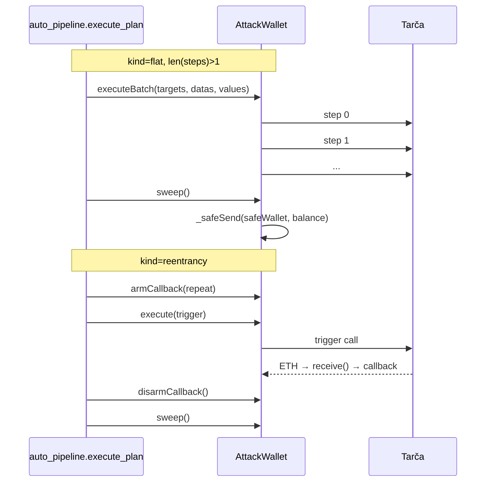

# ATTACKWALLET — pogodba in model izvajanja (W1–W5)

> Samostojen dokument. Sorodno: [TOK_PODATKOV.md](TOK_PODATKOV.md),
> [VARNOSTNI_MODEL.md](VARNOSTNI_MODEL.md), [PLAN_JSON.md](PLAN_JSON.md).

Vir: `onchain_scripts/contracts/AttackWallet.sol` in njegova uporaba v
`onchain_scripts/auto_pipeline.py`. Vsaka trditev je preverjena v kodi.

---

## 1. Zakaj ena sama pogodba

`AttackWallet` je edini on-chain primitiv, ki ga pipeline potrebuje.
Razporedi se **enkrat na verigo** in se ponovno uporablja
(`auto_pipeline.py::get_or_deploy_attack_wallet`). Namesto da bi za vsako
najdbo generiral, prevedel in razporedil novo Solidity pogodbo, Python
predvaja `*.plan.json` prek te pogodbe.

Razlogi (iz docstringov v kodi):
* en sam, revidiran primitiv namesto generirane kode na najdbo;
* `safeWallet` je zaklenjen, zato kompromitiran `owner` ne more preusmeriti
  izplačil;
* atomičnost prek `executeBatch` (ena transakcija).

---

## 2. Stanje pogodbe

| Element | Tip | Pomen |
|---------|-----|-------|
| `owner` | address | nastavljen v konstruktorju (`owner = msg.sender`) |
| `safeWallet` | address | cilj vseh `sweep*` klicev; zaklenjen enkrat |
| `pendingCallbackTarget` | address | cilj reentrancy callbacka |
| `pendingCallback` | bytes | calldata callbacka |
| `pendingFlashloanPool` | address | Aave pool, iz katerega se je zadolžilo |
| `pendingFlashloanSteps` | `Step[]` | zaporedje, ki se izvede ob flashloanu |
| `MAX_BUILDER_TIP_BPS` | `uint256 constant` | `1000` (10 % trda meja) |

Dogodki: `Executed`, `CallbackFired`, `SlotWarmed`,
`FlashloanActionFired`, `SafeWalletLocked`.

---

## 3. Funkcije

| Funkcija | Množičnost | Namen |
|----------|------------|-------|
| `setSafeWallet(address)` | `onlyOwner`, enkrat | zaklene `safeWallet`; zahteva `safeWallet == 0` in `wallet != 0` |
| `execute(address,bytes,uint256)` | `payable onlyOwner` | en klic kot identiteta pogodbe |
| `executeBatch(address[],bytes[],uint256[])` | `payable onlyOwner` | atomično zaporedje v eni transakciji |
| `armCallback(address,bytes)` | `onlyOwner` | pripravi callback za naslednji ETH |
| `disarmCallback()` | `onlyOwner` | počisti callback |
| `receive()` | `payable` | ob prejetem ETH izvede `pendingCallback`, če je nastavljen |
| `armFlashloanActions(address[],bytes[],uint256[])` | `onlyOwner` | pripravi zaporedje za flashloan |
| `disarmFlashloanActions()` | `onlyOwner` | počisti flashloan korake |
| `startFlashLoan(address,address,uint256,bytes)` | `onlyOwner` | sproži Aave V3 `flashLoanSimple` |
| `executeOperation(...)` | Aave callback | izvede flashloan korake in odobri vračilo |
| `sweep()` | `onlyOwner` | pošlje ves ETH na `safeWallet` |
| `sweepWithBuilderTip(uint256)` | `onlyOwner` | del ETH na `block.coinbase`, ostalo na `safeWallet` |
| `sweepToken(address,uint256)` | `onlyOwner` | pošlje tokene na `safeWallet` |
| `transferOwnership(address)` | `onlyOwner` | menjava `owner` |

`_bubbleRevert(bytes,string)` je interni pomožni; `_safeSend(address,uint256)`
interni prenos z `call` (poln gas), ne `.transfer()`.

---

## 4. Model izvajanja W1–W5

### W1 — `execute()` reverza ob neuspehu

`execute(target, data, value)`:
```solidity
(success, ret) = target.call{value: value}(data);
emit Executed(target, value, success);
if (!success) {
    _bubbleRevert(ret, "AttackWallet: execute target call reverted with no reason");
}
```

Prej je neuspeh tiho vrnil `success=false`; zunanja `execute()` je uspela in
pipeline je videl `receipt.status==1` ter poročal "vsak korak je uspel, brez
profita", čeprav je vmesni korak reverzal. Zdaj neuspeh reverza celotno
transakcijo in razlog se prenese (bubble). To je v skladu z
`executeOperation`-ovim `if (!ok) revert(...)`.

### W2 — `executeBatch()` atomično

`executeBatch(targets, datas, values)` v eni transakciji izvede celotno
zaporedje; ob neuspehu katerega koli koraka reverza **cel** batch. Python
uporabi to pot za `kind == "flat"` in `len(steps) > 1`
(`auto_pipeline.py::execute_plan`, `use_batch`).

### W3 — `_safeSend` namesto `.transfer()`

`sweep()`, `sweepWithBuilderTip()` in `sweepToken()` uporabljajo `call`
(poln gas) prek `_safeSend`, ne `.transfer()` (2300 gas). Pogodbeni prejemnik
(Gnosis Safe/multisig) ne more teči znotraj 2300 gas, zato bi `.transfer()`
reverzal in sredstva bi obtičala.

Enaka popravek je v generiranih Solidity predlogah
(`foundry_script.hbs`, `foundry_script_reentrancy.hbs`, funkcija
`collectAndDestroy()`), ki prav tako uporabljajo poln-gas `call`. Rust test:
`evm::solution::tests::generated_exploit_scripts_use_full_gas_call_not_transfer`.

### W4 — imenovanje neuspelega koraka

`auto_pipeline.first_failing_step_index` ponovno predvaja rastoče predpone
batcha prek `eth_call` in poroča
`best-effort prefix replay points at step i/n`. To je diagnostika; en sam
`eth_call` ne more reproducirati medstopenjske odvisnosti.

### W5 — topološko urejanje odvisnosti

`strategy_layer.order_steps_by_dependencies` stabilno topološko uredi
predpogoje pred njihovimi porabniki (`approve` → `transferFrom`,
`deposit` → `withdraw`) in cikel **poroča**, ne tiho preuredi.

---

## 5. `safeWallet`: varnostna meja

`safeWallet` se nastavi **enkrat** (`setSafeWallet`; `require(safeWallet ==
address(0))`). Vse `sweep*` funkcije **nimajo** argumenta cilja:

```solidity
function sweep() external onlyOwner {
    require(safeWallet != address(0), "AttackWallet: safe wallet not set");
    uint256 bal = address(this).balance;
    if (bal > 0) { _safeSend(safeWallet, bal); }
}
```

Zato tudi kompromitiran `owner` ne more preusmeriti izplačil. Edini način za
spremembo cilja je razporeditev nove `AttackWallet`.

`get_or_deploy_attack_wallet` zavrne ponovno uporabo obstoječe instance, katere
zaklenjeni `safeWallet` se ne ujema s pričakovanim (`raise SystemExit`).
Če instanca predhaja funkcijo `safeWallet` (slot je 0), jo ta funkcija zaklene
zdaj (backfill).

---

## 6. Reentrancy arm/disarm

Za `kind == "reentrancy"` plan Python:

1. pred **zadnjim** korakom pokliče `armCallback(repeat_step.contract,
   repeat_step.calldata)`;
2. izvede zadnji korak (sprožilec), ki pošlje ETH in sproži `receive()`;
3. `receive()` izvede pripravljeni klic;
4. za tem pokliče `disarmCallback()`.

`receive()` namenoma **ne** počisti `pendingCallbackTarget` (glej komentar v
pogodbi), zato se callback lahko ponovi večkrat, dokler ni razorožen.

---

## 7. Flashloan pot

`execute_flat_plan_via_flashloan` (in `AttackWallet`) omogoča napad brez
začetnega kapitala:

1. `armFlashloanActions(targets, datas, values)` — zaporedje (npr. WETH
   `withdraw`, sprožitev ranljivosti, ponovno `deposit`).
2. `startFlashLoan(pool, asset, amount, params)` — kliče Aave V3
   `flashLoanSimple` (selektor `0x42b0b77c`).
3. Aave pokliče `executeOperation(...)`:
   * `require(msg.sender == pendingFlashloanPool)`;
   * `emit SlotWarmed(pendingCallbackTarget)` — predgreje storage slot
     (EIP-2929), ker WETH9 `withdraw()` uporablja `msg.sender.transfer()`
     (2300 gas) in bi `receive()`-ov prvi SLOAD brez predgrevanja porabil
     preveč plina ("EvmError: OutOfGas");
   * izvede vsak korak; neuspeh `_bubbleRevert`;
   * `asset.call(approve(msg.sender, amount + premium))`.

Aave pool in WETH naslovi so v `chains.py::AAVE_V3_POOLS` /
`WETH_ADDRESSES` (samo `eth` in `sepolia`).

---

## 8. Flashbots bundle pot

Če je `total_value >= FLASHBOTS_THRESHOLD_ETH` in ima veriga relay
(`bundle_relay_for(chain)`), Python predpodpiše vse zaščitene klice in jih
pošlje kot en bundle (`flashbots_bundle.py`). Zadnji klic v bundleu je
`sweepWithBuilderTip(BUNDLE_BUILDER_TIP_BPS)`:

```solidity
function sweepWithBuilderTip(uint256 tipBps) external onlyOwner {
    require(tipBps <= MAX_BUILDER_TIP_BPS, "AttackWallet: tip too large");
    require(safeWallet != address(0), "AttackWallet: safe wallet not set");
    uint256 bal = address(this).balance;
    if (bal == 0) { return; }
    uint256 tip = (bal * tipBps) / 10000;
    if (tip > 0) { _safeSend(block.coinbase, tip); }
    uint256 remainder = address(this).balance;
    if (remainder > 0) { _safeSend(safeWallet, remainder); }
}
```

Napitnina se računa iz **realnega** stanja v trenutku izvedbe, ne iz
ocenjenega profita.

---

## 9. Diagram: izvedba plana prek AttackWallet



---

## 10. Odprto / neizmerjeno

* **Nepreverjeno:** ali `executeOperation` pravilno ravna z vsemi vrstami
  Aave V3 poolov (koda je bila preverjena le za WETH `flashLoanSimple`).
* **Neizmerjeno:** poraba plina po funkcijah ni del tega dokumenta.
* `W4` (`first_failing_step_index`) je diagnostika in ne garantira, da je
  označen korak res pravi vzrok (en sam `eth_call` ne more reproducirati
  medstopenjske odvisnosti).
