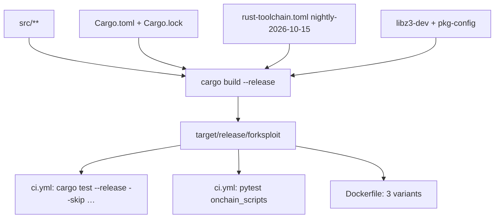

# BUILD AND INSTALL — prerequisites, build, Docker, CI

> Standalone document. Related: [CLI_REFERENCE.md](CLI_REFERENCE.md),
> [DEPENDENCIES.md](DEPENDENCIES.md), [TESTS.md](TESTS.md).

Every command is from the code (`Cargo.toml`, `rust-toolchain.toml`,
`Dockerfile`, `.github/workflows/*.yml`, `forksploit.sh`).

---

## 1. Prerequisites

| Tool | Why | Where it is required |
|--------|-------|----------------|
| Rust (`rustup` + `cargo`) | core build | `rust-toolchain.toml` pin |
| `libz3-dev` + `pkg-config` | Z3 is linked system-wide | `Cargo.toml` (`z3-sys`) |
| `clang`, `cmake`, `build-essential` | build | CI, `forksploit.sh::check_env` |
| `git`, `curl` | build.rs, installs | `check_env` |
| `python3` + `onchain_scripts/requirements.txt` | the execution layer | `forksploit.sh::have_python_deps` |
| `anvil` (optional) | pre-flight fork | `_start_fork` |
| `solc` 0.8.24 (optional) | compile `.sol` | `_find_solc` |
| `slither` (optional) | static analysis | `run_static_analysis` |

Rust is pinned in `rust-toolchain.toml`:

```toml
[toolchain]
channel = "nightly-2026-10-15"
```

`z3-sys` links the **system** Z3; without `libz3-dev` + `pkg-config` the build
will try to compile Z3 from source.

---

## 2. Build

```bash
# Prerequisites (Debian/Ubuntu)
sudo apt-get install -y libz3-dev libssl-dev libudev-dev \
    pkg-config clang cmake build-essential

# Build (default feature set)
cargo build --release
```

Binary: `target/release/forksploit`.

Default feature set (`Cargo.toml::[features].default`):
`cmp`, `dataflow`, `evm`, `print_txn_corpus`, `full_trace`, `force_cache`,
`real_balance`.

The build must end with **0 errors and 0 project warnings** (the only output is
a third-party future-incompat notice for `libafl 0.11.2` / `nom 2.2.1`, which is
not this repository's code). See `AGENTS.md` for rule R1.

`Makefile.toml` (cargo-make) offers the tasks:
`clean_cargo`, `clean`, `compile-release`, `copy-release`, `compile-debug`,
`copy-debug`, `build-cli-clean`, `build-cli`, `debug-clean`, `debug`, `run`.

---

## 3. Interactive entry and doctor

```bash
./forksploit.sh --doctor --no-install     # environment check only
./forksploit.sh --dry-run --no-install    # prints the command, does not run it
./forksploit.sh                           # interactive menu + wizard
```

`check_env` checks: z3, pkg-config, clang, cmake, python3, the C/C++ toolchain,
git, curl, cargo/rustup, python dependencies, anvil (optional), solc (optional),
the binary. `--no-install` checks and reports, does not install. `--doctor` ends
after the check with exit code 0 (even if the optional anvil/solc are missing).

**Measurement (this repository, this environment):** `bash forksploit.sh --doctor
--no-install` returned exit code `0`, printed `PRE-FLIGHT ENVIRONMENT CHECK
(doctor)`, `System : Debian GNU/Linux 13 (trixie) (x86_64)` and warnings for
missing `cargo`/`rustup`/`z3`/`pkg-config`/`clang`/`cmake` and the binary. This
is **unmeasured with respect to the build** — Rust is not installed in this
environment.

---

## 4. Python installation

```bash
pip install -r onchain_scripts/requirements.txt
```

`onchain_scripts/requirements.txt`:
```
requests>=2.28.1
retry>=0.9.2
web3>=8.0
fastapi>=0.110
uvicorn[standard]>=0.29
```

`forksploit.sh` offers installation via `python3 -m pip install -r …` (or a
`.venv`), never silently.

---

## 5. Docker

`Dockerfile` (multi-stage):

1. `run_environment` (from `rust:buster`): installs `curl`, `jq`, `python3`,
   `python3-pip`, `python3-setuptools`, `python3-wheel`, `python3-venv`,
   `libz3-dev`, `libssl-dev`, `git`.
2. `build_environment`: adds `clang`, `pkg-config`, `cmake`.
3. `builder`: copies `Cargo.toml`, `Cargo.lock`, `rust-toolchain.toml`, `src`,
   `benches`, `tests`, `.git`; builds **three** binary variants:
   * `cli_offchain`: `cmp dataflow evm print_txn_corpus full_trace force_cache real_balance`
   * `cli_onchain`: `cmp dataflow evm print_txn_corpus full_trace`
   * `cli_print_logs`: `cmp dataflow evm print_logs`
   All with `--no-default-features`.
4. Final image: `/bins` with all three, `EXPOSE 8000`.

---

## 6. CI

### `.github/workflows/ci.yml`

Two jobs on `ubuntu-22.04`:

**rust:**
* installs Rust from `rust-toolchain.toml`;
* `Swatinem/rust-cache@v2`;
* `apt-get install libz3-dev libssl-dev libudev-dev pkg-config clang cmake build-essential`;
* `cargo build --release --features "cmp dataflow evm print_txn_corpus full_trace force_cache real_balance" --no-default-features --locked`;
* `cargo test --release -- --skip onchain_pair_discovery --skip uniswap::tests::test_get_pair --skip uniswap::tests::test_fetch_uniswap_path --skip endpoints::tests::test_get_balance`;
* uploads `target/release/forksploit` as an artifact.

**python** (depends on `rust`):
* `setup-python@v5` (3.12);
* downloads the artifact, `chmod +x`;
* `pip install -r onchain_scripts/requirements.txt pytest`;
* `./forksploit.sh --doctor --no-install`;
* `python -m pytest onchain_scripts -q -p no:cacheprovider`.

CI **deliberately does not** run `cargo fmt --check` and `cargo clippy` (the
tree is not rustfmt-clean and has pre-existing warnings).

### `.github/workflows/release.yml`
Triggered on the tag `v*.*.*`, on a schedule (nightly) or manually. Jobs
`prepare`, build and publish the release; helper scripts
`.github/scripts/create-tag.js`, `move-tag.js`, `prune-prereleases.js`.

### `.github/workflows/docker-x86.yml`, `docker-arm.yml`
Build Docker images on self-hosted EC2 runners (they require AWS secrets).

---

## 7. Diagram: build and CI



---

## 8. Open / unmeasured

* **Unmeasured in this environment:** `cargo build --release` and `cargo test
  --release` were not run (Rust is not installed in this environment). The test
  numbers cited in `AGENTS.md` come from there, not from this document.
* **Unmeasured:** build times are not part of this document.
* `docker-x86.yml`/`docker-arm.yml` use self-hosted runners that require AWS
  secrets; they were not run in this environment.
