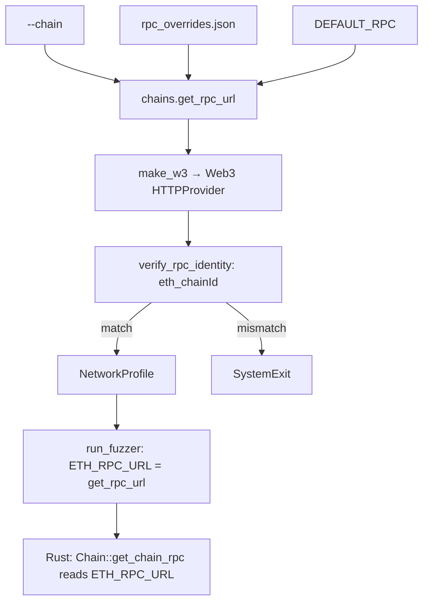

# CHAINS AND RPC — chains, RPC, network identity

> **⚠️ USE AT YOUR OWN RISK — THE AUTHORS ACCEPT NO LIABILITY.**
> **ForkSploit is provided "AS IS", without warranty of any kind. It signs and
> sends real transactions and can move real funds. You use it entirely at your
> own risk and under your own full responsibility; the authors and copyright
> holders accept NO liability whatsoever for any consequences of its use, misuse
> or inability to use it. See [`DISCLAIMER.md`](../DISCLAIMER.md).**

> Standalone document. Related: [CONFIGURATION.md](CONFIGURATION.md),
> [SECURITY_MODEL.md](SECURITY_MODEL.md), [PYTHON_LAYER.md](PYTHON_LAYER.md).

Every claim is verified in code (`src/evm/onchain/endpoints.rs`,
`onchain_scripts/chains.py`).

---

## 1. Two independent sources of truth

| Layer | Table | File |
|-------|--------|----------|
| Rust | `enum Chain` + `get_chain_id` + `get_chain_rpc` | `src/evm/onchain/endpoints.rs` |
| Python | `DEFAULT_RPC` + `CHAIN_IDS` | `onchain_scripts/chains.py` |

`ETH_RPC_URL` (an environment variable) **overrides** the RPC for every chain:
`Chain::get_chain_rpc` reads it unconditionally. Python sets it in `run_fuzzer`,
so any `rpc_overrides.json` reaches Rust.

---

## 2. Chain list (Rust `Chain`)

`Chain::from_str` accepts the following names (from the code):

| Name (`--chain-type`) | chain id |
|----------------------|----------|
| `eth` / `mainnet` | 1 |
| `goerli` | 5 |
| `sepolia` | 11155111 |
| `bsc` | 56 |
| `chapel` | 97 |
| `polygon` | 137 |
| `mumbai` | 80001 |
| `fantom` | 250 |
| `avalanche` | 43114 |
| `optimism` | 10 |
| `arbitrum` | 42161 |
| `gnosis` | 100 |
| `base` | 8453 |
| `celo` | 42220 |
| `zkevm` | 1101 |
| `zkevm_testnet` | 1442 |
| `blast` | 81457 |
| `linea` | 59144 |
| `local` | 31337 |
| `iotex` | 4689 |
| `scroll` | 534352 |
| `vana` | 1480 |
| `story` | 1514 |
| `etc` / `ethereumclassic` / `ethereum_classic` | 61 |
| `mordor` | 63 |

`Chain::to_lowercase()` returns the canonical name (e.g. `ethereumclassic` →
`etc`).

---

## 3. Testnet/mainnet split

`chains.py::TESTNET_CHAINS = {"sepolia", "chapel", "mordor"}`.

Every chain **not** in this set requires `--confirm-mainnet`
(`require_mainnet_confirmation`). This applies to everything that signs:
`auto_pipeline`, `batch_pipeline`, `monitor` (when rescue is enabled).

Specifically: `chain_banner` prints a warning for `eth` and `etc`, because they
are one letter apart and both are real mainnets.

---

## 4. Default RPCs (Python `DEFAULT_RPC`)

From the `chains.py` code:

| Chain | RPC |
|--------|-----|
| `sepolia` | `https://ethereum-sepolia.publicnode.com` |
| `eth` | `https://ethereum-rpc.publicnode.com` |
| `bsc` | `https://bsc-rpc.publicnode.com` |
| `polygon` | `https://polygon-bor-rpc.publicnode.com` |
| `arbitrum` | `https://arb1.arbitrum.io/rpc` |
| `optimism` | `https://mainnet.optimism.io` |
| `base` | `https://mainnet.base.org` |
| `etc` | `https://geth-at.etc-network.info` |
| `avalanche` | `https://api.avax.network/ext/bc/C/rpc` |
| `fantom` | `https://rpc.fantom.network` |
| `gnosis` | `https://rpc.gnosischain.com` |
| `celo` | `https://forno.celo.org` |
| `scroll` | `https://rpc.scroll.io` |
| `blast` | `https://rpc.blast.io` |
| `linea` | `https://rpc.linea.build` |
| `iotex` | `https://babel-api.mainnet.iotex.io` |
| `vana` | `https://rpc.vana.org` |
| `story` | `https://mainnet.storyrpc.io` |
| `zkevm` | `https://zkevm-rpc.com` |
| `chapel` | `https://bsc-testnet-rpc.publicnode.com` |
| `mordor` | `https://rpc.mordor.etccooperative.org` |

Rust `Chain::get_chain_rpc` has its own table; for some chains it differs from
the Python table (e.g. `celo`, `iotex`, `goerli`, `mumbai`, `zkevm_testnet` use
ankr RPCs). Python `known_chains()` returns the union of `DEFAULT_RPC` and
`rpc_overrides.json`; **`goerli`, `mumbai`, `zkevm_testnet` are not in
`DEFAULT_RPC`** (a comment notes that they are dead testnets).

---

## 5. Network identity verification

`chains.verify_rpc_identity(chain, tee, w3)`:

1. `expected = CHAIN_IDS.get(chain)`; an unknown chain → `SystemExit`.
2. `actual = w3.eth.chain_id`.
3. If `actual != expected` → `SystemExit` with a clear message.
4. Otherwise it returns a `NetworkProfile`.

`NetworkProfile` (`_profile_from_id`): `chain`, `chain_id`, `family`
(`network_family`: `"eth"` for id 1, `"etc"` for 61/63, otherwise `"other"`),
`is_testnet`, `native_symbol`, `supports_flashbots` (`chain_id == 1`).

---

## 6. Flashbots and mempool privacy

* `flashbots_bundle.RELAY_URLS` covers **only** `eth` and `sepolia`.
* `auto_pipeline.bundle_relay_for(chain)` returns a relay from that table or
  `None`.
* `PRIVACY_REDIRECT_RPC` has an entry only for `bsc`
  (`https://bsc.rpc.blxrbdn.com`, threshold 50 BNB). This is a single-transaction
  redirect, not an atomic bundle.
* Arbitrum is deliberately absent: its sequencer already offers a private
  mempool by default.

---

## 7. Aave V3 and WETH

`chains.AAVE_V3_POOLS` (chain → pool): `sepolia`, `eth`, `polygon`,
`arbitrum`, `optimism`, `avalanche`, `base`, `gnosis`, `scroll`, `bsc`.
`chains.WETH_ADDRESSES` (chain → WETH): only `eth` and `sepolia`.

The flashloan-funding path is limited to `kind == "flat"` and chains in **both**
tables (`auto_pipeline.execute_plan`). ETC/Mordor are deliberately absent (Aave
does not exist on ETC).

---

## 8. `rpc_overrides.json`

`chains.set_rpc_override(chain, url)` writes `{chain: url}`;
`get_rpc_url` returns the override, otherwise `DEFAULT_RPC`, otherwise a
`KeyError`. `clear_rpc_override(chain)` removes the entry.

The `forksploit.sh` "Settings" entry lets you set an override; the dashboard has
`POST /api/rpc-override` and `DELETE /api/rpc-override/{chain}`.

---

## 9. Diagram: RPC selection and verification

---

## 10. Open / unmeasured

* **Unverified:** whether all Rust default RPC paths work in practice. The code
  contains comments about "verified live" dates, but this document does not
  repeat those measurements as proof.
* **Unverified:** `goerli`, `mumbai`, `zkevm_testnet` are in the Rust `Chain`
  enum and `CHAIN_IDS`, but **not** in Python `DEFAULT_RPC`; the consequence is
  that Python tools cannot use these chains without an override.
* **Unmeasured:** the latency and reliability of individual RPC endpoints are not
  part of this document.
