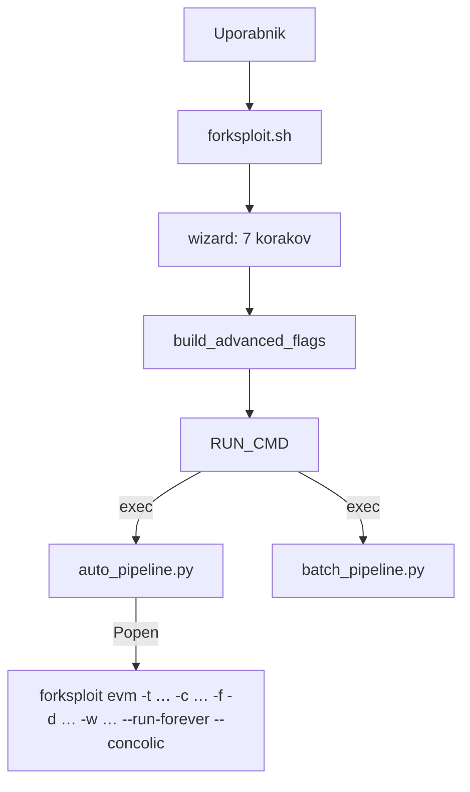

# CLI REFERENCA — binarij, skripti, forksploit.sh

> Samostojen dokument. Sorodno: [KONFIGURACIJA.md](KONFIGURACIJA.md),
> [VERIGE_IN_RPC.md](VERIGE_IN_RPC.md), [TOK_PODATKOV.md](TOK_PODATKOV.md).

Vse zastavice so iz kode (`src/evm/mod.rs::EvmArgs`, argparse v Python
skriptih, `forksploit.sh`).

---

## 1. Rust binarij: `forksploit evm`

```
target/release/forksploit evm [ZASTAVICE] [build_command...]
```

### 1.1 Cilj in veriga

| Zastavica | Kratka | Privzeto | Opis |
|-----------|--------|----------|------|
| `--target` | `-t` | `none` | glob ali naslov (`0x…`, vejica-ločeno) |
| `--target-type` | — | infer | `glob`/`address`/`anvil_fork`/`config`/`setup` |
| `--chain-type` | `-c` | — | ime verige (glej [VERIGE_IN_RPC.md](VERIGE_IN_RPC.md)) |
| `--onchain-block-number` | `-b` | — | blok (privzeto latest) |
| `--onchain-url` | `-u` | — | RPC override |
| `--onchain-chain-id` | `-i` | — | chain id |
| `--onchain-explorer-url` | `-e` | — | explorer |
| `--onchain-chain-name` | `-n` | — | ime |
| `--onchain-etherscan-api-key` | `-k` | — | API ključ |
| `--onchain-storage-fetching` | — | `onebyone` | `dump`/`onebyone` |
| `--fetch-tx-data` | — | `false` | naloži tx z `--proxy-address` (brez kratke oblike) |
| `--proxy-address` | — | `http://localhost:5001/data` | vir tx podatkov |
| `--constructor-args` | — | `""` | `K:v1,v2;K2:v3` |
| `--only-fuzz` | — | `""` | omeji fuzzing na naslove |

### 1.2 Concolic

| Zastavica | Privzeto | Opis |
|-----------|----------|------|
| `--concolic` | `false` | vklopi Z3 |
| `--concolic-caller` | `false` | simbolični klicatelj |
| `--concolic-timeout` | `1000` | ms na rešitev (0 = brez meje) |
| `--concolic-memory-mb` | `2048` | meja pomnilnika Z3 (0 = brez) |
| `--concolic-num-threads` | `0` | 0 = strop `min(2, cores)`; več se omeji |

### 1.3 Orakli in detektorji

| Zastavica | Kratka | Privzeto | Opis |
|-----------|--------|----------|------|
| `--detectors` | `-d` | `all` | `all`, `high_confidence`, ali vejica-ločen seznam |
| `--invariants` | — | — | pot do JSON z invariantami |
| `--state-comp-file` | — | — | JSON stanja za `state_comparison` |
| `--state-comp-matching` | — | `Exact` | `Exact`/`DesiredContain`/`StateContain` |
| `--auto-setup` | — | `false` | izpelji `setX(address)` povezave |

### 1.4 Izvajanje in korpus

| Zastavica | Kratka | Privzeto | Opis |
|-----------|--------|----------|------|
| `--work-dir` | `-w` | `work_dir` | mapa izhoda |
| `--run-forever` | — | `false` | nadaljuj po prvi najdbi |
| `--seed` | — | `1667840158231589000` | seme |
| `--jobs` | — | `1` | število procesov (omejeno na število jeder) |
| `--fuzz-seconds` | — | `0` | proračun (0 = neomejeno; smiselno z `--jobs>1`) |
| `--max-call-depth` | — | `32` | globina analize |
| `--sha3-bypass` | — | `false` | obidi SHA3 primerjave |
| `--flashloan` | `-f` | `false` | flashloan podpora (kratka oblika iz polja `flashloan`) |
| `--panic-on-bug` | — | `false` | panic ob `typed_bug()` |
| `--replay-file` | `-r` | — | ponovno predvajaj iz datoteke |
| `--load-corpus` | — | `""` | naloži korpus |
| `--write-relationship` | — | `false` | izpiši odnose v datoteke |
| `--spec-id` | — | `Latest` | `Frontier`…`Cancun`/`Latest` |

### 1.5 Gradnja pogodb

| Zastavica | Kratka | Opis |
|-----------|--------|------|
| `--deployment-script` | `-m` | pogodba, ki razporedi projekt |
| `--setup-file` | — | (deprecated alias `--deployment-script`) |
| `--force-abi` | — | `address:abi_file,...` |
| `--base-path` | — | osnovna pot za solc (source map) |
| `--base-directory` | — | `chdir` pred delom |
| `--onchain-builder` | — | URL graditelja |
| `--onchain-replacements-file` | — | zamenjave bajtkoda |
| `--builder-artifacts-url` | — | artefakti za pokritost |
| `--builder-artifacts-file` | — | artefakti za pokritost |
| `--offchain-config-url` | — | offchain config |
| `--offchain-config-file` | — | offchain config |
| `--preset-file-path` | — | predloge (feature `use_presets`) |
| `build_command` (pozicijski) | — | ukaz za build |

---

## 2. `forksploit.sh`

```
./forksploit.sh [--doctor] [--dry-run] [--no-install] [-h|--help]
```

| Zastavica | Pomen |
|-----------|-------|
| `--doctor` | zaženi preflight in končaj |
| `--dry-run` | izpiši končni ukaz, ne zaženi |
| `--no-install` | nikoli ne nameščaj, samo poročaj |
| `-h`, `--help` | pomoč (iz glave datoteke) |

Glavni meni (`main_menu`, št. = konstante v testu):

```
1) Nov tek              -> čarovnik (7 korakov)
2) Nastavitve           -> privzeti ključ / RPC po verigi
3) Preveri okolje       -> polni doctor
4) Pomoč               -> kaj orodje dela
5) Napredne nastavitve  -> trajne nastavitve teka
6) Orodja               -> monitor, triage, materialize, dashboard, DEX, fixture
izhod / q               -> izhod
```

Navigacija: `nazaj`/`0` (prejšnji), `glavni meni`/`MM`, `izhod`/`q`. Številke
izbirajo **samo** vnose.

Čarovnik (7 korakov): veriga → RPC → ključ → cilji → recovery → politika →
mainnet potrditev, nato povzetek in `choose_pipeline`.

Napredne nastavitve (v `forksploit_settings.json`) preslikajo v:
`--fuzz-seconds`, `--detectors`, `--fund-eth`, `--no-preflight`,
`--no-gas-oracle`.

---

## 3. `auto_pipeline.py`

```
python3 auto_pipeline.py --target <pot|0x…> --recovery-wallet 0x… --key <pot> \
    [--chain sepolia] [--confirm-mainnet] [--fund-eth 0.01] \
    [--fuzz-seconds 300] [--detectors all] [--no-preflight] [--no-gas-oracle]
```

| Zastavica | Obvezno | Privzeto | Opis |
|-----------|---------|----------|------|
| `--target` | da | — | `.sol`/`.bin` ali naslov |
| `--recovery-wallet` | da | — | cilj pobiranja |
| `--key` | da | — | pot do ključa |
| `--chain` | ne | `sepolia` | iz `known_chains()` |
| `--confirm-mainnet` | ne | false | za non-testnet |
| `--fund-eth` | ne | `0.0` | financiranje tarče |
| `--fuzz-seconds` | ne | `300` | proračun |
| `--detectors` | ne | `all` | oracle preset |
| `--no-preflight` | ne | false | izklop pre-flight vrat |
| `--no-gas-oracle` | ne | false | izklop uradnega gas oracla |

---

## 4. `batch_pipeline.py`

```
python3 batch_pipeline.py --targets targets.txt --recovery-wallet 0x… --key <pot> \
    [--chain sepolia] [--confirm-mainnet] [--fund-eth 0.01] \
    [--fuzz-seconds 300] [--detectors all] [--no-preflight] [--no-gas-oracle]
```

`--targets` je datoteka: en cilj na vrstico; prazne vrstice in `#` so
ignorirane.

---

## 5. `monitor.py`

```
python3 monitor.py (--address 0x… --chain <chain> | --config targets.json) \
    [--poll-interval 20] [--balance-drop-pct 10] [--large-tx-eth 0] \
    [--rescan-interval 600] [--rescan-seconds 60] [--rescan-detectors all] \
    [--key <pot>] [--safe-wallet 0x…] [--confirm-mainnet]
```

Avtomatska rešitev zahteva `--key` **in** `--safe-wallet`. `--config` je JSON
seznam `{chain, address}`.

---

## 6. `dashboard_server.py` in `server_run.sh`

```
python3 dashboard_server.py [--port 4114]
onchain_scripts/server_run.sh [preferred_port]
```

Strežnik veže `127.0.0.1` (nikoli navzven). `server_run.sh` privzeto uporabi
`4114`, poišče prosta vrata, če so zasedena s tujim servisom, in ponovno
uporabi obstoječi dashboard, če ta že teče.

---

## 7. `wallet_policy.py`

```
python3 wallet_policy.py register --chain <chain> --confirm-chain <chain> \
    --funding-wallet 0x… --recovery-wallet 0x… --confirm [--force] [--client-note "…"]
python3 wallet_policy.py show [--chain <chain>]
python3 wallet_policy.py contracts [--chain <chain>]
```

---

## 8. `gas_oracle.py`

```
python3 gas_oracle.py [--verify] [--fee-fields CHAIN] [--selftest] \
    [--chains eth etc] [--api-key …]
```

---

## 9. `triage_findings.py`, `materialize_plan.py`, `gen_chain_fixture.py`

```
python3 triage_findings.py <work_dir…> [--json]
python3 materialize_plan.py <work_dir…> [--json] [--lookup]
python3 gen_chain_fixture.py <N> <dir>
```

---

## 10. `dex_arbitrage_scanner.py`, `aave_flashloan_runner.py`,
`deploy_sepolia_demo.py`, `evaluate.py`

Ti skripti imajo lastne argparse sheme; glej njihove docstringe. `evaluate.py`
bere `target.txt` in zahteva `../cli/target/release/cli`.

---

## 11. Diagram: kako se zgradi končni ukaz



---

## 12. Odprto / neizmerjeno

* **Nepreverjeno:** `evaluate.py`, `immunefi.py`, `debug_file_generator.py`
  imajo lastne argparse/tokove, ki v tem dokumentu niso razčlenjeni do
  zastavice.
* **Nepreverjeno:** predloge `.t.sol`/`.s.sol` v komentarju navajajo zastavici
  `-o` in `-p` (`forksploit evm -o -t … -c … -f -i -p …`), ki v `EvmArgs`
  **ne obstajata** (`src/evm/mod.rs` nima `short('o')` ali `short('p')`).
  Ukaz v komentarju generirane datoteke je torej zastarel; `-i` je
  `--onchain-chain-id`, `-f` je `--flashloan` (kratka oblika iz polja
  `flashloan`), ne `--fetch-tx-data`.
