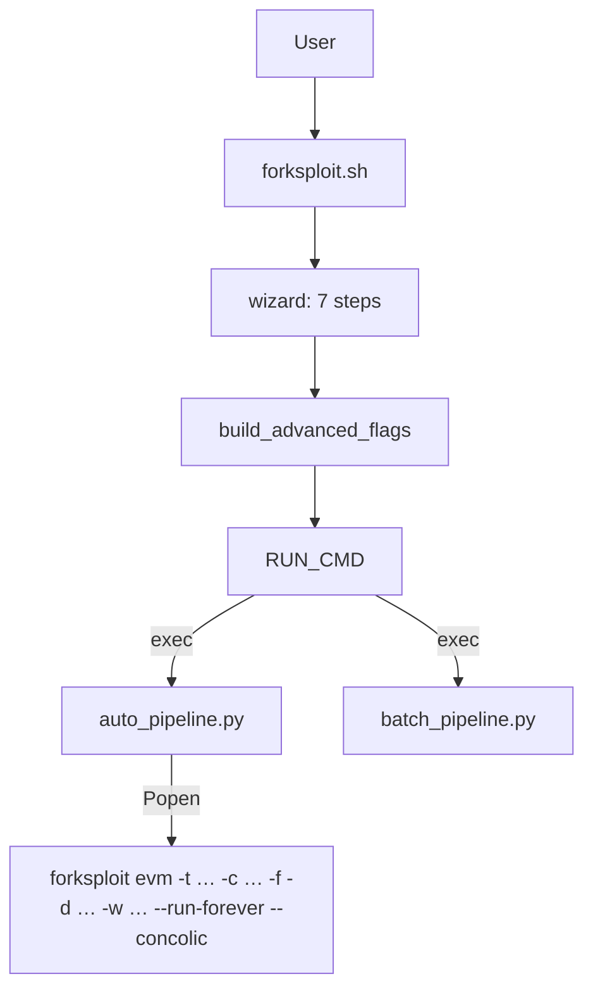

# CLI REFERENCE — binaries, scripts, forksploit.sh

> Standalone document. Related: [CONFIGURATION.md](CONFIGURATION.md),
> [CHAINS_AND_RPC.md](CHAINS_AND_RPC.md), [DATA_FLOW.md](DATA_FLOW.md).

All flags are from the code (`src/evm/mod.rs::EvmArgs`, argparse in the Python
scripts, `forksploit.sh`).

---

## 1. Rust binary: `forksploit evm`

```
target/release/forksploit evm [FLAGS] [build_command...]
```

### 1.1 Target and chain

| Flag | Short | Default | Description |
|-----------|--------|----------|------|
| `--target` | `-t` | `none` | glob or address (`0x…`, comma-separated) |
| `--target-type` | — | infer | `glob`/`address`/`anvil_fork`/`config`/`setup` |
| `--chain-type` | `-c` | — | chain name (see [CHAINS_AND_RPC.md](CHAINS_AND_RPC.md)) |
| `--onchain-block-number` | `-b` | — | block (default latest) |
| `--onchain-url` | `-u` | — | RPC override |
| `--onchain-chain-id` | `-i` | — | chain id |
| `--onchain-explorer-url` | `-e` | — | explorer |
| `--onchain-chain-name` | `-n` | — | name |
| `--onchain-etherscan-api-key` | `-k` | — | API key |
| `--onchain-storage-fetching` | — | `onebyone` | `dump`/`onebyone` |
| `--fetch-tx-data` | — | `false` | load txs from `--proxy-address` (no short form) |
| `--proxy-address` | — | `http://localhost:5001/data` | tx data source |
| `--constructor-args` | — | `""` | `K:v1,v2;K2:v3` |
| `--only-fuzz` | — | `""` | restrict fuzzing to addresses |

### 1.2 Concolic

| Flag | Default | Description |
|-----------|----------|------|
| `--concolic` | `false` | enables Z3 |
| `--concolic-caller` | `false` | symbolic caller |
| `--concolic-timeout` | `1000` | ms per solution (0 = unlimited) |
| `--concolic-memory-mb` | `2048` | Z3 memory limit (0 = unlimited) |
| `--concolic-num-threads` | `0` | 0 = the cap `min(2, cores)`; more is clamped |

### 1.3 Oracles and detectors

| Flag | Short | Default | Description |
|-----------|--------|----------|------|
| `--detectors` | `-d` | `all` | `all`, `high_confidence`, or a comma-separated list |
| `--invariants` | — | — | path to JSON with invariants |
| `--state-comp-file` | — | — | state JSON for `state_comparison` |
| `--state-comp-matching` | — | `Exact` | `Exact`/`DesiredContain`/`StateContain` |
| `--auto-setup` | — | `false` | derive `setX(address)` links |

### 1.4 Execution and corpus

| Flag | Short | Default | Description |
|-----------|--------|----------|------|
| `--work-dir` | `-w` | `work_dir` | output directory |
| `--run-forever` | — | `false` | continue after the first finding |
| `--seed` | — | `1667840158231589000` | seed |
| `--jobs` | — | `1` | number of processes (clamped to the core count) |
| `--fuzz-seconds` | — | `0` | budget (0 = unlimited; sensible with `--jobs>1`) |
| `--max-call-depth` | — | `32` | analysis depth |
| `--sha3-bypass` | — | `false` | bypass SHA3 comparisons |
| `--flashloan` | `-f` | `false` | flashloan support (short form from the `flashloan` field) |
| `--panic-on-bug` | — | `false` | panic on `typed_bug()` |
| `--replay-file` | `-r` | — | replay from a file |
| `--load-corpus` | — | `""` | load a corpus |
| `--write-relationship` | — | `false` | write relationships to files |
| `--spec-id` | — | `Latest` | `Frontier`…`Cancun`/`Latest` |

### 1.5 Contract building

| Flag | Short | Description |
|-----------|--------|------|
| `--deployment-script` | `-m` | the contract that deploys the project |
| `--setup-file` | — | (deprecated alias of `--deployment-script`) |
| `--force-abi` | — | `address:abi_file,...` |
| `--base-path` | — | base path for solc (source map) |
| `--base-directory` | — | `chdir` before work |
| `--onchain-builder` | — | builder URL |
| `--onchain-replacements-file` | — | bytecode replacements |
| `--builder-artifacts-url` | — | artifacts for coverage |
| `--builder-artifacts-file` | — | artifacts for coverage |
| `--offchain-config-url` | — | offchain config |
| `--offchain-config-file` | — | offchain config |
| `--preset-file-path` | — | presets (feature `use_presets`) |
| `build_command` (positional) | — | the build command |

---

## 2. `forksploit.sh`

```
./forksploit.sh [--doctor] [--dry-run] [--no-install] [-h|--help]
```

| Flag | Meaning |
|-----------|-------|
| `--doctor` | run the preflight and exit |
| `--dry-run` | print the final command, do not run it |
| `--no-install` | never install, only report |
| `-h`, `--help` | help (from the file header) |

Main menu (`main_menu`, the number = a constant in the test):

```
1) New run          -> the wizard (7 steps)
2) Settings         -> default key / RPC per chain
3) Check environment-> the full doctor
4) Help             -> what the tool does
5) Advanced settings-> persistent run settings
6) Tools            -> monitor, triage, materialize, dashboard, DEX, fixture
exit / q            -> exit
```

Navigation: `nazaj`/`0` (previous), `glavni meni`/`MM`, `izhod`/`q`. Numbers
select entries **only**.

Wizard (7 steps): chain → RPC → key → targets → recovery → policy → mainnet
confirmation, then a summary and `choose_pipeline`.

Advanced settings (in `forksploit_settings.json`) map to:
`--fuzz-seconds`, `--detectors`, `--fund-eth`, `--no-preflight`,
`--no-gas-oracle`.

---

## 3. `auto_pipeline.py`

```
python3 auto_pipeline.py --target <path|0x…> --recovery-wallet 0x… --key <path> \
    [--chain sepolia] [--confirm-mainnet] [--fund-eth 0.01] \
    [--fuzz-seconds 300] [--detectors all] [--no-preflight] [--no-gas-oracle]
```

| Flag | Required | Default | Description |
|-----------|---------|----------|------|
| `--target` | yes | — | `.sol`/`.bin` or an address |
| `--recovery-wallet` | yes | — | the extraction destination |
| `--key` | yes | — | path to the key |
| `--chain` | no | `sepolia` | from `known_chains()` |
| `--confirm-mainnet` | no | false | for non-testnet |
| `--fund-eth` | no | `0.0` | funding the target |
| `--fuzz-seconds` | no | `300` | budget |
| `--detectors` | no | `all` | oracle preset |
| `--no-preflight` | no | false | disables the pre-flight gate |
| `--no-gas-oracle` | no | false | disables the official gas oracle |

---

## 4. `batch_pipeline.py`

```
python3 batch_pipeline.py --targets targets.txt --recovery-wallet 0x… --key <path> \
    [--chain sepolia] [--confirm-mainnet] [--fund-eth 0.01] \
    [--fuzz-seconds 300] [--detectors all] [--no-preflight] [--no-gas-oracle]
```

`--targets` is a file: one target per line; blank lines and `#` are ignored.

---

## 5. `monitor.py`

```
python3 monitor.py (--address 0x… --chain <chain> | --config targets.json) \
    [--poll-interval 20] [--balance-drop-pct 10] [--large-tx-eth 0] \
    [--rescan-interval 600] [--rescan-seconds 60] [--rescan-detectors all] \
    [--key <path>] [--safe-wallet 0x…] [--confirm-mainnet]
```

Automatic rescue requires `--key` **and** `--safe-wallet`. `--config` is a JSON
list of `{chain, address}`.

---

## 6. `dashboard_server.py` and `server_run.sh`

```
python3 dashboard_server.py [--port 4114]
onchain_scripts/server_run.sh [preferred_port]
```

The server binds `127.0.0.1` (never outward). `server_run.sh` defaults to
`4114`, finds a free port if it is taken by a foreign service, and reuses an
existing dashboard if one already runs.

---

## 7. `wallet_policy.py`

```
python3 wallet_policy.py register --chain <chain> --confirm-chain <chain> \
    --funding-wallet 0x… --recovery-wallet 0x… --confirm [--force] [--client-note "…"]
python3 wallet_policy.py show [--chain <chain>]
python3 wallet_policy.py contracts [--chain <chain>]
```

---

## 8. `gas_oracle.py`

```
python3 gas_oracle.py [--verify] [--fee-fields CHAIN] [--selftest] \
    [--chains eth etc] [--api-key …]
```

---

## 9. `triage_findings.py`, `materialize_plan.py`, `gen_chain_fixture.py`

```
python3 triage_findings.py <work_dir…> [--json]
python3 materialize_plan.py <work_dir…> [--json] [--lookup]
python3 gen_chain_fixture.py <N> <dir>
```

---

## 10. `dex_arbitrage_scanner.py`, `aave_flashloan_runner.py`,
`deploy_sepolia_demo.py`, `evaluate.py`

These scripts have their own argparse schemas; see their docstrings. `evaluate.py`
reads `target.txt` and requires `../cli/target/release/cli`.

---

## 11. Diagram: how the final command is built



---

## 12. Open / unmeasured

* **Unverified:** `evaluate.py`, `immunefi.py`, `debug_file_generator.py` have
  their own argparse/flows that this document does not break down to the flag
  level.
* **Unverified:** the `.t.sol`/`.s.sol` templates mention the flags `-o` and `-p`
  in a comment (`forksploit evm -o -t … -c … -f -i -p …`), which do **not**
  exist in `EvmArgs` (`src/evm/mod.rs` has no `short('o')` or `short('p')`). The
  command in the generated file's comment is therefore stale; `-i` is
  `--onchain-chain-id`, `-f` is `--flashloan` (the short form from the
  `flashloan` field), not `--fetch-tx-data`.
