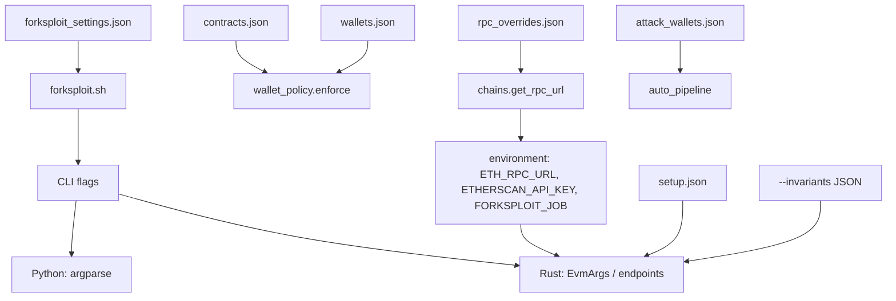

# CONFIGURATION — flags, environment, files

> Standalone document. Related: [CLI_REFERENCE.md](CLI_REFERENCE.md),
> [CHAINS_AND_RPC.md](CHAINS_AND_RPC.md), [PLAN_JSON.md](PLAN_JSON.md),
> [SECURITY_MODEL.md](SECURITY_MODEL.md).

Every value is verified in code.

---

## 1. Environment variables

| Variable | Where it is read | Meaning |
|---------------|-------------|-------|
| `ETH_RPC_URL` | `src/evm/onchain/endpoints.rs::Chain::get_chain_rpc` | RPC address; if set, it is used **for every** chain. Python sets it in `auto_pipeline.py::run_fuzzer` from `chains.get_rpc_url(chain)`. |
| `ETHERSCAN_API_KEY` | `src/evm/mod.rs::evm_main` | a fallback value when `--onchain-etherscan-api-key` is not given |
| `SOLC` | `auto_pipeline.py::_find_solc` (indirectly) | via `_solc_support`/`_find_solc`; Python defaults to `~/.svm/0.8.24/solc-0.8.24`, otherwise `solc` |
| `FORKSPLOIT_JOB` | `src/evm/mod.rs::evm_main` | if set, it forces `--jobs 1` (a fork-bomb safeguard) |
| `CARGO_FEATURE_*` | `src/build.rs` | read at build time for `GIT_VERSION_INFO` |
| `NO_COLOR` | `forksploit.sh` | disables colours |
| `TMPDIR` | `forksploit.sh::run_wizard` | directory for the temporary targets file |

`CAST` and `SOLC` as such: `auto_pipeline._find_solc` returns a `SOLC`-independent
path (`~/.svm/0.8.24/solc-0.8.24` or `solc`). `CAST` is **not** used in the
`auto_pipeline.py` code; `cast` appears only in
`onchain_scripts/contracts/proof_w1_w2_w3.sh`. `integration_test.py` uses
`_find_solc` the same way.

---

## 2. Configuration files

### 2.1 `onchain_scripts/wallets.json` (gitignored)
Schema (`wallet_policy.register_policy`):

```json
{
  "<chain>": {
    "funding_wallet": "0x…",
    "recovery_wallet": "0x…",
    "registered_at": "2026-…T…+00:00",
    "client_note": ""
  }
}
```

### 2.2 `onchain_scripts/contracts.json` (gitignored)
Schema (`wallet_policy.register_contract`):

```json
{
  "<chain>:<address_lower>": {
    "address": "0x…",
    "chain": "sepolia",
    "source": "…",
    "first_seen": "2026-…T…+00:00",
    "runs": [
      {"run_id": "…", "script": "auto_pipeline", "timestamp": "…",
       "funding_wallet": "0x…", "recovery_wallet": "0x…"}
    ]
  }
}
```

### 2.3 `onchain_scripts/rpc_overrides.json` (gitignored)
Schema (`chains.set_rpc_override`):

```json
{ "<chain>": "https://my-rpc.example" }
```

### 2.4 `onchain_scripts/forksploit_settings.json` (gitignored)
Written by `forksploit.sh::save_settings`; read by `load_settings`. Keys:

| Key | Maps to flag |
|-------|----------------------|
| `DEFAULT_KEY` | the default key in the wizard |
| `FUZZ_SECONDS` | `--fuzz-seconds` |
| `DETECTORS` | `--detectors` |
| `FUND_ETH` | `--fund-eth` |
| `NO_PREFLIGHT` | `--no-preflight` (0/1) |
| `NO_GAS_ORACLE` | `--no-gas-oracle` (0/1) |

`build_advanced_flags` adds a flag **only** if the value is set; an empty value
means "no flag".

### 2.5 `onchain_scripts/attack_wallets.json` (gitignored)
Schema (`get_or_deploy_attack_wallet`): `{ "<chain>": "<attack_wallet_address>" }`.

### 2.6 `setup.json` (beside a fixture)
Schema (`src/evm/setup.rs::SetupSpec`):

```json
{ "calls": [
  { "to": "Vault",  "sig": "setAsset(address)",     "args": ["Token"] },
  { "to": "Token",  "sig": "mint(address,uint256)", "args": ["$caller", "1000000"] }
] }
```

`to` and address arguments accept a contract name (the fixture file stem),
`$caller` (the first fuzzer caller) or `$deployer`.

### 2.7 `--invariants` JSON
The schema (`src/evm/oracles/invariant.rs`) is in [ORACLES.md](ORACLES.md) §4.

### 2.8 `onchain_scripts/target.txt`
Input for `evaluate.py` (a list of targets). Not part of the main flow.

---

## 3. Key constants (from the code)

### Rust (`src/const.rs`, `src/evm/mod.rs`, `src/evm/host.rs`)
| Constant | Value |
|-----------|----------|
| `MAX_CONCOLIC_THREADS` | `2` |
| `DROP_THRESHOLD` | `4000` |
| `PRUNE_AMT` | `1000` |
| `ACCOUNT_AMT` | `8` |
| `CONTRACT_AMT` | `8` |
| `MAX_INPUT_SIZE` | `64` |
| `MAX_HAVOC_ATTEMPTS` | `32` |
| `MUTATION_RETRIES` | `20` |
| `KNOWN_STATE_MAX_SIZE` | `1000` |
| `CONTROL_LEAK_THRESHOLD` | `200` |
| `MAX_ANALYSIS_CALL_DEPTH` | default `15` (set from `--max-call-depth`, default `32`) |
| `FIX_DEPLOYER` | `8b21e662154b4bbc1ec0754d0238875fe3d22fa6` |

### Python
| Constant | Value | File |
|-----------|----------|----------|
| `MAX_GAS_LIMIT` | `8_000_000` | `gas_utils.py` |
| `DEFAULT_GAS_LIMIT_MARGIN` | `0.10` | `gas_utils.py` |
| `BASE_FEE_LOOKAHEAD_BLOCKS` | `2` | `gas_utils.py` |
| `GAS_BUDGET_MARGIN` | `1.10` | `auto_pipeline.py` |
| `FLASHBOTS_THRESHOLD_ETH` | `10.0` | `auto_pipeline.py` |
| `BUNDLE_GAS_LIMIT` | `2_000_000` | `auto_pipeline.py` |
| `BUNDLE_BUILDER_TIP_BPS` | `400` | `auto_pipeline.py` |
| `REPLACEMENT_FEE_BUMP` | `1.15` | `auto_pipeline.py` |
| `REPLACEMENT_MAX_ATTEMPTS` | `3` | `auto_pipeline.py` |
| `FORK_SIM_PORT` | `18545` | `auto_pipeline.py` |
| `FORK_SIM_ETC_HARDFORK` | `"shanghai"` | `auto_pipeline.py` |
| `FORK_SIM_STARTUP_TIMEOUT_S` | `20.0` | `auto_pipeline.py` |
| `MIN_COVERAGE_PCT_FOR_NEGATIVE_RESULT` | `80.0` | `auto_pipeline.py` |
| `MIN_FUZZ_SECONDS_FOR_NEGATIVE_RESULT` | `300` | `auto_pipeline.py` |
| `SOLC_EVM_VERSION` | `"cancun"` | `auto_pipeline.py` |
| `_SOLC_EVM_FALLBACKS` | `["cancun","shanghai","paris","london"]` | `auto_pipeline.py` |
| `TESTNET_CHAINS` | `{"sepolia","chapel","mordor"}` | `chains.py` |
| `DEFAULT_TIMEOUT` (gas oracle) | `12` | `gas_oracle.py` |
| `DEFAULT_TTL_SECONDS` | `12` | `gas_oracle.py` |
| `DEFAULT_LOOKAHEAD_BLOCKS` | `2` | `gas_oracle.py` |

---

## 4. Python pipeline flags

### `auto_pipeline.py`
| Flag | Default | Meaning |
|-----------|----------|-------|
| `--target` | (required) | `.sol`/`.bin` or `0x…` |
| `--recovery-wallet` | (required) | the extraction destination |
| `--key` | (required) | path to the key |
| `--chain` | `sepolia` | from `known_chains()` |
| `--confirm-mainnet` | false | confirmation for non-testnet |
| `--fund-eth` | `0.0` | funding the target |
| `--no-gas-oracle` | false | disables the official gas oracle |
| `--fuzz-seconds` | `300` | budget |
| `--detectors` | `all` | oracle preset |
| `--no-preflight` | false | disables the pre-flight gate |

### `batch_pipeline.py`
`--targets` (required), `--recovery-wallet` (required), `--key`, `--chain`,
`--confirm-mainnet`, `--fund-eth`, `--fuzz-seconds`, `--detectors`,
`--no-preflight`, `--no-gas-oracle`.

### `monitor.py`
`--address`, `--chain`, `--config`, `--poll-interval` (20.0),
`--balance-drop-pct` (10.0), `--large-tx-eth` (0.0), `--rescan-interval` (600.0),
`--rescan-seconds` (60), `--rescan-detectors` (`all`), `--key`,
`--safe-wallet`, `--confirm-mainnet`.

### `dashboard_server.py`
`--port` (default `4114`).

### `wallet_policy.py`
`register` (`--chain`, `--confirm-chain`, `--funding-wallet`,
`--recovery-wallet`, `--force`, `--client-note`, `--confirm`),
`show [--chain]`, `contracts [--chain]`.

### `gas_oracle.py`
`--verify`, `--fee-fields CHAIN`, `--selftest`, `--chains …`, `--api-key`.

### `triage_findings.py`, `materialize_plan.py`
`triage_findings.py <work_dir…> [--json]`;
`materialize_plan.py <work_dir…> [--json] [--lookup]`.

---

## 5. Rust feature flags (`Cargo.toml`)

The default set: `cmp`, `dataflow`, `evm`, `print_txn_corpus`, `full_trace`,
`force_cache`, `real_balance`.

| Feature | Meaning |
|---------|-------|
| `evm` | EVM support |
| `cmp` | comparison feedback |
| `dataflow` | data dependency |
| `print_txn_corpus` | print the corpus + dump findings (`vuln_file_base`) |
| `full_trace` | the full transaction trace |
| `force_cache` | aggressive caching |
| `real_balance` | real balance |
| `print_logs` | print logs |
| `use_presets` | presets (`presets/`) |
| `z3_debug`, `debug`, `flashloan_debug` | debugging |
| `ondisk_corpus` | corpus on disk |
| `no_etherscan` | without Etherscan |
| `fuzz_static`, `evaluation`, `deployer_is_attacker`, `print_infant_corpus` | other |

CI/Docker use the combinations:
`cmp dataflow evm print_txn_corpus full_trace force_cache real_balance`,
`cmp dataflow evm print_txn_corpus full_trace`, `cmp dataflow evm print_logs`.

---

## 6. Diagram: where configuration is read



---

## 7. Open / unmeasured

* **Unverified:** `CAST` as an environment variable — there is no reading of
  `CAST` in `auto_pipeline.py`; `cast` is used only in `proof_w1_w2_w3.sh`.
* **Unverified:** `SOLC` as an environment variable — `_find_solc` returns a
  fixed path or `solc` from `PATH`; it does not read `$SOLC` directly.
* **Unmeasured:** this document does not state how often each configuration is
  used in practice.
