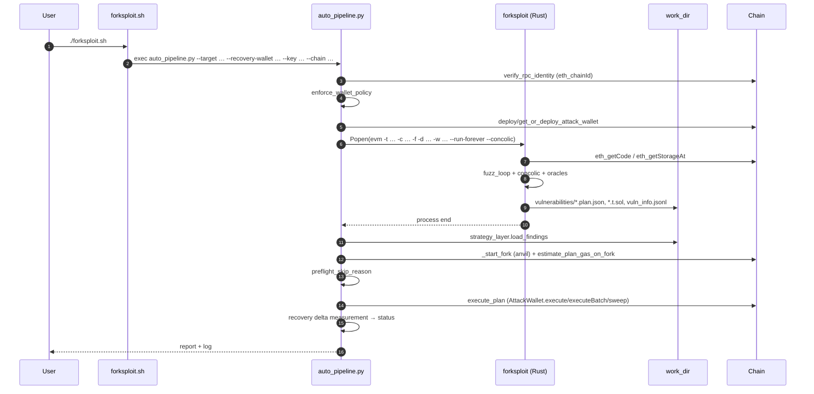

# DATA FLOW — from command to on-chain proof

> **⚠️ USE AT YOUR OWN RISK — THE AUTHORS ACCEPT NO LIABILITY.**
> **ForkSploit is provided "AS IS", without warranty of any kind. It signs and
> sends real transactions and can move real funds. You use it entirely at your
> own risk and under your own full responsibility; the authors and copyright
> holders accept NO liability whatsoever for any consequences of its use, misuse
> or inability to use it. See [`DISCLAIMER.md`](../DISCLAIMER.md).**

> Standalone document. Related: [ARCHITECTURE.md](ARCHITECTURE.md),
> [RUST_PYTHON_WIRING.md](RUST_PYTHON_WIRING.md),
> [ATTACKWALLET.md](ATTACKWALLET.md), [PLAN_JSON.md](PLAN_JSON.md).

This document draws the entire execution flow from the entry point to the
measured on-chain proof. Each step names its `file::symbol` and who calls whom.
Every claim is verified in code.

---

## 0. Overview of the flow

```
[1] CLI entry
     │  forksploit.sh  ──(exec)──▶  auto_pipeline.py / batch_pipeline.py
     │  OR directly:  target/release/forksploit evm …
     ▼
[2] Target loading + proxy + setup
     │  chains.verify_rpc_identity → wallet_policy.enforce_wallet_policy
     │  proxy_resolver.resolve_proxy_chain
     │  Rust: ContractLoader::from_address/from_glob/from_fork/from_setup
     │  Rust: auto_setup::derive_setup_spec (--auto-setup)
     ▼
[3] Fuzz campaign (Rust)
     │  evm_fuzzer → corpus_initializer → fuzz_loop
     │  one transaction per EVMInput; corpus genealogy; concolic
     ▼
[4] An oracle hits → dump
     │  ForkSploitFuzzer::evaluate_input_events
     │  → vulnerabilities/*.plan.json + *.t.sol (+ *.s.sol)
     │  → vuln_info.jsonl, coverage.txt, traces/
     ▼
[5] Python reads the plans
     │  strategy_layer.load_findings → ordering_key
     ▼
[6] Pre-flight gate
     │  metadata_skip_reason → estimate_plan_gas_on_fork → simulate_plan_on_fork
     ▼
[7] Execution through AttackWallet
     │  execute_plan: deploy/get_or_deploy_attack_wallet, execute/executeBatch,
     │  armCallback (reentrancy), Aave flashloan, Flashbots bundle
     ▼
[8] Extraction + proof
     │  sweep() / sweepToken() → recovery wallet
     │  recovery delta measurement → PLAN_CONFIRMED / NO_PROFIT / ...
```

---

## 1. CLI entry

Two paths:

### 1.1 Interactive entry — `forksploit.sh`

* `forksploit.sh::main` (end of the file): checks the environment
  (`check_env`), shows the main menu (`main_menu`), then `run_wizard`.
* `run_wizard` performs 7 steps (`step_chain`, `step_rpc`, `step_key`,
  `step_targets`, `step_recovery`, `step_policy`, `step_mainnet`), then
  `summary` and `choose_pipeline`.
* At the end it builds `RUN_CMD` and `exec`s `auto_pipeline.py` or
  `batch_pipeline.py` (in `$SCRIPTS_DIR`).
* Flags: `--doctor` (preflight only), `--dry-run` (prints the command),
  `--no-install` (never installs).

### 1.2 Direct entry

* Rust: `target/release/forksploit evm <args>` → `src/main.rs::main` →
  `Commands::Evm(args)` → `src/evm/mod.rs::evm_main`.
* Python: `python3 onchain_scripts/auto_pipeline.py --target … --recovery-wallet
  … --key … --chain …` → `auto_pipeline.py::main`.

### 1.3 Initial checks in `auto_pipeline.main`

After `build_parser().parse_args()`:

1. `require_mainnet_confirmation(args.chain, args.confirm_mainnet)`
   (`chains.py`) — if `--chain` is not in `TESTNET_CHAINS` and
   `--confirm-mainnet` is missing, `SystemExit`.
2. Create `Tee(LOGS_DIR / f"auto_pipeline_{run_id}.log")`.
3. Read the key (`Path(args.key)`), build `w3 = make_w3(args.chain)`.
4. `verify_rpc_identity(args.chain, tee, w3=w3)` — reads the **real**
   `eth_chainId` and compares it with `chains.CHAIN_IDS`; a mismatch →
   `SystemExit`.
5. `acct = Account.from_key(...)`; `enforce_wallet_policy(chain, acct.address,
   args.recovery_wallet)` (`wallet_policy.py`) — if there is no registered
   policy or the key/wallet do not match, `SystemExit`.
6. Check the signer's balance; if 0, an error.

---

## 2. Target loading, proxy expansion, setup

### 2.1 Python side

* If `--target` is already an address (`0x…`, length 42), it is used directly.
  Otherwise `.sol`/`.bin` is compiled (`compile_contract`) and deployed
  (`deploy`).
* `register_contract(...)` in `contracts.json`.
* If `--fund-eth > 0` and the target is empty,
  `send_call(..., "Fund target", ...)`.
* `attack_wallet = get_or_deploy_attack_wallet(...)` — once per chain.
* `proxy_info = resolve_proxy_chain(w3, target_address)` (`proxy_resolver.py`)
  — discovers implementations via EIP-1967/1822/1167/7702. `extra_targets =
  proxy_info["implementations"]`.

### 2.2 Rust side

`evm_main` selects the `target_type` (`EVMTargetType`):

| Value | When | Loader |
|----------|------|-----------|
| `Glob` | `--target` is not an address | `ContractLoader::from_glob` |
| `Address` | `--target 0x…` | `ContractLoader::from_address` |
| `AnvilFork` | `--chain-type` + builder/artifacts | `ContractLoader::from_fork` |
| `Config` | `--offchain-config-*` | `ContractLoader::from_config` |
| `Setup` | `--deployment-script`/`--setup-file` | `ContractLoader::from_setup` |

`from_address` and `from_fork` call `expand_proxy_targets`, which via
`proxy_implementations_of` follows EIP-1967 (impl/beacon), EIP-1822 (UUPS),
EIP-1167 (minimal proxy) and EIP-7702 (`0xef0100 || delegate`).

`--auto-setup` (`src/evm/auto_setup.rs::derive_setup_spec`) derives the
`setX(address)` links between deployed contracts; an explicit `setup.json`
always wins (`src/evm/mod.rs::evm_main`).

`setup.json` (`src/evm/setup.rs::SetupSpec`) is executed **once**, before
fuzzing, on the freshly deployed state.

---

## 3. Fuzz campaign

Entry: `src/fuzzers/evm_fuzzer.rs::evm_fuzzer(config, state)`.

Steps in `evm_fuzzer`:

1. Create `SimpleEventManager`, `SortedDroppingScheduler` (infant),
   `PowerABIScheduler`.
2. `FuzzHost::new(scheduler, work_dir)`; set `spec_id`.
3. Add middlewares according to `Config` (onchain, flashloan, sha3 taint/bypass,
   reentrancy, overflow, delegatecall, ecrecover, arbitrary-storage-write,
   storage-collision, delegatecall-target, uninitialized-memory,
   unchecked-call, tx-origin).
4. `EVMQueueExecutor::new(fuzz_host, deployer)`.
5. `EVMCorpusInitializer::new(...)` + `initialize(&mut contract_loader)` —
   deploys contracts, computes the initial corpus.
6. Add the `Coverage` middleware.
7. Build `oracles` according to the `Config` flags (see [ORACLES.md](ORACLES.md)).
8. `ForkSploitFuzzer::new(scheduler, infant_scheduler, wrapped_feedback,
   infant_feedback, infant_result_feedback, objective, minimizer, work_dir)`.
9. If `--replay-file`/`--load-corpus`, load testcases from files.
10. `fuzzer.fuzz_loop(&mut stages, &mut executor, state, &mut mgr)`.

**One transaction per `EVMInput`** (`src/evm/input.rs::EVMInput`):
`input_type`, `caller`, `contract`, `data` (ABI), `sstate` (staged VM state),
`txn_value`, `env`, `repeat`, `randomness`, `swap_data`.

**Corpus genealogy**: every execution records `TxnTrace::from_idx` (parent) and
a concise record in `src/fuzzer.rs` (features `full_trace` +
`print_txn_corpus`); `cov_stage`/`minimizer` replay the sequence (root → setup →
attack). This makes multi-step bugs reachable even though `EVMInput` is one
transaction.

**Concolic** (`src/evm/concolic/*`): `ConcolicStage::perform` runs over the
corpus; each testcase gets Z3 solving on a bounded worker pool
(`src/const.rs::MAX_CONCOLIC_THREADS = 2`,
`src/evm/mod.rs::resolve_concolic_num_threads`). During solving,
`CONCOLIC_NO_CONTROL_LEAK` is raised (`src/evm/host.rs`), so every call is routed
to `call_forbid_control_leak`. Uninitialized staged states are skipped.

---

## 4. Oracle hit → write plan.json + .t.sol

Place: `src/fuzzer.rs::ForkSploitFuzzer::evaluate_input_events`.

1. An oracle returns a `bug_idx`; `OracleFeedback` (in `src/oracle.rs`) marks the
   result as `ExecuteInputResult::Solution`.
2. On `Solution`:
   * `BugMetadata::register_corpus_idx`.
   * `sequential_minimizer.minimize(...)` → minimized trace.
   * `prettify_concise_inputs(&minimized)` → readable output.
   * Print a report (Description + Trace).
   * `solution::generate_test_with_full_trace(cur_report, minimized,
     Some(full_trace_inputs))`.
   * Append `ORACLE_OUTPUT` (Mutex<Vec<serde_json::Value>>) to
     `work_dir/vuln_info.jsonl`.
   * Write `work_dir/vulnerabilities/<idxs>` and `<idxs>_replayable`
     (`vuln_file_base` bounds the name).
   * Without `--run-forever` → `exit(0)`.

`generate_test_with_full_trace` (`src/evm/solution/mod.rs`):

* Writes `{contract_name}.t.sol` (template `foundry_test.hbs`).
* If it is reentrancy (`is_reentrancy_bug`) and `split_reentrant_trace`
  succeeds: `generate_reentrancy_script` + `generate_reentrancy_exploit_plan`.
* Otherwise: `generate_exploit_plan`.
* If it is `Confirmed`-tier **and** there is no control leak **and** there is a
  single caller: `generate_script` (`.s.sol`).

`write_plan` (`src/evm/solution/script_generator.rs`) writes
`{contract_name}.plan.json` (see [PLAN_JSON.md](PLAN_JSON.md)).

---

## 5. Python: reading plans, merging, pre-flight

In `auto_pipeline.main`:

```python
findings = strategy_layer.load_findings(work_dir)
findings.sort(key=strategy_layer.ordering_key)
plan_files = [f["plan_path"] for f in findings]
```

* `ordering_key`: unlock-class first, then ambiguous, then objective, then
  unclassified; within a level, richer traces first; numeric tiebreak.
* `report_coverage(work_dir, tee)` returns `(min_instr_pct, min_branch_pct)`.
* `report_unexecuted_findings`, `report_surface_triage`.
* Pre-flight fork: `_start_fork(args.chain, tee)` (if `--no-preflight` is not
  given).
* For each finding: `estimate_plan_gas_on_fork` → stamping of gas fields →
  `gated_execute_plan`.

`gated_execute_plan` (`auto_pipeline.py`):

* If `--no-preflight`: `execute_plan` directly.
* Otherwise it builds `finding_` and calls `preflight_skip_reason`; on a skip it
  returns `(skip_status_for(reason), 0, 0, 0, 0)`.

---

## 6. Execution through AttackWallet

`execute_plan(w3, acct, nonce_box, attack_wallet, plan, recovery_wallet, tee,
chain)`:

1. `GasLedger()`, `recovery_balance_before`.
2. `total_value = sum(parse_pretty_wei(step["value"]))`.
3. Choose the protection path:
   * `bundle_relay = bundle_relay_for(chain)`; `use_bundle` if
     `total_value >= FLASHBOTS_THRESHOLD_ETH` and the chain has a relay.
   * `use_privacy_redirect` if `PRIVACY_REDIRECT_RPC` has the chain and
     `total_value >= threshold_native`.
4. If `total_value > 0` and the `AttackWallet` is underfunded:
   * if the signer has enough → `send_call(..., "Fund AttackWallet", ...)`;
   * otherwise, for a `flat` plan on a chain with Aave V3 + WETH →
     `execute_flat_plan_via_flashloan`;
   * otherwise → `PLAN_INCONCLUSIVE`.
5. Execution:
   * **Bundle path**: every protected call is pre-signed (`sign_step`), then
     `call_bundle` (simulation) + `submit_bundle_and_wait`.
   * **Sequential path**: `use_batch = (kind == "flat" and len(steps) > 1)` →
     `executeBatch` in one transaction; otherwise step by step `execute`.
     A reentrancy plan inserts `armCallback` before the last step and
     `disarmCallback` after it.
6. Gas budget: `GasBudget(gas_cap_wei)`, where `gas_cap_wei` depends on the
   `eth_estimateGas` of the first step (`estimate_gas_limit`), the number of
   calls and `GAS_BUDGET_MARGIN`.

AttackWallet requirements (see [ATTACKWALLET.md](ATTACKWALLET.md)):
`execute(target, data, value)`, `executeBatch(targets, datas, values)`,
`armCallback`/`disarmCallback`, `startFlashLoan`, `sweep`,
`sweepWithBuilderTip`, `sweepToken`.

---

## 7. Extraction + proof

At the end of `execute_plan`:

1. `bal = w3.eth.get_balance(attack_wallet)`; if `> 0`, `sweep()` to the locked
   `safeWallet`.
2. For each `stolen_asset` in the steps: `erc20_balance_of` of the AttackWallet,
   `sweepToken(token, amount)` to the recovery wallet; record the delta.
3. `recovery_balance_after = w3.eth.get_balance(recovery_checksum)`;
   `delta = after - before`.
4. If `delta > 0` or a token was obtained → `PLAN_CONFIRMED`.
5. Otherwise → `PLAN_EXECUTED_NO_PROFIT` (and a warning that the token may not
   even have been checked, if there was no recognised ERC-20 step).

The proof is therefore a **measurement of the recovery wallet state**
(`is_chain_verified`), not a label from the simulation.

---

## 8. Feedback loop and final report

* After each plan, `plan["gas_used"]` is written back into `plan.json`.
* `results` collects one line per plan (status, delta, gas, net, proof).
* Phase 2: `strategy_layer.run_chain_attempts` attempts composed plans
  (unlock → objective), skipping those whose objective is already confirmed on
  its own.
* The final summary prints the counters by status and the sum of confirmed
  increases (gross and net after gas).

---

## 9. Sequence diagram (the whole flow)



---

## 10. Open / unmeasured

* **Unmeasured:** the actual values of duration, number of executions and reach
  depth are not part of this document. For measurements see `AGENTS.md` and
  `BLOCKERS.md`; this document describes the path, not the performance.
* **Unverified:** the order of step execution within `fuzz_loop` depends on the
  libafl scheduler (`PowerABIScheduler`); this document only states that the loop
  runs, not a deterministic order of individual mutations.
* `-f` in `run_fuzzer` is `--flashloan` (the short form of the `flashloan`
  field), not `--fetch-tx-data`. `--fetch-tx-data` is **not** enabled in
  `run_fuzzer`; Rust would use it to load transactions from a local proxy
  endpoint (`src/evm/mod.rs::evm_main`, `args.proxy_address`), but the pipeline
  does not set it. That is why `-f` is listed under `--flashloan` in the CLI
  reference.
