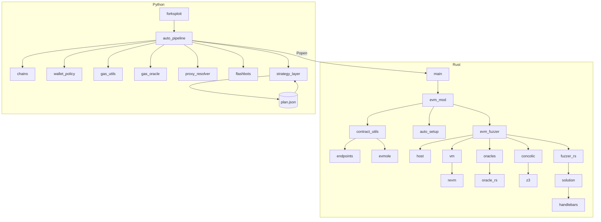

# DEPENDENCIES — external, internal and execution order

> **⚠️ USE AT YOUR OWN RISK — THE AUTHORS ACCEPT NO LIABILITY.**
> **ForkSploit is provided "AS IS", without warranty of any kind. It signs and
> sends real transactions and can move real funds. You use it entirely at your
> own risk and under your own full responsibility; the authors and copyright
> holders accept NO liability whatsoever for any consequences of its use, misuse
> or inability to use it. See [`DISCLAIMER.md`](../DISCLAIMER.md).**

> Standalone document. Related: [BUILD_AND_INSTALL.md](BUILD_AND_INSTALL.md),
> [RUST_CORE.md](RUST_CORE.md), [PYTHON_LAYER.md](PYTHON_LAYER.md).

All versions are from `Cargo.toml` / `Cargo.lock` / `requirements.txt`.

---

## 1. External dependencies — Rust (`Cargo.toml`)

| Package | Version | Purpose |
|-------|-----------|-------|
| `revm` | git `forksploit/revm` rev `1dead51` (version 3.3.0 in the lock) | EVM; features `no_gas_measuring`, `serde`, `memory_limit` |
| `revm-primitives` | same git/rev | primitives |
| `revm-interpreter` | same git/rev | interpreter |
| `libafl` | `=0.11.2` | fuzzer framework (pinned) |
| `libafl_bolts` | `=0.11.2` | helpers |
| `z3` | `0.21.1` | Z3 binding |
| `z3-sys` | `0.13.1` | Z3 FFI (links the system Z3) |
| `clap` | `4.6.7` (derive) | CLI |
| `serde` | `1.0.147` | serialization |
| `serde_json` | `1.0.73` | JSON |
| `serde_traitobject` | `0.2.8` (patched in `vendor/`) | serde for `dyn` |
| `ethers` | `2.0.14` | Ethereum types |
| `alloy-sol-types` | `1.7.3` | ABI |
| `alloy-dyn-abi` | `1.7.3` (arbitrary, eip712) | dynamic ABI |
| `alloy-primitives` | `1.7.3` | primitives |
| `alloy-json-abi` | `1.7.3` | JSON ABI |
| `handlebars` | `6.4.4` | Solidity templates |
| `evmole` | `0.9.4` | ABI decompilation |
| `reqwest` | `0.13.5` (blocking, json) | HTTP/RPC |
| `primitive-types` | `0.14.0` | U256/H160 |
| `bytes` | `1.2.1` | bytes |
| `hex` | `0.4` | hex |
| `rand` | `0.8.5` | RNG |
| `rlp` | `0.5.2` | RLP |
| `rust-crypto` | `0.2` | sha3 |
| `itertools` | `0.10.2` | iterators |
| `once_cell` | `1.8.0` | lazy statics |
| `either` | `1.8.0` | Either |
| `regex` | `1` | regex |
| `typetag` | `0.2.13` | serde for trait objects |
| `lazy_static` | `1.4.0` | statics |
| `anyhow` | `1.0` | errors |
| `thiserror` | `2.0.21` | errors |
| `tracing` | `0.1` | logging |
| `tracing-subscriber` | `0.3` | logging |
| `colored` | `2.0` | colours |
| `semver` | `1.0.28` | versions |
| `retry` | `2.0.0` | retries |
| `glob` | `0.3.0` | glob |
| `criterion` | `0.7.0` (dev) | benchmarks |

**Special case — `serde_traitobject`:** the latest release (`0.2.9`) has three
pointer casts that newer rustc rejects (E0804). Since upstream is unmaintained,
`Cargo.toml` contains:

```toml
[patch.crates-io]
serde_traitobject = { path = "vendor/serde_traitobject-0.2.9-patched" }
```

Vendor directory: `vendor/serde_traitobject-0.2.9-patched`.

**Git submodules** (`.gitmodules`): `tests/evm_manual/foundry1/lib/forge-std`,
`tests/evm_manual/foundry1/lib/openzeppelin-contracts`,
`tests/evm_manual/foundry/lib/forge-std`.

---

## 2. External dependencies — Python (`onchain_scripts/requirements.txt`)

| Package | Requirement |
|-------|---------|
| `requests` | `>=2.28.1` |
| `retry` | `>=0.9.2` |
| `web3` | `>=8.0` |
| `fastapi` | `>=0.110` |
| `uvicorn[standard]` | `>=0.29` |

`eth_abi` and `eth_account` are also used (transitively via `web3`). The tests
require `pytest` (CI installs it separately).

---

## 3. External tools (not packages)

| Tool | Use | Required? |
|--------|---------|----------|
| `anvil` (Foundry) | pre-flight fork | no (optional) |
| `solc` 0.8.24 | compile `.sol` | for `.sol` targets |
| `cast` (Foundry) | `proof_w1_w2_w3.sh` | only for the proof script |
| `slither` | static analysis | no |
| `git`, `curl` | build/preflight | yes |

---

## 4. Internal dependencies (Rust)

```
main.rs
 └── evm/mod.rs (evm_main)
      ├── const.rs
      ├── evm/config.rs
      ├── evm/onchain/endpoints.rs (Chain)
      ├── evm/contract_utils.rs ── evm/onchain/*, evm/blaz/*
      ├── evm/auto_setup.rs ── evm/setup.rs, evm/contract_utils.rs
      ├── evm/solution/mod.rs (init_cli_args)
      └── fuzzers/evm_fuzzer.rs
           ├── evm/host.rs
           ├── evm/corpus_initializer.rs ── evm/contract_utils.rs
           ├── evm/vm.rs ── revm
           ├── evm/oracles/* ── evm/oracle.rs, evm/host.rs
           ├── evm/concolic/* ── evm/host.rs, z3
           ├── evm/middlewares/*
           ├── fuzzer.rs ── evm/solution/mod.rs
           │                 └── evm/solution/script_generator.rs ── evm/host.rs
           └── oracle.rs, feedback.rs, state.rs, scheduler.rs
```

`src/evm/mod.rs` is the module that knows the most: it assembles everything.

---

## 5. Internal dependencies (Python)

```
forksploit.sh
 └── auto_pipeline.py
      ├── chains.py
      ├── wallet_policy.py ── chains.py
      ├── gas_utils.py ── chains.py
      ├── gas_oracle.py
      ├── proxy_resolver.py
      ├── flashbots_bundle.py
      └── strategy_layer.py (does not import auto_pipeline)
 batch_pipeline.py ── auto_pipeline.py, chains.py, wallet_policy.py,
                      gas_utils.py, strategy_layer.py
 monitor.py ── chains.py, wallet_policy.py, gas_utils.py, auto_pipeline.py
 dashboard_server.py ── auto_pipeline.py, chains.py, wallet_policy.py
 triage_findings.py ── strategy_layer.py
 materialize_plan.py
```

`strategy_layer.py` deliberately **does not** import `auto_pipeline` (to avoid a
circular import); it receives `execute_plan` as a parameter.

---

## 6. Startup order

1. `forksploit.sh`: `load_chains`, `load_settings`, `check_env`.
2. `auto_pipeline.main`: parse → `require_mainnet_confirmation` → `Tee` →
   `make_w3` → `verify_rpc_identity` → `Account.from_key` →
   `enforce_wallet_policy`.
3. Target: `compile_contract`/`deploy` or an existing address →
   `register_contract` → `get_or_deploy_attack_wallet` →
   `resolve_proxy_chain`.
4. `run_fuzzer` (Popen Rust).
5. `report_coverage` → `load_findings` → `ordering_key` →
   `report_unexecuted_findings` → `report_surface_triage`.
6. `_start_fork` → for each plan `estimate_plan_gas_on_fork` →
   `gated_execute_plan`.
7. `strategy_layer.run_chain_attempts`.
8. Final report; `tee.close()`.

Rust side (inside step 4): `main` → `evm_main` → target loading → `evm_fuzzer`
→ `fuzz_loop`.

---

## 7. Full dependency diagram



---

## 8. Open / unmeasured

* **Unverified:** whether all transitive dependencies are available in all
  environments; `Cargo.lock` is present, but this document does not list the
  whole tree.
* **Unmeasured:** build size, compilation times and binary size are not part of
  this document.
* `reqwest` `0.13.5` is in `Cargo.toml`; `Cargo.lock` must be read for exact
  transitive versions.
