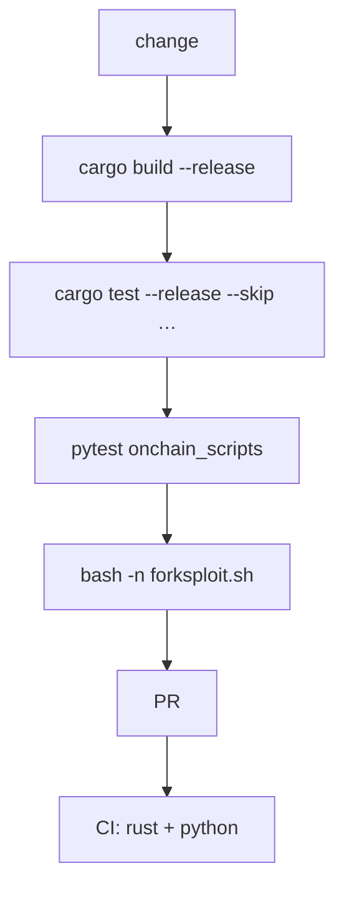

# DEVELOPER GUIDE — how to contribute, conventions, R1

> **⚠️ USE AT YOUR OWN RISK — THE AUTHORS ACCEPT NO LIABILITY.**
> **ForkSploit is provided "AS IS", without warranty of any kind. It signs and
> sends real transactions and can move real funds. You use it entirely at your
> own risk and under your own full responsibility; the authors and copyright
> holders accept NO liability whatsoever for any consequences of its use, misuse
> or inability to use it. See [`DISCLAIMER.md`](../DISCLAIMER.md).**

> Standalone document. Related: [BUILD_AND_INSTALL.md](BUILD_AND_INSTALL.md),
> [TESTS.md](TESTS.md), [DEPENDENCIES.md](DEPENDENCIES.md),
> [LIMITATIONS.md](LIMITATIONS.md).

---

## 1. Rule R1 — proof before claim

Never write "done", "fixed" or "works" in a commit message, documentation or PR
description without **reproducible proof**: a test, a measurement or command
output. Anything not measured is marked **unmeasured** in the documentation.

This rule is recorded in `CONTRIBUTING.md` and `AGENTS.md` and is the starting
point of this documentation.

---

## 2. Setting up the environment

```bash
# System prerequisites (Debian/Ubuntu)
sudo apt-get install -y libz3-dev pkg-config clang cmake build-essential

rustup toolchain install          # reads rust-toolchain.toml
cargo build --release
pip install -r onchain_scripts/requirements.txt
```

Rust is pinned to `nightly-2026-10-15` (`rust-toolchain.toml`).

---

## 3. Before you open a PR

The same commands CI runs (`.github/workflows/ci.yml`):

```bash
# Rust (10 network/state-dependent tests are skipped)
cargo test --release -- \
  --skip onchain_pair_discovery \
  --skip uniswap::tests::test_get_pair \
  --skip uniswap::tests::test_fetch_uniswap_path \
  --skip endpoints::tests::test_get_balance

# Python (no network; no anvil/solc)
cd onchain_scripts && python -m pytest -q

# Shell
bash -n forksploit.sh
bash -n onchain_scripts/server_run.sh
```

`cargo build --release` must stay **warning-free** (only the third-party
`libafl`/`nom` future-incompat notice is allowed). `cargo fmt` / `cargo clippy`
are **not** CI gates; if you touch Rust, keep the surrounding style and do not
add new clippy warnings.

---

## 4. Code conventions

From `CONTRIBUTING.md`:

* **Match the surrounding style**; keep changes minimal and focused.
* **Comments**: only for genuinely non-obvious invariants, workarounds or
  trade-offs. Do not narrate the diff, restate the code, or describe history —
  that belongs in the commit message / PR description.
* **Never** `.unwrap()`/`.expect()` on data from outside the process (RPC
  responses, solc/forge artifacts, ABIs, storage, user presets). Return a typed
  `Result` or a safe default. The remaining `.unwrap()`s are `.parse().unwrap()`
  on static literals, `lock().unwrap()` or inside `#[cfg(test)]`.

### Rust style (`rustfmt.toml`)
`max_width = 120`, `fn_params_layout = "Tall"`,
`group_imports = "StdExternalCrate"`, `imports_layout = "HorizontalVertical"`,
`wrap_comments = true`, `reorder_imports = true`,
`imports_granularity = "Crate"`, `binop_separator = "Back"`,
`trailing_comma = "Vertical"`, `use_field_init_shorthand = true`,
`format_code_in_doc_comments = true`.

### Tests
* Proof tests live in a `#[cfg(test)] mod tests` beside the module they cover,
  tagged with the phase (e.g. `PHASE 6.1`).
* Python tests are in `onchain_scripts/test_*.py` and run **real** code (no
  mocks) where possible.

---

## 5. Where things belong

| Change | Where |
|-----------|-----|
| A new oracle | `src/evm/oracles/<name>.rs` + `mod.rs` + `OracleType` in `src/evm/mod.rs` + a `Config` field + `evm_fuzzer.rs` |
| A new Rust flag | `EvmArgs` (`src/evm/mod.rs`) + `Config` |
| A new Python flag | argparse in `auto_pipeline.py` / `batch_pipeline.py` |
| A new chain | `src/evm/onchain/endpoints.rs::Chain` + `chains.py::DEFAULT_RPC`/`CHAIN_IDS` |
| A new plan schema | `src/evm/solution/script_generator.rs::PlanMeta` + `PLAN_JSON.md` |
| A new contract | `onchain_scripts/contracts/` |

---

## 6. Documentation

* `README.md` is the main entry point for users.
* `AGENTS.md` is the persistent memory for agents (repository-specific knowledge).
* `CLAUDE.md` describes the architecture.
* `docs/` (this directory) is the complete technical documentation.
* `docs/project/LIMITATIONS.md` and `docs/project/BLOCKERS.md` list what the
  system cannot do.
* Every claim in the documentation must have a `path/to/file.rs::symbol`
  reference or a reproducible command.

---

## 7. Diagram: the contribution flow



---

## 8. Open / unmeasured

* **Unverified:** this document does not describe the release process (see
  `.github/workflows/release.yml` and `.github/scripts/*`).
* **Unmeasured:** CI times and success rates are not part of this document.
