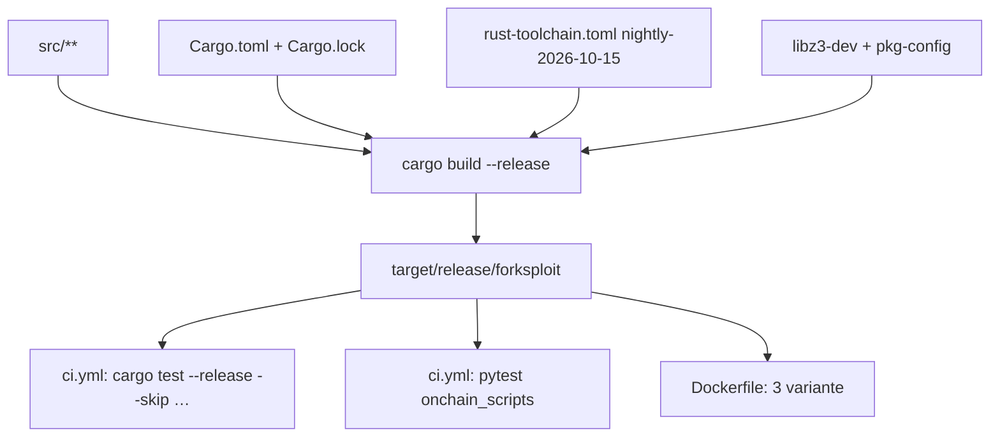

# GRADNJA IN NAMESTITEV — predpogoji, build, Docker, CI

> Samostojen dokument. Sorodno: [CLI_REFERENCA.md](CLI_REFERENCA.md),
> [ODVISNOSTI.md](ODVISNOSTI.md), [TESTI.md](TESTI.md).

Vsak ukaz je iz kode (`Cargo.toml`, `rust-toolchain.toml`, `Dockerfile`,
`.github/workflows/*.yml`, `forksploit.sh`).

---

## 1. Predpogoji

| Orodje | Zakaj | Kje se zahteva |
|--------|-------|----------------|
| Rust (`rustup` + `cargo`) | build jedra | `rust-toolchain.toml` pin |
| `libz3-dev` + `pkg-config` | Z3 se linka sistemsko | `Cargo.toml` (`z3-sys`) |
| `clang`, `cmake`, `build-essential` | build | CI, `forksploit.sh::check_env` |
| `git`, `curl` | build.rs, namestitve | `check_env` |
| `python3` + `onchain_scripts/requirements.txt` | izvršilna plast | `forksploit.sh::have_python_deps` |
| `anvil` (opcijsko) | pre-flight fork | `_start_fork` |
| `solc` 0.8.24 (opcijsko) | prevod `.sol` | `_find_solc` |
| `slither` (opcijsko) | statična analiza | `run_static_analysis` |

Rust je piniran v `rust-toolchain.toml`:

```toml
[toolchain]
channel = "nightly-2026-10-15"
```

`z3-sys` linka **sistemski** Z3; brez `libz3-dev` + `pkg-config` bo build
poskusil prevesti Z3 iz izvora.

---

## 2. Build

```bash
# Predpogoji (Debian/Ubuntu)
sudo apt-get install -y libz3-dev libssl-dev libudev-dev \
    pkg-config clang cmake build-essential

# Build (privzeti feature set)
cargo build --release
```

Binarij: `target/release/forksploit`.

Privzeti feature set (`Cargo.toml::[features].default`):
`cmp`, `dataflow`, `evm`, `print_txn_corpus`, `full_trace`, `force_cache`,
`real_balance`.

Build mora končati z **0 napak in 0 projektnih opozoril** (edini izpis je
third-party future-incompat opozorilo za `libafl 0.11.2` / `nom 2.2.1`, ki
ni koda tega repozitorija). Glej `AGENTS.md` za pravilo R1.

`Makefile.toml` (cargo-make) ponuja naloge:
`clean_cargo`, `clean`, `compile-release`, `copy-release`, `compile-debug`,
`copy-debug`, `build-cli-clean`, `build-cli`, `debug-clean`, `debug`, `run`.

---

## 3. Interaktivni vstop in doctor

```bash
./forksploit.sh --doctor --no-install     # samo preverjanje okolja
./forksploit.sh --dry-run --no-install    # izpiše ukaz, ne zažene
./forksploit.sh                           # interaktivni meni + wizard
```

`check_env` preveri: z3, pkg-config, clang, cmake, python3, C/C++ toolchain,
git, curl, cargo/rustup, python odvisnosti, anvil (opcijsko), solc
(opcijsko), binarij. `--no-install` preveri in poroča, ne namešča.
`--doctor` konča po preverjanju z izhodno kodo 0 (tudi če opcijski anvil/solc
manjkata).

**Meritev (ta repozitorij, ta okolje):** `bash forksploit.sh --doctor
--no-install` je vrnil izhodno kodo `0`, izpisal `PREDLETNO PREVERJANJE
OKOLJA (doctor)`, `Sistem : Debian GNU/Linux 13 (trixie) (x86_64)` in opozorila
za manjkajoče `cargo`/`rustup`/`z3`/`pkg-config`/`clang`/`cmake` ter binarij.
To je **neizmerjeno glede na build** — v tem okolju Rust ni nameščen.

---

## 4. Python namestitev

```bash
pip install -r onchain_scripts/requirements.txt
```

`onchain_scripts/requirements.txt`:
```
requests>=2.28.1
retry>=0.9.2
web3>=8.0
fastapi>=0.110
uvicorn[standard]>=0.29
```

`forksploit.sh` ponudi namestitev prek `python3 -m pip install -r …` (ali
`.venv`), nikoli tiho.

---

## 5. Docker

`Dockerfile` (multi-stage):

1. `run_environment` (od `rust:buster`): namesti `curl`, `jq`, `python3`,
   `python3-pip`, `python3-setuptools`, `python3-wheel`, `python3-venv`,
   `libz3-dev`, `libssl-dev`, `git`.
2. `build_environment`: doda `clang`, `pkg-config`, `cmake`.
3. `builder`: kopira `Cargo.toml`, `Cargo.lock`, `rust-toolchain.toml`,
   `src`, `benches`, `tests`, `.git`; zgradi **tri** binarne različice:
   * `cli_offchain`: `cmp dataflow evm print_txn_corpus full_trace force_cache real_balance`
   * `cli_onchain`: `cmp dataflow evm print_txn_corpus full_trace`
   * `cli_print_logs`: `cmp dataflow evm print_logs`
   Vse z `--no-default-features`.
4. Končna slika: `/bins` z vsemi tremi, `EXPOSE 8000`.

---

## 6. CI

### `.github/workflows/ci.yml`

Dve opravili na `ubuntu-22.04`:

**rust:**
* namesti Rust iz `rust-toolchain.toml`;
* `Swatinem/rust-cache@v2`;
* `apt-get install libz3-dev libssl-dev libudev-dev pkg-config clang cmake build-essential`;
* `cargo build --release --features "cmp dataflow evm print_txn_corpus full_trace force_cache real_balance" --no-default-features --locked`;
* `cargo test --release -- --skip onchain_pair_discovery --skip uniswap::tests::test_get_pair --skip uniswap::tests::test_fetch_uniswap_path --skip endpoints::tests::test_get_balance`;
* naloži `target/release/forksploit` kot artefakt.

**python** (odvisno od `rust`):
* `setup-python@v5` (3.12);
* prenese artefakt, `chmod +x`;
* `pip install -r onchain_scripts/requirements.txt pytest`;
* `./forksploit.sh --doctor --no-install`;
* `python -m pytest onchain_scripts -q -p no:cacheprovider`.

CI **namerno ne** poganja `cargo fmt --check` in `cargo clippy` (drevo ni
rustfmt-čisto oz. ima prejšnja opozorila).

### `.github/workflows/release.yml`
Sproži se na tag `v*.*.*`, po urniku (nightly) ali ročno. Opravila
`prepare`, gradnja in objava izdaje; pomožni skripti
`.github/scripts/create-tag.js`, `move-tag.js`, `prune-prereleases.js`.

### `.github/workflows/docker-x86.yml`, `docker-arm.yml`
Gradnja Docker slik na self-hosted EC2 runnerjih (zahtevajo AWS skrivnosti).

---

## 7. Diagram: build in CI



---

## 8. Odprto / neizmerjeno

* **Neizmerjeno v tem okolju:** `cargo build --release` in `cargo test
  --release` nista bila pognana (Rust ni nameščen v tem okolju). Številke
  testov, navedene v `AGENTS.md`, so iz tam, ne iz tega dokumenta.
* **Neizmerjeno:** časi gradnje niso del tega dokumenta.
* `docker-x86.yml`/`docker-arm.yml` uporabljata self-hosted runnerje, ki
  zahtevajo AWS skrivnosti; v tem okolju nista bila pognana.
