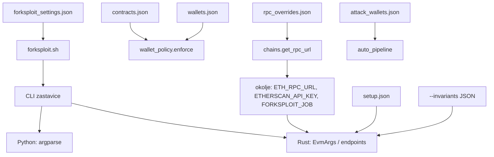

# KONFIGURACIJA — zastavice, okolje, datoteke

> Samostojen dokument. Sorodno: [CLI_REFERENCA.md](CLI_REFERENCA.md),
> [VERIGE_IN_RPC.md](VERIGE_IN_RPC.md), [PLAN_JSON.md](PLAN_JSON.md),
> [VARNOSTNI_MODEL.md](VARNOSTNI_MODEL.md).

Vsaka vrednost je preverjena v kodi.

---

## 1. Okoljske spremenljivke

| Spremenljivka | Kje se bere | Pomen |
|---------------|-------------|-------|
| `ETH_RPC_URL` | `src/evm/onchain/endpoints.rs::Chain::get_chain_rpc` | RPC naslov; če nastavljen, se uporabi **za vsako** verigo. Python ga nastavi v `auto_pipeline.py::run_fuzzer` iz `chains.get_rpc_url(chain)`. |
| `ETHERSCAN_API_KEY` | `src/evm/mod.rs::evm_main` | rezervna vrednost, če `--onchain-etherscan-api-key` ni podan |
| `SOLC` | `auto_pipeline.py::_find_solc` (posredno) | prek `_solc_support`/`_find_solc`; Python privzeto uporabi `~/.svm/0.8.24/solc-0.8.24`, sicer `solc` |
| `FORKSPLOIT_JOB` | `src/evm/mod.rs::evm_main` | če nastavljen, vsili `--jobs 1` (varovalka proti fork-bombi) |
| `CARGO_FEATURE_*` | `src/build.rs` | prebrano ob buildu za `GIT_VERSION_INFO` |
| `NO_COLOR` | `forksploit.sh` | izklopi barve |
| `TMPDIR` | `forksploit.sh::run_wizard` | mapa za začasno datoteko ciljev |

`CAST` in `SOLC` kot taki: `auto_pipeline._find_solc` vrne `SOLC`-neodvisno
pot (`~/.svm/0.8.24/solc-0.8.24` ali `solc`). `CAST` se v kodi
`auto_pipeline.py` **ne** uporablja; `cast` se pojavi le v
`onchain_scripts/contracts/proof_w1_w2_w3.sh`. `integration_test.py` uporablja
`_find_solc` enako.

---

## 2. Konfiguracijske datoteke

### 2.1 `onchain_scripts/wallets.json` (gitignored)
Shema (`wallet_policy.register_policy`):

```json
{
  "<chain>": {
    "funding_wallet": "0x…",
    "recovery_wallet": "0x…",
    "registered_at": "2026-…T…+00:00",
    "client_note": ""
  }
}
```

### 2.2 `onchain_scripts/contracts.json` (gitignored)
Shema (`wallet_policy.register_contract`):

```json
{
  "<chain>:<address_lower>": {
    "address": "0x…",
    "chain": "sepolia",
    "source": "…",
    "first_seen": "2026-…T…+00:00",
    "runs": [
      {"run_id": "…", "script": "auto_pipeline", "timestamp": "…",
       "funding_wallet": "0x…", "recovery_wallet": "0x…"}
    ]
  }
}
```

### 2.3 `onchain_scripts/rpc_overrides.json` (gitignored)
Shema (`chains.set_rpc_override`):

```json
{ "<chain>": "https://moj-rpc.example" }
```

### 2.4 `onchain_scripts/forksploit_settings.json` (gitignored)
Nastavi jo `forksploit.sh::save_settings`; bere `load_settings`. Ključi:

| Ključ | Preslika v zastavico |
|-------|----------------------|
| `DEFAULT_KEY` | privzeti ključ v wizardu |
| `FUZZ_SECONDS` | `--fuzz-seconds` |
| `DETECTORS` | `--detectors` |
| `FUND_ETH` | `--fund-eth` |
| `NO_PREFLIGHT` | `--no-preflight` (0/1) |
| `NO_GAS_ORACLE` | `--no-gas-oracle` (0/1) |

`build_advanced_flags` doda zastavico **samo**, če je vrednost nastavljena;
prazna vrednost pomeni "brez zastavice".

### 2.5 `onchain_scripts/attack_wallets.json` (gitignored)
Shema (`get_or_deploy_attack_wallet`): `{ "<chain>": "<attack_wallet_address>" }`.

### 2.6 `setup.json` (ob fixture-u)
Shema (`src/evm/setup.rs::SetupSpec`):

```json
{ "calls": [
  { "to": "Vault",  "sig": "setAsset(address)",     "args": ["Token"] },
  { "to": "Token",  "sig": "mint(address,uint256)", "args": ["$caller", "1000000"] }
] }
```

`to` in naslovni argumenti sprejmejo ime pogodbe (fixture file stem),
`$caller` (prvi fuzzer klicatelj) ali `$deployer`.

### 2.7 `--invariants` JSON
Shema (`src/evm/oracles/invariant.rs`) je v [ORAKLI.md](ORAKLI.md) §4.

### 2.8 `onchain_scripts/target.txt`
Vhod za `evaluate.py` (seznam ciljev). Ni del glavnega toka.

---

## 3. Ključne konstante (iz kode)

### Rust (`src/const.rs`, `src/evm/mod.rs`, `src/evm/host.rs`)
| Konstanta | Vrednost |
|-----------|----------|
| `MAX_CONCOLIC_THREADS` | `2` |
| `DROP_THRESHOLD` | `4000` |
| `PRUNE_AMT` | `1000` |
| `ACCOUNT_AMT` | `8` |
| `CONTRACT_AMT` | `8` |
| `MAX_INPUT_SIZE` | `64` |
| `MAX_HAVOC_ATTEMPTS` | `32` |
| `MUTATION_RETRIES` | `20` |
| `KNOWN_STATE_MAX_SIZE` | `1000` |
| `CONTROL_LEAK_THRESHOLD` | `200` |
| `MAX_ANALYSIS_CALL_DEPTH` | privzeto `15` (nastavljeno iz `--max-call-depth`, privzeto `32`) |
| `FIX_DEPLOYER` | `8b21e662154b4bbc1ec0754d0238875fe3d22fa6` |

### Python
| Konstanta | Vrednost | Datoteka |
|-----------|----------|----------|
| `MAX_GAS_LIMIT` | `8_000_000` | `gas_utils.py` |
| `DEFAULT_GAS_LIMIT_MARGIN` | `0.10` | `gas_utils.py` |
| `BASE_FEE_LOOKAHEAD_BLOCKS` | `2` | `gas_utils.py` |
| `GAS_BUDGET_MARGIN` | `1.10` | `auto_pipeline.py` |
| `FLASHBOTS_THRESHOLD_ETH` | `10.0` | `auto_pipeline.py` |
| `BUNDLE_GAS_LIMIT` | `2_000_000` | `auto_pipeline.py` |
| `BUNDLE_BUILDER_TIP_BPS` | `400` | `auto_pipeline.py` |
| `REPLACEMENT_FEE_BUMP` | `1.15` | `auto_pipeline.py` |
| `REPLACEMENT_MAX_ATTEMPTS` | `3` | `auto_pipeline.py` |
| `FORK_SIM_PORT` | `18545` | `auto_pipeline.py` |
| `FORK_SIM_ETC_HARDFORK` | `"shanghai"` | `auto_pipeline.py` |
| `FORK_SIM_STARTUP_TIMEOUT_S` | `20.0` | `auto_pipeline.py` |
| `MIN_COVERAGE_PCT_FOR_NEGATIVE_RESULT` | `80.0` | `auto_pipeline.py` |
| `MIN_FUZZ_SECONDS_FOR_NEGATIVE_RESULT` | `300` | `auto_pipeline.py` |
| `SOLC_EVM_VERSION` | `"cancun"` | `auto_pipeline.py` |
| `_SOLC_EVM_FALLBACKS` | `["cancun","shanghai","paris","london"]` | `auto_pipeline.py` |
| `TESTNET_CHAINS` | `{"sepolia","chapel","mordor"}` | `chains.py` |
| `DEFAULT_TIMEOUT` (gas oracle) | `12` | `gas_oracle.py` |
| `DEFAULT_TTL_SECONDS` | `12` | `gas_oracle.py` |
| `DEFAULT_LOOKAHEAD_BLOCKS` | `2` | `gas_oracle.py` |

---

## 4. Zastavice Python pipeline-a

### `auto_pipeline.py`
| Zastavica | Privzeto | Pomen |
|-----------|----------|-------|
| `--target` | (obvezno) | `.sol`/`.bin` ali `0x…` |
| `--recovery-wallet` | (obvezno) | cilj pobiranja |
| `--key` | (obvezno) | pot do ključa |
| `--chain` | `sepolia` | iz `known_chains()` |
| `--confirm-mainnet` | false | potrditev za non-testnet |
| `--fund-eth` | `0.0` | financiranje tarče |
| `--no-gas-oracle` | false | izklop uradnega gas orakla |
| `--fuzz-seconds` | `300` | proračun |
| `--detectors` | `all` | oracle preset |
| `--no-preflight` | false | izklop pre-flight vrat |

### `batch_pipeline.py`
`--targets` (obvezno), `--recovery-wallet` (obvezno), `--key`, `--chain`,
`--confirm-mainnet`, `--fund-eth`, `--fuzz-seconds`, `--detectors`,
`--no-preflight`, `--no-gas-oracle`.

### `monitor.py`
`--address`, `--chain`, `--config`, `--poll-interval` (20.0),
`--balance-drop-pct` (10.0), `--large-tx-eth` (0.0), `--rescan-interval` (600.0),
`--rescan-seconds` (60), `--rescan-detectors` (`all`), `--key`,
`--safe-wallet`, `--confirm-mainnet`.

### `dashboard_server.py`
`--port` (privzeto `4114`).

### `wallet_policy.py`
`register` (`--chain`, `--confirm-chain`, `--funding-wallet`,
`--recovery-wallet`, `--force`, `--client-note`, `--confirm`),
`show [--chain]`, `contracts [--chain]`.

### `gas_oracle.py`
`--verify`, `--fee-fields CHAIN`, `--selftest`, `--chains …`, `--api-key`.

### `triage_findings.py`, `materialize_plan.py`
`triage_findings.py <work_dir…> [--json]`;
`materialize_plan.py <work_dir…> [--json] [--lookup]`.

---

## 5. Rust feature zastavice (`Cargo.toml`)

Privzeti set: `cmp`, `dataflow`, `evm`, `print_txn_corpus`, `full_trace`,
`force_cache`, `real_balance`.

| Feature | Pomen |
|---------|-------|
| `evm` | EVM podpora |
| `cmp` | primerjalna povratna informacija |
| `dataflow` | podatkovna odvisnost |
| `print_txn_corpus` | izpis korpusa + dump najdb (`vuln_file_base`) |
| `full_trace` | polna sled transakcij |
| `force_cache` | agresivno predpomnjenje |
| `real_balance` | realno stanje |
| `print_logs` | izpis dnevnikov |
| `use_presets` | predloge (`presets/`) |
| `z3_debug`, `debug`, `flashloan_debug` | razhroščevanje |
| `ondisk_corpus` | korpus na disku |
| `no_etherscan` | brez Etherscan |
| `fuzz_static`, `evaluation`, `deployer_is_attacker`, `print_infant_corpus` | ostalo |

CI/Docker uporabljata kombinacije:
`cmp dataflow evm print_txn_corpus full_trace force_cache real_balance`,
`cmp dataflow evm print_txn_corpus full_trace`, `cmp dataflow evm print_logs`.

---

## 6. Diagram: kje se konfiguracija bere



---

## 7. Odprto / neizmerjeno

* **Nepreverjeno:** `CAST` kot okoljska spremenljivka — v `auto_pipeline.py`
  ni branja `CAST`; uporablja se le `cast` v `proof_w1_w2_w3.sh`.
* **Nepreverjeno:** `SOLC` kot okoljska spremenljivka — `_find_solc` vrne
  fiksno pot ali `solc` z `PATH`; ne bere `$SOLC` neposredno.
* **Neizmerjeno:** ta dokument ne navaja, koliko je posamezna konfiguracija
  uporabljena v praksi.
