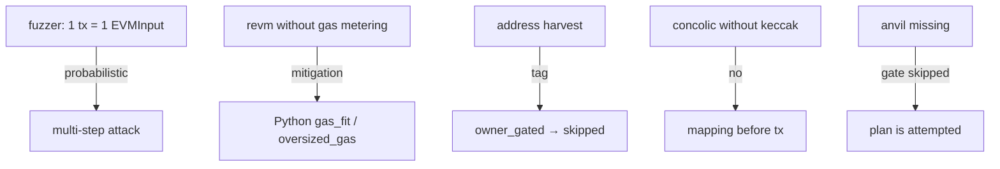

# LIMITATIONS — what the system cannot do (from the code)

> Standalone document. Related: [ARCHITECTURE.md](ARCHITECTURE.md),
> [ORACLES.md](ORACLES.md), [SECURITY_MODEL.md](SECURITY_MODEL.md),
> [TROUBLESHOOTING.md](TROUBLESHOOTING.md).

Rule R3: a limitation is **written down**, not hidden. This document is derived
from the code; every item cites the code.

---

## 1. Execution model

### 1.1 The `revm` fork does not measure gas
`Cargo.toml` uses `revm` from `forksploit/revm` rev `1dead51` with the feature
`no_gas_measuring`. The model therefore does not measure gas. Consequence: a
plan that succeeds in simulation can exceed `block.gasLimit` on-chain.

Mitigation in Python: `gas_utils.estimate_gas_limit` + `gas_fit` +
`gas_oversized_reason` (status `oversized_gas`). **What is missing:** the
measurement is on the Python side and requires a reachable fork; without a fork
the field `fits_block_gas_limit` is absent and `gas_oversized_reason` returns
`None` (it does not guess).

### 1.2 No mempool, ordering or front-running
There is no model of a mempool, sandwich/backrun or MEV in the code. The
Flashbots bundle (`flashbots_bundle.py`) is only a mechanism to **deliver** a
sequence as one bundle, not a market model.

### 1.3 Concolic is narrow
`src/evm/concolic/*` supports symbolic calldata, `callvalue`, `caller`, `origin`
and memory. From the code:

* **Closed:** symbolic storage is keyed by contract address
  (`ConcolicHost::symbolic_state`), persistent across calls.
* **Closed:** symbolic return values of `CALL`/`STATICCALL`/`DELEGATECALL` in
  the same transaction (`return_bytes`, `insert_bytes`).
* **STILL OPEN:** `keccak256` in the concolic host is `concrete_eval!` (not
  modelled). Therefore a mapping entry that existed **before the transaction**
  (`require(m[k] == 1)` for an attacker's `k`) remains unreachable — inverting
  the hash would be needed.
* **STILL OPEN:** the symbolic `CALL` target and symbolic balances.
* **Reliability:** with a large constant the solution needs more than the default
  `--concolic-timeout 1000` ms.

### 1.4 The unit of fuzzing is one transaction
`EVMInput` (`src/evm/input.rs`) is **one** transaction. Multi-step behaviour
arises only across the corpus genealogy (`TxnTrace::from_idx`) and replay in
`cov_stage`/`minimizer`. For classes that require an exact sequence, the reach is
probabilistic, not planned. There is **no** general symbolic planner in the code.

---

## 2. Attacker vs. privileged party

### 2.1 The harvest heuristic remains (deliberately)
`src/evm/host.rs` records addresses read from the target's storage
(`HARVESTED_STORAGE_ADDRESSES`, `HARVESTED_ADDRESS_ORIGINS`,
`HARVESTED_SENDER_GUARDS`). The fuzzer can "become" an address from storage
(`require(msg.sender == owner)`), which is not an attack by an external actor.

Mitigation: plans are tagged (`owner_impersonation`, `owner_gated`) and Python
**skips** them (`metadata_skip_reason`) and shows them as blockers (`build_proof`).
**What is missing:** a more general semantic test of an arbitrary privileged
condition, not only "an address from its own storage".

---

## 3. Execution and proof

### 3.1 `sim-confirmed` is only a simulation
`src/evm/oracle.rs::ConfidenceTier::as_str` returns `"sim-confirmed"` /
`"sim-review"`, never a bare `"confirmed"`. Only Python's `PLAN_CONFIRMED` (a
measured increase of the recovery wallet) is proof. There is no `severity`/CVSS
field in the code.

### 3.2 No single proof schema for a whole run
`build_proof` returns a `Proof` **per plan**. There is no aggregate across all
plans in one structure (the sum is only in the log, `auto_pipeline.main`).

### 3.3 The pre-flight is "best-effort"
`_start_fork` returns `(None, None)` if anvil is not installed or does not come
up; `simulate_plan_on_fork` returns `None` if the simulation cannot be decided.
In that case the gate does not block — the plan is attempted. So the pre-flight
never stops a run, it only reduces spending.

### 3.4 Reliability of the fork replay
`simulate_plan_on_fork` uses `evm_snapshot`/`evm_revert` and
`anvil_setBalance`. If the fork is unreachable or the RPC returns an error,
`None` is returned and the gate is skipped.

---

## 4. Code reliability

### 4.1 `.unwrap()`/`.expect()` on external data
Most boundaries are hardened (see `AGENTS.md`), but `.unwrap()`/`.expect()` remain
outside `#[cfg(test)]`. A search over `src/**` still finds many
`.unwrap()`/`.expect()`, among them on inputs such as:
* `src/evm/mod.rs::evm_main` — `reqwest::blocking::get(...).unwrap()` for
  `--fetch-tx-data`; `hex::decode(...).unwrap()`; `rlp::decode(...).unwrap()`;
  `EVMAddress::from_str(...)` for `--only-fuzz` uses `unwrap_or_else` with
  `exit(1)` (that is deliberate).
* `src/evm/contract_utils.rs::from_config`/`from_setup` — `.expect(...)` on
  missing artifacts.
* `src/fuzzers/evm_fuzzer.rs` — `.unwrap()` on reading the state-comp file.

**What is missing:** `clippy::unwrap_used` as a CI lint, so the remainder does
not grow.

### 4.2 `File name too long`
Fixed in `src/fuzzer.rs::vuln_file_base` (the name is bounded to 120 bytes + a
hash). The dumps use `error!` instead of `unwrap`.

---

## 5. Multi-core and concolic

### 5.1 Multi-core is process isolation
`src/evm/multicore.rs` uses **processes** (`--jobs N`), not threads, because
`EVMFuzzState` is not `Send` and the `RacyCell` maps are sound only under a
single-threaded assumption (`src/sync_utils.rs`). `--jobs` is clamped to the core
count (`clamp_jobs_to_cores`).

**Unmeasured:** the speedup factor "N cores → ~N times more cases/s" is not
measured in this document.

### 5.2 The concolic cap is 2
`src/const.rs::MAX_CONCOLIC_THREADS = 2`; `max_concolic_threads()` returns
`min(2, cores)`. `--concolic-num-threads` is honoured up to the cap, more is cut
off. `--jobs` **shares** the cap (`per_job_concolic_threads`). With more jobs than
the cap (e.g. `--jobs 4`, cap 2) every worker still has at least one solver, so
the total equals the number of jobs, not `N * cap`.

---

## 6. Reporting

### 6.1 No `severity`/CVSS
There are `confidence`, `net_profit_wei`, `gas_spent_wei`, `recovery_delta_wei`
and the `chain-verified` predicate
(`is_chain_verified(status, recovery_delta_wei)`). There is no structured
`severity`/CVSS field.

### 6.2 Unlabeled ABI
If the target has no ABI, Rust uses EVMole decompilation
(`src/evm/onchain/abi_decompiler.rs::fetch_abi_evmole`). The quality depends on
the decompiler.

---

## 7. Chains and functions not covered

### 7.1 Dead testnets
`goerli`, `mumbai`, `zkevm_testnet` are in the Rust `Chain` enum and Python
`CHAIN_IDS`, but **not** in Python `DEFAULT_RPC` (`chains.py`). Python tools
cannot use these chains without an override.

### 7.2 Flashloan covers only `flat` on some chains
The flashloan-funding path is limited to `kind == "flat"` and chains in **both**
tables `AAVE_V3_POOLS` and `WETH_ADDRESSES` (`eth`, `sepolia`). ETC/Mordor are
deliberately absent.

### 7.3 Flashbots only on `eth` and `sepolia`
`flashbots_bundle.RELAY_URLS` covers only those two chains. BSC has a
single-transaction private mempool redirect (`PRIVACY_REDIRECT_RPC`), not an
atomic bundle.

---

## 8. Scientific honesty: what we deliberately do NOT claim

* **We do not claim a contract is free of vulnerabilities** when there are no
  findings. "Not found" means "not found in this budget with these oracles".
  Python expresses this with `SCAN_NO_BUG_BOUNDED` / `SCAN_INSUFFICIENT_COVERAGE`
  and the thresholds (`MIN_COVERAGE_PCT_FOR_NEGATIVE_RESULT = 80.0`,
  `MIN_FUZZ_SECONDS_FOR_NEGATIVE_RESULT = 300`, `--detectors all`).
* **We do not claim a finding is real until funds move.** `sim-confirmed` is a
  simulation; only `PLAN_CONFIRMED` is proof.
* **We do not claim a control-leak trace reflects the real chain.** Such a trace
  is never presented as `sim-confirmed` (`build_plan_meta`,
  `effective_confidence`).

---

## 9. Diagram: where limitations have an effect

---

## 10. Open / unmeasured

* **Unmeasured:** the multi-core speedup factor.
* **Unmeasured:** how many findings are lost due to 1.4 (one transaction) — the
  code describes examples, not systematic measurements.
* **Unverified:** the completeness of the `.unwrap()`/`.expect()` list in §4.1;
  this document cites examples, not a complete inventory.
