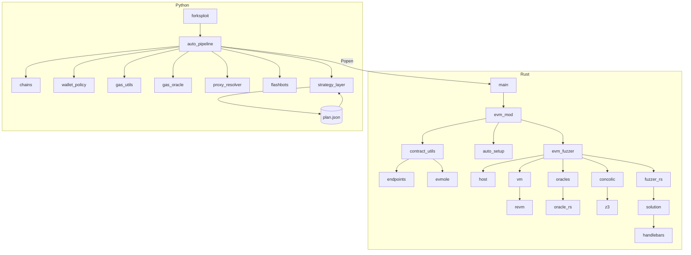

# ODVISNOSTI — zunanje, notranje in vrstni red izvajanja

> Samostojen dokument. Sorodno: [GRADNJA_IN_NAMESTITEV.md](GRADNJA_IN_NAMESTITEV.md),
> [RUST_JEDRO.md](RUST_JEDRO.md), [PYTHON_PLAST.md](PYTHON_PLAST.md).

Vse različice so iz `Cargo.toml` / `Cargo.lock` / `requirements.txt`.

---

## 1. Zunanje odvisnosti — Rust (`Cargo.toml`)

| Paket | Različica | Namen |
|-------|-----------|-------|
| `revm` | git `forksploit/revm` rev `1dead51` (verzija 3.3.0 v lock) | EVM; features `no_gas_measuring`, `serde`, `memory_limit` |
| `revm-primitives` | isti git/rev | primitivi |
| `revm-interpreter` | isti git/rev | interpreter |
| `libafl` | `=0.11.2` | fuzzer framework (pin) |
| `libafl_bolts` | `=0.11.2` | pomožno |
| `z3` | `0.21.1` | Z3 binding |
| `z3-sys` | `0.13.1` | Z3 FFI (linka sistemski Z3) |
| `clap` | `4.6.7` (derive) | CLI |
| `serde` | `1.0.147` | serializacija |
| `serde_json` | `1.0.73` | JSON |
| `serde_traitobject` | `0.2.8` (patched v `vendor/`) | serde za `dyn` |
| `ethers` | `2.0.14` | Ethereum tipi |
| `alloy-sol-types` | `1.7.3` | ABI |
| `alloy-dyn-abi` | `1.7.3` (arbitrary, eip712) | dinamični ABI |
| `alloy-primitives` | `1.7.3` | primitivi |
| `alloy-json-abi` | `1.7.3` | JSON ABI |
| `handlebars` | `6.4.4` | predloge Solidity |
| `evmole` | `0.9.4` | dekompilacija ABI |
| `reqwest` | `0.13.5` (blocking, json) | HTTP/RPC |
| `primitive-types` | `0.14.0` | U256/H160 |
| `bytes` | `1.2.1` | bajti |
| `hex` | `0.4` | hex |
| `rand` | `0.8.5` | RNG |
| `rlp` | `0.5.2` | RLP |
| `rust-crypto` | `0.2` | sha3 |
| `itertools` | `0.10.2` | iteratorji |
| `once_cell` | `1.8.0` | lazy statike |
| `either` | `1.8.0` | Either |
| `regex` | `1` | regex |
| `typetag` | `0.2.13` | serde za trait objekte |
| `lazy_static` | `1.4.0` | statike |
| `anyhow` | `1.0` | napake |
| `thiserror` | `2.0.21` | napake |
| `tracing` | `0.1` | logiranje |
| `tracing-subscriber` | `0.3` | logiranje |
| `colored` | `2.0` | barve |
| `semver` | `1.0.28` | različice |
| `retry` | `2.0.0` | ponovitve |
| `glob` | `0.3.0` | glob |
| `criterion` | `0.7.0` (dev) | primerjalni testi |

**Posebnost — `serde_traitobject`:** zadnja izdaja (`0.2.9`) ima tri
pointer-caste, ki jih novejši rustc zavrne (E0804). Ker upstream ni
vzdrževan, `Cargo.toml` vsebuje:

```toml
[patch.crates-io]
serde_traitobject = { path = "vendor/serde_traitobject-0.2.9-patched" }
```

Vendor mapa: `vendor/serde_traitobject-0.2.9-patched`.

**Git podmoduli** (`.gitmodules`): `tests/evm_manual/foundry1/lib/forge-std`,
`tests/evm_manual/foundry1/lib/openzeppelin-contracts`,
`tests/evm_manual/foundry/lib/forge-std`.

---

## 2. Zunanje odvisnosti — Python (`onchain_scripts/requirements.txt`)

| Paket | Zahteva |
|-------|---------|
| `requests` | `>=2.28.1` |
| `retry` | `>=0.9.2` |
| `web3` | `>=8.0` |
| `fastapi` | `>=0.110` |
| `uvicorn[standard]` | `>=0.29` |

Dodatno se uporabljata `eth_abi` in `eth_account` (tranzitivno prek `web3`).
Testi zahtevajo `pytest` (CI ga namesti ločeno).

---

## 3. Zunanja orodja (ne-paketi)

| Orodje | Uporaba | Obvezno? |
|--------|---------|----------|
| `anvil` (Foundry) | pre-flight fork | ne (opcijsko) |
| `solc` 0.8.24 | prevod `.sol` | za `.sol` cilje |
| `cast` (Foundry) | `proof_w1_w2_w3.sh` | samo za dokazni skript |
| `slither` | statična analiza | ne |
| `git`, `curl` | build/preflight | da |

---

## 4. Notranje odvisnosti (Rust)

```
main.rs
 └── evm/mod.rs (evm_main)
      ├── const.rs
      ├── evm/config.rs
      ├── evm/onchain/endpoints.rs (Chain)
      ├── evm/contract_utils.rs ── evm/onchain/*, evm/blaz/*
      ├── evm/auto_setup.rs ── evm/setup.rs, evm/contract_utils.rs
      ├── evm/solution/mod.rs (init_cli_args)
      └── fuzzers/evm_fuzzer.rs
           ├── evm/host.rs
           ├── evm/corpus_initializer.rs ── evm/contract_utils.rs
           ├── evm/vm.rs ── revm
           ├── evm/oracles/* ── evm/oracle.rs, evm/host.rs
           ├── evm/concolic/* ── evm/host.rs, z3
           ├── evm/middlewares/*
           ├── fuzzer.rs ── evm/solution/mod.rs
           │                 └── evm/solution/script_generator.rs ── evm/host.rs
           └── oracle.rs, feedback.rs, state.rs, scheduler.rs
```

`src/evm/mod.rs` je modul, ki zna največ: sestavi vse skupaj.

---

## 5. Notranje odvisnosti (Python)

```
forksploit.sh
 └── auto_pipeline.py
      ├── chains.py
      ├── wallet_policy.py ── chains.py
      ├── gas_utils.py ── chains.py
      ├── gas_oracle.py
      ├── proxy_resolver.py
      ├── flashbots_bundle.py
      └── strategy_layer.py (ne importa auto_pipeline)
 batch_pipeline.py ── auto_pipeline.py, chains.py, wallet_policy.py,
                      gas_utils.py, strategy_layer.py
 monitor.py ── chains.py, wallet_policy.py, gas_utils.py, auto_pipeline.py
 dashboard_server.py ── auto_pipeline.py, chains.py, wallet_policy.py
 triage_findings.py ── strategy_layer.py
 materialize_plan.py
```

`strategy_layer.py` namenoma **ne** importa `auto_pipeline` (izogib krožnemu
importu); `execute_plan` prejme kot parameter.

---

## 6. Vrstni red zagona

1. `forksploit.sh`: `load_chains`, `load_settings`, `check_env`.
2. `auto_pipeline.main`: parse → `require_mainnet_confirmation` → `Tee` →
   `make_w3` → `verify_rpc_identity` → `Account.from_key` →
   `enforce_wallet_policy`.
3. Cilj: `compile_contract`/`deploy` ali obstoječi naslov →
   `register_contract` → `get_or_deploy_attack_wallet` →
   `resolve_proxy_chain`.
4. `run_fuzzer` (Popen Rust).
5. `report_coverage` → `load_findings` → `ordering_key` →
   `report_unexecuted_findings` → `report_surface_triage`.
6. `_start_fork` → za vsak plan `estimate_plan_gas_on_fork` →
   `gated_execute_plan`.
7. `strategy_layer.run_chain_attempts`.
8. Končno poročilo; `tee.close()`.

Rust stran (znotraj koraka 4): `main` → `evm_main` → naložitev tarče →
`evm_fuzzer` → `fuzz_loop`.

---

## 7. Diagram odvisnosti (celotno)



---

## 8. Odprto / neizmerjeno

* **Nepreverjeno:** ali so vse tranzitivne odvisnosti na voljo v vseh
  okoljih; `Cargo.lock` je prisoten, a ta dokument ne navaja celotnega drevesa.
* **Neizmerjeno:** velikost builda, časi prevajanja in velikost binarne
  datoteke niso del tega dokumenta.
* `reqwest` `0.13.5` je v `Cargo.toml`; `Cargo.lock` je treba brati za
  natančne tranzitivne različice.
