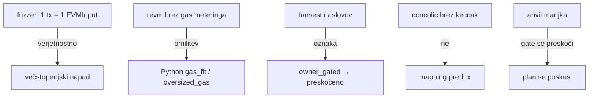

# OMEJITVE — kaj sistem ne zna (iz kode)

> Samostojen dokument. Sorodno: [ARHITEKTURA.md](ARHITEKTURA.md),
> [ORAKLI.md](ORAKLI.md), [VARNOSTNI_MODEL.md](VARNOSTNI_MODEL.md),
> [ZDRAVLJENJE_NAPAK.md](ZDRAVLJENJE_NAPAK.md).

Pravilo R3: omejitev se **zapiše**, ne skrije. Ta dokument je izpeljan iz
kode; vsaka točka navaja sklic na kodo.

---

## 1. Izvedbeni model

### 1.1 `revm` fork ne meri gasa
`Cargo.toml` uporablja `revm` iz `forksploit/revm` rev `1dead51` s feature
`no_gas_measuring`. Model torej ne meri plina. Posledica: plan, ki v
simulaciji uspe, lahko na verigi prekorači `block.gasLimit`.

Omilitev v Pythonu: `gas_utils.estimate_gas_limit` + `gas_fit` +
`gas_oversized_reason` (status `oversized_gas`). **Kaj manjka:** merjenje je
na Python strani in zahteva dosegljiv fork; brez forka polja
`fits_block_gas_limit` ni in `gas_oversized_reason` vrne `None` (ne ugiba).

### 1.2 Ni mempoola, vrstnega reda ali front-runninga
V kodi ni nobenega modela mempoola, sandwich/backrun ali MEV. Flashbots
bundle (`flashbots_bundle.py`) je le mehanizem za **dostavo** zaporedja kot
enega bundla, ne model trga.

### 1.3 Concolic je ozek
`src/evm/concolic/*` podpira simbolično calldata, `callvalue`, `caller`,
`origin` in memory. Iz kode:

* **Zaprto:** simbolični storage je ključen po naslovu pogodbe
  (`ConcolicHost::symbolic_state`), obstojen čez klice.
* **Zaprto:** simbolične vrnjene vrednosti `CALL`/`STATICCALL`/`DELEGATECALL`
  v isti transakciji (`return_bytes`, `insert_bytes`).
* **ŠE ODPRTO:** `keccak256` v concolic hostu je `concrete_eval!` (ni
  modeliran). Zato mapping vnos, ki je obstajal **že pred transakcijo**
  (`require(m[k] == 1)` za napadalčev `k`), ostane nedosegljiv — obrniti bi
  bilo treba hash.
* **ŠE ODPRTO:** simbolični `CALL` target in simbolične bilance.
* **Zanesljivost:** pri veliki konstanti rešitev potrebuje več kot privzetih
  `--concolic-timeout 1000` ms.

### 1.4 Enota fuzzinga je ena transakcija
`EVMInput` (`src/evm/input.rs`) je **ena** transakcija. Večkoračno vedenje
nastane šele čez genealogijo korpusa (`TxnTrace::from_idx`) in ponovno
predvajanje v `cov_stage`/`minimizer`. Za razrede, ki zahtevajo natančno
sekvenco, je doseg verjetnosten, ne planski. V kodi **ni** splošnega
simboličnega planerja.

---

## 2. Napadalec vs. privilegirana stranka

### 2.1 Harvest heuristika ostaja (namerno)
`src/evm/host.rs` beleži naslove, prebrane iz storage tarče
(`HARVESTED_STORAGE_ADDRESSES`, `HARVESTED_ADDRESS_ORIGINS`,
`HARVESTED_SENDER_GUARDS`). Fuzzer lahko "postane" naslov iz storage
(`require(msg.sender == owner)`), kar ni napad zunanjega akterja.

Omilitev: plani se označijo (`owner_impersonation`, `owner_gated`) in
Python jih **preskoči** (`metadata_skip_reason`) in prikaže kot blockerje
(`build_proof`). **Kaj manjka:** splošnejši semantični test poljubnega
privilegiranega pogoja, ne le "naslov iz lastnega storage-a".

---

## 3. Izvedba in dokaz

### 3.1 `sim-confirmed` je le simulacija
`src/evm/oracle.rs::ConfidenceTier::as_str` vrne `"sim-confirmed"` /
`"sim-review"`, nikoli golo `"confirmed"`. Šele Python-ov `PLAN_CONFIRMED`
(merjen dvig recovery denarnice) je dokaz. V kodi ni polja `severity`/CVSS.

### 3.2 Ni enotne sheme dokaza za cel tek
`build_proof` vrne `Proof` **na plan**. Ni agregata čez vse plane v enem
stroju (vsota je le v dnevniku, `auto_pipeline.main`).

### 3.3 Pre-flight je "best-effort"
`_start_fork` vrne `(None, None)`, če anvil ni nameščen ali se ne dvigne;
`simulate_plan_on_fork` vrne `None`, če simulacije ni mogoče odločiti. V tem
primeru vrata ne blokirajo — plan se poskusi. Zato pre-flight nikoli ne
ustavi teka, le zmanjša porabo.

### 3.4 Zanesljivost fork replaya
`simulate_plan_on_fork` uporablja `evm_snapshot`/`evm_revert` in
`anvil_setBalance`. Če fork ni dosegljiv ali RPC vrne napako, se vrneta
`None` in gate se preskoči.

---

## 4. Zanesljivost kode

### 4.1 `.unwrap()`/`.expect()` na zunanjih podatkih
Večina meja je utrjena (glej `AGENTS.md`), a ostajajo `.unwrap()`/`.expect()`
zunaj `#[cfg(test)]`. Iskanje po `src/**` najde še mnoge
`.unwrap()`/`.expect()`, med njimi na vhodih, kot so:
* `src/evm/mod.rs::evm_main` — `reqwest::blocking::get(...).unwrap()` pri
  `--fetch-tx-data`; `hex::decode(...).unwrap()`; `rlp::decode(...).unwrap()`;
  `EVMAddress::from_str(...)` za `--only-fuzz` uporablja `unwrap_or_else` z
  `exit(1)` (to je namerno).
* `src/evm/contract_utils.rs::from_config`/`from_setup` — `.expect(...)` na
  manjkajočih artefaktih.
* `src/fuzzers/evm_fuzzer.rs` — `.unwrap()` na branju state-comp datoteke.

**Kaj manjka:** `clippy::unwrap_used` kot lint v CI, da ostanek ne raste.

### 4.2 `File name too long`
Odpravljeno v `src/fuzzer.rs::vuln_file_base` (ime omejeno na 120 bajtov +
hash). Dumpi uporabljajo `error!` namesto `unwrap`.

---

## 5. Večjedrnost in concolic

### 5.1 Multi-core je procesna izolacija
`src/evm/multicore.rs` uporablja **procese** (`--jobs N`), ne niti, ker
`EVMFuzzState` ni `Send` in so mape `RacyCell` varne le ob enovitosti
(`src/sync_utils.rs`). `--jobs` je clampan na število jeder
(`clamp_jobs_to_cores`).

**Neizmerjeno:** hitrostni faktor "N jeder → ~N-krat več primerov/s" ni
izmerjen v tem dokumentu.

### 5.2 Concolic strop je 2
`src/const.rs::MAX_CONCOLIC_THREADS = 2`; `max_concolic_threads()` vrne
`min(2, cores)`. `--concolic-num-threads` je spoštovan do stropa, več se
odreže. `--jobs` si strop **deli** (`per_job_concolic_threads`). Pri več jobih
kot je strop (npr. `--jobs 4`, strop 2) ima vsak delavec še vedno vsaj enega
reševalca, zato je skupno število enako številu jobov, ne `N * strop`.

---

## 6. Poročanje

### 6.1 Ni `severity`/CVSS
Obstajajo `confidence`, `net_profit_wei`, `gas_spent_wei`,
`recovery_delta_wei` in predikat `chain-verified`
(`is_chain_verified(status, recovery_delta_wei)`). Strukturiranega polja
`severity`/CVSS ni.

### 6.2 Neoznačeni ABI
Če tarča nima ABI-ja, Rust uporabi EVMole dekompilacijo
(`src/evm/onchain/abi_decompiler.rs::fetch_abi_evmole`). Kakovost je odvisna
od dekompilatorja.

---

## 7. Verige in funkcije, ki niso pokrite

### 7.1 Mrtve testne mreže
`goerli`, `mumbai`, `zkevm_testnet` so v Rust `Chain` enum in Python
`CHAIN_IDS`, a **niso** v Python `DEFAULT_RPC` (`chains.py`). Python orodja
teh verig ne morejo uporabiti brez override-a.

### 7.2 Flashloan pokriva le `flat` na nekaterih verigah
Flashloan-funding pot je omejena na `kind == "flat"` in verige v **obeh**
tabelah `AAVE_V3_POOLS` in `WETH_ADDRESSES` (`eth`, `sepolia`). ETC/Mordor
sta namenoma odsotna.

### 7.3 Flashbots le na `eth` in `sepolia`
`flashbots_bundle.RELAY_URLS` pokriva samo ti dve verigi. BSC ima
eno-transakcijski zasebni mempool redirect (`PRIVACY_REDIRECT_RPC`), ne
atomičnega bundla.

---

## 8. Znanstvena poštenost: česa namenoma NE trdimo

* **Ne trdimo, da je pogodba brez ranljivosti**, kadar ni najdb. "Ni najdeno"
  pomeni "ni najdeno v tem proračunu s temi orakli". Python to izrazi z
  `SCAN_NO_BUG_BOUNDED` / `SCAN_INSUFFICIENT_COVERAGE` in pragovi
  (`MIN_COVERAGE_PCT_FOR_NEGATIVE_RESULT = 80.0`,
  `MIN_FUZZ_SECONDS_FOR_NEGATIVE_RESULT = 300`, `--detectors all`).
* **Ne trdimo, da je najdba resnična, dokler se sredstva ne premaknejo.**
  `sim-confirmed` je simulacija; šele `PLAN_CONFIRMED` je dokaz.
* **Ne trdimo, da control-leak sled odraža realno verigo.** Taka sled se
  nikoli ne predstavi kot `sim-confirmed` (`build_plan_meta`,
  `effective_confidence`).

---

## 9. Diagram: kje omejitve vplivajo

---

## 10. Odprto / neizmerjeno

* **Neizmerjeno:** hitrostni faktor večjedrnega teka.
* **Neizmerjeno:** koliko najdb se izgubi zaradi 1.4 (ena transakcija) — v
  kodi so opisani primeri, ne sistematične meritve.
* **Nepreverjeno:** popolnost seznama `.unwrap()`/`.expect()` v §4.1; ta
  dokument navaja primere, ne popolnega popisa.
