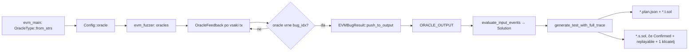

# ORAKLI — katalog oraklov in bug tipov

> Samostojen dokument. Sorodno: [RUST_JEDRO.md](RUST_JEDRO.md),
> [PLAN_JSON.md](PLAN_JSON.md), [OZICENJE_RUST_PYTHON.md](OZICENJE_RUST_PYTHON.md).

Orakel je modul, ki med fuzzingom opazuje izvedbo in ob zadetku vrne
`bug_idx` ter zapiše `EVMBugResult` v `ORACLE_OUTPUT`. Vsak oracle
implementira trait `Oracle` (`src/oracle.rs`). Vrednosti `bug_idx` so
konstante v `src/evm/oracles/mod.rs`.

---

## 1. Kako je oracle povezan s fuzzerjem

* Seznam oraklov se sestavi v `src/evm/mod.rs::evm_main` glede na
  `OracleType::from_strs(args.detectors)` in se shrani v `Config::oracle`.
* `src/fuzzers/evm_fuzzer.rs::evm_fuzzer` začne z `let mut oracles =
  config.oracle;` in nato doda še oracle, vezane na posamezne zastavice
  (`state_comp_oracle`, `math_calculate_oracle` → `IntegerOverflowOracle`,
  `delegatecall_injection_oracle`, `ecrecover_zero_oracle`,
  `arbitrary_storage_write_oracle`, `token_accounting_mismatch_oracle`,
  `forced_eth_accounting_oracle`, `readonly_reentrancy_oracle`,
  `storage_collision_oracle`, `delegatecall_target_oracle`,
  `uninitialized_memory_oracle`, `unchecked_call_oracle`,
  `unbounded_loop_oracle`, `stale_guard_oracle`, `self_referral_oracle`,
  `tx_origin_oracle`, `zero_address_setter_oracle`, `gas_stipend_oracle`,
  `weak_randomness_oracle`, `precision_loss_oracle`, `revert_in_loop_oracle`,
  `assert_violation_oracle`, `arbitrary_external_call`, `typed_bug`,
  `selfdestruct_oracle`, `reentrancy_oracle`).
* Orakel se sproži prek `OracleFeedback` (`src/oracle.rs`) po vsaki
  transakciji.
* `oracle_should_skip!` makro preveri `BugMetadata::known_bugs`, da se isti
  zadetek ne ponovi.

---

## 2. Preseta `--detectors`

`OracleType::from_strs` (`src/evm/mod.rs`) podpira:

* `all` — vseh 47 tipov (vključno `Invariant`).
* `high_confidence` — ožji seznam. Vsebuje: ERC20, Pair, Reentrancy,
  ArbitraryCall, TypedBug, SelfDestruct, Erc4626, AccessControl,
  SignatureReplay, SignatureMalleability, NftTransfer, ProxyIntegrity,
  ProxyUpgradeHijack, ArbTransfer, DelegatecallInjection, EcrecoverZero,
  ArbitraryStorageWrite, StorageCollision, DelegatecallTarget, TxOrigin,
  InitializerFrontRun, PreviewRounding, EthBacking, SelfReferral.
* Vejica-ločen seznam imen iz `OracleType::as_str` (npr.
  `--detectors reentrancy,access_control`).
* Neznano ime → `panic!("Invalid detector type: {}", s)`.

---

## 3. Katalog oraklov

Stolpec "bug_type" navaja niz(e), ki jih oracle zapiše v `EVMBugResult`.
Stolpec "nivo" je rezultat `oracle.rs::classify_confidence` za ta bug_type.

| # | bug_idx konstanta | Modul | `OracleType` | bug_type | nivo |
|---|-------------------|-------|--------------|----------|------|
| 0 | `ERC20_BUG_IDX` | `erc20.rs` | `erc20` | `Fund Loss` | Confirmed |
| 2 | `V2_PAIR_BUG_IDX` | `v2_pair.rs` | `pair` | `Imbalanced Uniswap Pair` | Confirmed |
| 4 | `TYPED_BUG_BUG_IDX` | `typed_bug.rs` | `typed_bug` | `Bug` | Confirmed |
| 5 | `SELFDESTRUCT_BUG_IDX` | `selfdestruct.rs` | `selfdestruct` | `Selfdestruct` | Confirmed |
| 7 | `STATE_COMP_BUG_IDX` | `state_comp.rs` | `state_comparison` | `state_comp` | Review |
| 8 | `ARB_CALL_BUG_IDX` | `arb_call.rs` | `arbitrary_call` | `Arbitrary Call` | Confirmed |
| 9 | `REENTRANCY_BUG_IDX` | `reentrancy.rs` | `reentrancy` | `Reentrancy` | Confirmed |
| 11 | `INTEGER_OVERFLOW_BUG_IDX` | `overflow.rs` | `math_calculate` | `Integer Overflow` | Review |
| 12 | `ERC4626_BUG_IDX` | `erc4626.rs` | `erc4626` | `ERC4626 Share Inflation` | Confirmed |
| 13 | `ACCESS_CONTROL_BUG_IDX` | `access_control.rs` | `access_control` | `Unauthorized Owner Change`, `Unauthorized Pause Toggle`, `Unauthorized Proxy Upgrade` | Confirmed |
| 14 | `SIGNATURE_REPLAY_BUG_IDX` | `signature_replay.rs` | `signature_replay` | `Signature Replay` | Confirmed |
| 15 | `NFT_TRANSFER_BUG_IDX` | `nft_transfer.rs` | `nft_transfer` | `Unauthorized NFT Transfer`, `Unauthorized ERC1155 Transfer` | Confirmed |
| 16 | `PROXY_INTEGRITY_BUG_IDX` | `proxy_integrity.rs` | `proxy_integrity` | `Proxy Reinitialization`, `Proxy Storage Collision` | Confirmed |
| 17 | `ARB_TRANSFER_BUG_IDX` | `arb_transfer.rs` | `arb_transfer` | `Unauthorized ERC20 Transfer` | Confirmed |
| 18 | `DELEGATECALL_INJECTION_BUG_IDX` | `delegatecall.rs` | `delegatecall_injection` | `Delegatecall Injection` | Confirmed |
| 19 | `ECRECOVER_ZERO_BUG_IDX` | `ecrecover.rs` | `ecrecover_zero` | `Unchecked ecrecover(0)` | Confirmed |
| 20 | `STORAGE_COLLISION_BUG_IDX` | `storage_collision.rs` | `storage_collision` | `Storage Collision` | Confirmed |
| 21 | `DELEGATECALL_TARGET_BUG_IDX` | `delegatecall_target.rs` | `delegatecall_target` | `Delegatecall Target From Calldata`, `Delegatecall Target From Calldata (Unconfirmed)` | prvi Confirmed, drugi Review |
| 22 | `UNINITIALIZED_MEMORY_BUG_IDX` | `uninitialized_memory.rs` | `uninitialized_memory` | `Uninitialized Memory Read` | Review |
| 23 | `UNCHECKED_CALL_BUG_IDX` | `unchecked_call.rs` | `unchecked_call` | `Unchecked Low-Level Call` | Review |
| 24 | `TX_ORIGIN_BUG_IDX` | `tx_origin.rs` | `tx_origin` | `Tx.Origin Phishing Bypass` | Confirmed |
| 25 | `INITIALIZER_FRONT_RUN_BUG_IDX` | `initializer_front_run.rs` | `initializer_front_run` | `Initializer Front-Running` | Confirmed |
| 26 | `CENTRALIZATION_RISK_BUG_IDX` | `centralization_risk.rs` | `centralization_risk` | `Centralization Risk: Owner-Only Function` | Review |
| 27 | `SIGNATURE_MALLEABILITY_BUG_IDX` | `signature_malleability.rs` | `signature_malleability` | `Signature Malleability` | Confirmed |
| 28 | `CURVE_VIRTUAL_PRICE_BUG_IDX` | `curve_virtual_price.rs` | `curve_virtual_price` | `Curve Virtual Price Decrease (Profit Confirmed)` / `Curve Virtual Price Decrease` | prvi Confirmed, drugi Review |
| 29 | `PRICE_FEED_STALENESS_BUG_IDX` | `price_feed_staleness.rs` | `price_feed_staleness` | `Price Feed Staleness` | Review |
| 30 | `TWAP_MANIPULATION_BUG_IDX` | `twap_manipulation.rs` | `twap_manipulation` | `TWAP Manipulation (Profit Confirmed)` / `TWAP Manipulation Precondition` | prvi Confirmed, drugi Review |
| 31 | `PREVIEW_ROUNDING_BUG_IDX` | `preview_rounding.rs` | `preview_rounding` | `ERC4626 Rounding Favors User` | Confirmed |
| 32 | `ETH_BACKING_BUG_IDX` | `eth_backing.rs` | `eth_backing` | `Insolvent: Promised Native Value Exceeds Real Balance` | Confirmed |
| 33 | `UNBOUNDED_LOOP_BUG_IDX` | `unbounded_loop.rs` | `unbounded_loop` | `Unbounded Loop` | Review |
| 34 | `STALE_GUARD_BUG_IDX` | `stale_guard.rs` | `stale_guard` | `Stale Guard Counter` | Review |
| 35 | `SELF_REFERRAL_BUG_IDX` | `self_referral.rs` | `self_referral` | `Validation-Independent Payment` | Confirmed |
| 36 | `ARBITRARY_STORAGE_WRITE_BUG_IDX` | `arbitrary_storage_write.rs` | `arbitrary_storage_write` | `Arbitrary Storage Write` | Confirmed |
| 37 | `TOKEN_ACCOUNTING_MISMATCH_BUG_IDX` | `token_accounting_mismatch.rs` | `token_accounting_mismatch` | `Token Accounting Mismatch` | Review |
| 38 | `FORCED_ETH_ACCOUNTING_BUG_IDX` | `forced_eth_accounting.rs` | `forced_eth_accounting` | `Forced Native Value Accounting` | Review |
| 39 | `READONLY_REENTRANCY_BUG_IDX` | `readonly_reentrancy.rs` | `readonly_reentrancy` | `Read-Only Reentrancy` | Review |
| 40 | `ZERO_ADDRESS_SETTER_BUG_IDX` | `zero_address_setter.rs` | `zero_address_setter` | `Zero Address Setter` | Review |
| 41 | `GAS_STIPEND_BUG_IDX` | `gas_stipend.rs` | `gas_stipend` | `Hardcoded Gas Stipend` | Review |
| 42 | `WEAK_RANDOMNESS_BUG_IDX` | `weak_randomness.rs` | `weak_randomness` | `Weak Randomness` | Review |
| 43 | `PRECISION_LOSS_BUG_IDX` | `precision_loss.rs` | `precision_loss` | `Precision Loss` | Review |
| 44 | `REVERT_IN_LOOP_BUG_IDX` | `revert_in_loop.rs` | `revert_in_loop` | `Revert In Loop (DoS)` | Review |
| 45 | `ASSERT_VIOLATION_BUG_IDX` | `assert_violation.rs` | `assert_violation` | `Assert Violation` | Review |
| 46 | `PROXY_UPGRADE_HIJACK_BUG_IDX` | `proxy_upgrade_hijack.rs` | `proxy_upgrade_hijack` | `Unprotected Proxy Upgrade (UUPS)` | Confirmed |
| 47 | `UNBACKED_MINT_BUG_IDX` | `unbacked_mint.rs` | `unbacked_mint` | `Unbacked Mint (Supply Growth Without Backing)` | Review |
| 48 | `FORGED_PROOF_BUG_IDX` | `forged_proof.rs` | `forged_proof` | `Forged Proof (Caller-Supplied Root Accepted)` | Review |
| 49 | `TRANSIENT_GUARD_BUG_IDX` | `transient_guard.rs` | `transient_guard` | `Transient Guard Released Before External Call` | Review |
| 50 | `INVARIANT_BUG_IDX` | `invariant.rs` | `invariant` | `Invariant Violation` | Confirmed |

Opombe:

* Nivo je določen s `oracle.rs::classify_confidence`, ki ga ta tabela
  povzema. Za nekatere tipe nivo **ni** 1:1 na `OracleType`: `twap_manipulation`
  in `curve_virtual_price` imata po dva bug tipa (osnovni Review, "(Profit
  Confirmed)" Confirmed).
* `high_confidence` preset vsebuje natanko te `OracleType`: ERC20, Pair,
  Reentrancy, ArbitraryCall, TypedBug, SelfDestruct, Erc4626, AccessControl,
  SignatureReplay, SignatureMalleability, NftTransfer, ProxyIntegrity,
  ProxyUpgradeHijack, ArbTransfer, DelegatecallInjection, EcrecoverZero,
  ArbitraryStorageWrite, StorageCollision, DelegatecallTarget, TxOrigin,
  InitializerFrontRun, PreviewRounding, EthBacking, SelfReferral.
  Vsi ostali orakli (`unbacked_mint`, `forged_proof`, `transient_guard`,
  `readonly_reentrancy`, `token_accounting_mismatch`,
  `forced_eth_accounting`, `zero_address_setter`, `gas_stipend`,
  `weak_randomness`, `precision_loss`, `revert_in_loop`, `assert_violation`,
  `unbounded_loop`, `stale_guard`, `centralization_risk`,
  `price_feed_staleness`, `twap_manipulation`, `curve_virtual_price`,
  `uninitialized_memory`, `unchecked_call`, `math_calculate`) so v `all`, ne
  pa v `high_confidence`.
* Nivo `Confirmed` tu pomeni **simulacijsko** potrjeno (`sim-confirmed`), ne
  potrjeno na verigi. To je ločnica, ki jo dokumentira
  [OZICENJE_RUST_PYTHON.md](OZICENJE_RUST_PYTHON.md).

---

## 4. Deklarativni invariantni oracle (`--invariants`)

`src/evm/oracles/invariant.rs` omogoča uporabniku, da izrazi lastno
ekonomsko invarianto v JSON datoteki.

Format:

```json
{ "invariants": [
  { "name": "vault solvent",
    "op": "le",
    "lhs": { "sum_over_callers": { "sig": "balances(address)" } },
    "rhs": { "native_balance": true } }
] }
```

Operandi:
* `{"native_balance": true}` — realno stanje tarče;
* `{"literal": "1000"}` — decimalna ali `0x` konstanta;
* `{"call": {"sig": "...", "args": ["$caller", "0x..", "123"]}}` — statični
  klic; `$caller` je klicatelj transakcije;
* `{"sum_over_callers": {"sig": "balanceOf(address)"}}` — klic enkrat na
  opaženega klicatelja, sešteto.

Operacije: `le`, `lt`, `ge`, `gt`, `eq`, `ne`.

Kršitev se poroča kot `Invariant Violation` (Confirmed-tier). Če datoteka ne
uspe razčleniti, `evm_main` izpiše `error!` in **nobenih** uporabniških
invariant se ne preveri (ne tiho).

---

## 5. Diagram: pot orakla do plan.json



---

## 6. Odprto / neizmerjeno

* **Nepreverjeno:** ali je seznam Review-tier tipov popoln glede na vse
  možne nize, ki jih orakli zapišejo. Tabela je izpeljana iz
  `classify_confidence` in `oracles/*.rs`; za tip, ki ni v `classify_confidence`,
  `classify_confidence` privzeto vrne `Review`.
* **Neizmerjeno:** ta dokument ne navaja, kako pogosto posamezen oracle
  zadene; to so meritve, ne del tega dokumenta.
* `state_comp` bug tip je dobesedno niz `"state_comp"`, ne opisno ime
  (`src/evm/oracles/state_comp.rs`).
