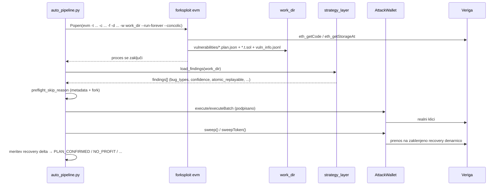
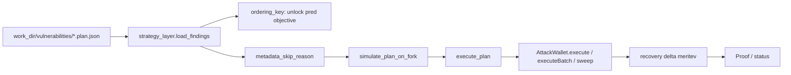

# OŽIČENJE RUST ↔ PYTHON — kontrakt med plastema

> Samostojen dokument. Sorodno: [ARHITEKTURA.md](ARHITEKTURA.md),
> [TOK_PODATKOV.md](TOK_PODATKOV.md), [PLAN_JSON.md](PLAN_JSON.md),
> [ZDRAVLJENJE_NAPAK.md](ZDRAVLJENJE_NAPAK.md).

Ta dokument opisuje **vsak stik** med Rust in Python plastjo, z natančnim
sklicem na kodo. Vsaka trditev je preverjena v kodi.

---

## 1. Povzetek kontrakta

| Stik | Smer | Mehanizem | Koda |
|------|------|-----------|------|
| Zagon fuzzerja | Python → Rust | `subprocess.Popen` z argv | `onchain_scripts/auto_pipeline.py::run_fuzzer` |
| RPC naslov | Python → Rust | okoljska spremenljivka `ETH_RPC_URL` | `src/evm/onchain/endpoints.rs::Chain::get_chain_rpc` |
| Delovna mapa | Python → Rust | `-w <work_dir>` | `src/evm/mod.rs::EvmArgs::work_dir` |
| Najdbe (plan) | Rust → Python | `work_dir/vulnerabilities/*.plan.json` | `src/evm/solution/script_generator.rs::write_plan` |
| Reprodukcija | Rust → Python | `work_dir/vulnerabilities/*.t.sol` | `src/evm/solution/mod.rs::generate_test_with_full_trace` |
| Atomični PoC | Rust → Python | `work_dir/vulnerabilities/*.s.sol` | `src/evm/solution/script_generator.rs::generate_script` |
| Zbirni dnevnik najdb | Rust → Python | `work_dir/vuln_info.jsonl` | `src/fuzzer.rs::evaluate_input_events` |
| Pokritost | Rust → Python | `work_dir/coverage.txt` | `src/evm/middlewares/coverage.rs::dump_file` |
| Povratna zanka (plin) | Python → Rust | Python napiše polja nazaj v `plan.json` | `onchain_scripts/auto_pipeline.py::main` |

---

## 2. Kako Python požene Rust binarij

Funkcija: `onchain_scripts/auto_pipeline.py::run_fuzzer(target_address, chain,
detectors, fuzz_seconds, work_dir, tee, extra_targets)`.

Binarij: `REPO_ROOT / "target" / "release" / "forksploit"`, kjer je
`REPO_ROOT = onchain_scripts/../` (`auto_pipeline.py:78-79`).

Zgrajeni argv (dobesedno iz kode, `run_fuzzer`):

```
target/release/forksploit evm
    -t  <target_address>[,<impl1>,<impl2>...]     # -t / --target
    -c  <chain>                                    # -c / --chain-type
    -f                                             # --flashloan  (kratka `-f` iz polja `flashloan`)
    -d  <detectors>                                # -d / --detectors
    -w  <work_dir>                                 # -w / --work-dir
    --run-forever
    --concolic
    --concolic-caller
    [--spec-id Shanghai]                           # samo za chain v ("etc","mordor")
```

Nato se doda okolje: `env["ETH_RPC_URL"] = get_rpc_url(chain)`.

Opombe, preverjene v kodi:

* `-t` je **ena** vrednost, ki je vejica-združena lista. `all_targets =
  [target_address] + extra_targets`, nato `",".join(all_targets)`.
  `extra_targets` so implementacije proxyja iz
  `proxy_resolver.resolve_proxy_chain` (`auto_pipeline.py::main`).
* `--run-forever` je nujen, ker bi se brez njega binarij ustavil ob **prvi**
  najdbi (`src/fuzzer.rs`: `if !RUN_FOREVER.load(...) { exit(0); }`). Zato
  `work_dir/vulnerabilities/` dobi več kot en `*.plan.json` na tek.
* `--concolic` in `--concolic-caller` sta eksplicitna izbira natančnosti
  (Z3) pred hitrostjo.
* `--spec-id Shanghai` se doda **samo** za `etc` in `mordor`; drugi verigi
  uporabita privzeti `Latest` (`src/evm/mod.rs::EvmArgs::spec_id`).

Proces se zažene s `cwd=str(REPO_ROOT)`; stdout+stderr se združita
(`stderr=subprocess.STDOUT`) in se vrstico-po-vrstico prelivata v dnevnik z
predpono `[fuzzer]`.

### 2.1 Prekinitev po času

`run_fuzzer` meri pretečeni čas in ob `time.time() - start > fuzz_seconds`
pošlje `proc.terminate()` (nato `proc.kill()` po 10 s). Vrne **dejansko**
trajanje (`time.time() - start`), ki ga `determine_negative_result_verdict`
uporabi namesto zahtevanega proračuna.

### 2.2 Kako Python zazna uspeh/neuspeh fuzzerja

Python **ne** interpretira izhodne kode Rust binarija kot signal o najdbi:

* `run_fuzzer` prebere izhodni tok in vrne trajanje; ne preverja
  `proc.returncode` za uspeh.
* Prisotnost najdb se ugotovi iz **datotek** na disku:
  `strategy_layer.load_findings(work_dir)` prebere
  `work_dir/vulnerabilities/*.plan.json`; `vuln_info.jsonl` se prebere v
  `report_unexecuted_findings`.
* Če Rust proces umre zgodaj, to vodi v manjkajoč `coverage.txt` →
  `determine_negative_result_verdict` vrne `insufficient_coverage`
  (`onchain_scripts/auto_pipeline.py`).

Exit kode Rust binarija (iz kode):

| Mesto | Koda | Pogoj |
|-------|------|-------|
| `src/fuzzer.rs::evaluate_input_events` | `exit(0)` | najdena ranljivost brez `--run-forever` |
| `src/fuzzers/evm_fuzzer.rs` | `exit(1)` | `fuzz_loop` vrne napako (npr. prazna korpus) |
| `src/evm/multicore.rs::run_supervisor` | vrnjen `i32` | nadzornik večopravilnega teka (`--jobs`) |
| `src/evm/mod.rs::evm_main` | `std::process::exit(code)` | ko je `--jobs > 1` (nadzornik) |

---

## 3. Datotečni kontrakt: kaj Rust izpiše

Vse pod `work_dir` (privzeto `work_dir`, Python pa uporablja
`onchain_scripts/auto_work/<run_id>`).

### 3.1 `work_dir/vulnerabilities/*.plan.json`

Zapiše ga `src/evm/solution/script_generator.rs::write_plan`. Ime datoteke je
`{contract_name}.plan.json`, kjer `contract_name` vključuje unikaten števec
(`{make_contract_name}_{N}`, `src/evm/solution/mod.rs::BUG_COUNTER`), da si
različne najdbe na isti tarči ne prepišejo dokazov.

Shema je dokumentirana v [PLAN_JSON.md](PLAN_JSON.md). Polja, ki jih Python
bere (`strategy_layer.load_findings` + `auto_pipeline`):

| Polje | Tip | Vir v Rustu | Uporaba v Pythonu |
|-------|-----|-------------|-------------------|
| `contract_name` | str | `TemplateArgs::contract_name` | identifikator, `ordering_key` |
| `kind` | `"flat"` \| `"reentrancy"` | `generate_exploit_plan` / `generate_reentrancy_exploit_plan` | izbira poti izvedbe |
| `needs_funding` | bool | `TemplateArgs::needs_funding` | informativno; `execute_plan` vsoto izračuna sam |
| `total_value` | str (wei) | seštevek `Tx::value` | informativno |
| `steps[]` | sez. PlanStep | minimizirana sled | dejanski koraki izvedbe |
| `full_trace_steps[]` | sez. PlanStep | neminimizirana sled | `_steps_of` prednost pri združevanju |
| `repeat_step` | PlanStep \| null | `split_reentrant_trace` | reentrancy arm |
| `bug_types[]` | sez. str | `parse_bug_report` | klasifikacija unlock/objective |
| `confidence` | `sim-confirmed`/`sim-review` | `build_plan_meta` | `ordering_key`, filter |
| `confirmed_exploitable` | bool | `is_confirmed_exploitable_bug` | `metadata_skip_reason` |
| `atomic_replayable` | bool | `!requires_control_leak` | `metadata_skip_reason`, `_is_chainable` |
| `requires_control_leak` | bool | `trace_depends_on_control_leak` | triage |
| `distinct_callers` | int | `callers.len()` | `metadata_skip_reason` |
| `callers[]` | sez. str | `Tx::caller` | triage |
| `owner_impersonation` | bool | `is_harvested_storage_address` | `metadata_skip_reason` |
| `owner_impersonation_detail[]` | sez. `{caller, harvested_from_contract, harvested_from_slot}` | `harvested_address_origin` | poročilo |
| `owner_gated` | bool | `is_harvested_sender_for` | `metadata_skip_reason`, `build_proof` |
| `owner_gated_detail[]` | sez. ImpersonatedCaller | `is_harvested_sender_for` | poročilo |
| `step_count` | int | `trace.len()` | `ordering_key` |
| `target` | str | `CliArgs::target` | poročilo |
| `chain` | str | `CliArgs::chain` | poročilo |

PlanStep polja (`src/evm/solution/script_generator.rs::PlanStep`):
`contract`, `calldata`, `value`, `caller`, `fn_selector`, `stolen_asset`
(nullable), `call_leak` (u32; `u32::MAX` = brez control leaka).

### 3.2 `work_dir/vulnerabilities/*.t.sol`

Reprodukcijski Foundry test. Zapiše
`src/evm/solution/mod.rs::generate_test_with_full_trace` prek predloge
`src/evm/solution/foundry_test.hbs`. Uporablja `vm.prank`/`vm.deal`
(Foundry-only cheatcode), zato ni izvedljiv na realni verigi.

### 3.3 `work_dir/vulnerabilities/*.s.sol`

Atomični `forge script` PoC. Zapiše
`src/evm/solution/script_generator.rs::generate_script` (predloga
`foundry_script.hbs`) ali `generate_reentrancy_script`
(`foundry_script_reentrancy.hbs`). Nastane **samo**, kadar je najdba
`Confirmed`-tier, sled ni odvisna od control leaka in ima enega samega
klicatelja (`src/evm/solution/mod.rs::generate_test_with_full_trace`).

### 3.4 `work_dir/vuln_info.jsonl`

Vsaka vrstica je JSON `EVMBugResult::to_value`
(`src/evm/oracle.rs`): `bug_type`, `bug_info`, `input`, `sourcemap`,
`issue_source`, `bug_idx`, `confidence`, `evidence`. Zapiše ga
`src/fuzzer.rs::evaluate_input_events`.

### 3.5 `work_dir/coverage.txt`

Zapiše `src/evm/middlewares/coverage.rs::dump_file`. Vsebuje vrstice
`Instruction Coverage: X/Y (Z%)` in `Branch Coverage: ...`, ki jih
`report_coverage` (`auto_pipeline.py`) razčleni.

### 3.6 Drugo

* `work_dir/abis.json` — preslikava naslov → ABI (`src/evm/mod.rs::evm_main`).
* `work_dir/traces/` — sledi korpusa (`src/evm/cov_stage.rs`, polje
  `trace_dir`).
* `work_dir/vulnerabilities/<idxs>` in `<idxs>_replayable` — surova sled
  (feature `print_txn_corpus`, `src/fuzzer.rs::vuln_file_base`).

---

## 4. Kje Python prebere plan

`onchain_scripts/strategy_layer.py::load_findings(work_dir)`:

```python
vulnerabilities_dir = work_dir / "vulnerabilities"
for plan_path in sorted(vulnerabilities_dir.glob("*.plan.json")):
    plan = json.loads(plan_path.read_text())
    ...
```

Vrne seznam slovarjev z metapodatki, ki jih Python dejansko uporablja:

| Polje v `findings[i]` | Vir v plan.json | Privzetek, če manjka |
|-----------------------|-----------------|----------------------|
| `contract_name` | `contract_name` | (obvezno) |
| `plan_path` | pot datoteke | — |
| `plan` | celoten slovar | — |
| `bug_types` | `bug_types` | fallback: branje `{contract_name}.t.sol` |
| `kind` | `kind` | `None` |
| `needs_funding` | `needs_funding` | `False` |
| `atomic_replayable` | `atomic_replayable` | `True` |
| `distinct_callers` | `distinct_callers` | `1` |
| `step_count` | `step_count` | `len(steps)` |
| `confirmed_exploitable` | `confirmed_exploitable` | `True` |

Fallback za `bug_types`: če plan nima polja, `load_findings` razčleni
`{contract_name}.t.sol` z regularnim izrazom
`_CONFIRMED_BUG_TYPE_RE = re.compile(r"^\[(.+?)\]\s*\((?:sim-)?confirmed\):", re.MULTILINE)`
— toleranten na obe pisavi (`confirmed` in `sim-confirmed`).

---

## 5. Kako se odloči, ali plan izvesti

Dve vrstici vrat, obe v `onchain_scripts/auto_pipeline.py`.

### 5.1 Pre-flight vrata (metadata + fork)

`preflight_skip_reason(finding, fork_w3, acct, attack_wallet, recovery_wallet,
chain, tee, native_symbol)`:

1. **Sloj 1 — metadata** (`metadata_skip_reason`, brez omrežja):
   * `confirmed_exploitable == False` in `kind != "reentrancy"` → preskoči
     (Review-tier heuristika, ni izvedbenega koraka).
   * `owner_gated == True` → preskoči (trace kliče tarčo kot identiteto,
     prebrano iz njenega lastnega storage; oblika
     `require(msg.sender == owner)`).
   * `owner_impersonation == True` → preskoči (klicatelj je iz storage
     prebrana identiteta).
   * `atomic_replayable == False` → preskoči (odvisnost od control leaka).
   * `distinct_callers > 1` → preskoči (en podpisnik ne more reproducirati).
2. **Sloj 2 — fork simulacija** (`simulate_plan_on_fork`), samo če je anvil
   na voljo. Vrača `(delta, gas_spent, reverted, gained_tokens)`.
   Preskoči, če replay reverza ali če `delta <= gas_spent` (neprofitabilno).
   Za plan, ki prinese tokene, se ne preskoči (primerjava gas vs. token ni
   istovrstna).

Status, ki iz tega sledi (`skip_status_for`): `metadata:` →
`skipped_not_extractable`; `gas:` → `oversized_gas`; drugo →
`skipped_unprofitable`.

### 5.2 Plinska vrata

`gas_oversized_reason(plan)` uporablja polje `fits_block_gas_limit`, ki ga
stemplja `estimate_plan_gas_on_fork` (node-ov lastni `eth_estimateGas` proti
realnemu `block.gasLimit`). Če polje manjka, se ne ugiba (`None`).

---

## 6. Povratna zanka: Python napiše polja nazaj v plan.json

V `auto_pipeline.py::main` se plan **prepiše** na disk po tem, ko fork
izmeri plin in ko plan izvede/naredi:

```python
plan["gas_estimate"] = gas_fit_info["gas_estimate"]
plan["fits_block_gas_limit"] = gas_fit_info["fits_block_gas_limit"]
plan["gas_headroom_pct"] = gas_fit_info["gas_headroom_pct"]
plan["block_gas_limit"] = gas_fit_info["block_gas_limit"]
...
finding["plan_path"].write_text(json.dumps(plan, indent=2))
```

in po izvedbi:

```python
plan["gas_used"] = gas_units
plan_path.write_text(json.dumps(plan, indent=2))
```

Tako `plan.json` na koncu nosi **obe** polji: `gas_estimate` (fork ocena) in
`gas_used` (dejansko porabljeno, ali fork ocena, če ni bilo poslano).

---

## 7. Diagram: zaporedje Rust → Python → veriga



---

## 8. Exit kode in statusi, ki jih Python vrača

`execute_plan` vrne 4-terico `(status, recovery_delta_wei, gas_spent_wei,
net_profit_wei)` (ali 5-terico z `return_units=True`). Statusi so konstante v
`auto_pipeline.py`:

| Konstanta | Vrednost | Pomen |
|-----------|----------|-------|
| `PLAN_CONFIRMED` | `"confirmed"` | recovery denarnica se je **merljivo** povečala |
| `PLAN_NOT_CONFIRMED` | `"not_confirmed"` | korak je reverzal na realnem stanju |
| `PLAN_INCONCLUSIVE` | `"inconclusive"` | ni bilo mogoče izvesti (npr. nefinancirano) |
| `PLAN_EXECUTED_NO_PROFIT` | `"executed_no_profit"` | vsi koraki OK, a nič ni bilo preneseno |
| `PLAN_SKIPPED_UNPROFITABLE` | `"skipped_unprofitable"` | pre-flight dokazal neprofitabilnost |
| `PLAN_SKIPPED_NOT_EXTRACTABLE` | `"skipped_not_extractable"` | ni izvedbenega koraka (heuristika/leak/multi-caller) |
| `PLAN_OVERSIZED_GAS` | `"oversized_gas"` | izmerjen plin ne gre v blok |

`chain-verified` ni shranjena oznaka, ampak se izpelje:
`is_chain_verified(status, recovery_delta_wei)` vrne `True` samo, ko je
`status == PLAN_CONFIRMED` **in** `recovery_delta_wei > 0`.

---

## 9. Diagram: kje Python bere plan in kaj uporabi



---

## 10. Odprto / neizmerjeno

* **Nepreverjeno:** ali `EVMBugResult::to_value` polje `evidence`
  (`"replayable_transaction_trace"`) Python kdaj prebere. V kodi ni sklica
  nanj na Python strani (iskanje po `evidence` v `onchain_scripts/` ne
  najde porabe). Zapisano kot dejstvo iz kode.
* **Neizmerjeno:** dejanske številke o tem, koliko planov na tek nastane, niso
  del tega dokumenta — to so opažanja iz komentarjev v kodi (npr. 1945 planov
  iz 1022 zadetkov v `strategy_layer.py`), ki jih ta dokument ne ponavlja kot
  meritev.
* Polje `stolen_asset` je `null` za vsak korak, ki ni prepoznan ERC-20
  money-mover (glej `src/evm/solution/mod.rs::erc20_token_touched`).
* **Razhajanje:** `auto_pipeline.run_fuzzer` v komentarju opisuje `-f` kot
  `--fetch-tx-data`, a v `EvmArgs` (`src/evm/mod.rs`) je `-f` kratka oblika
  polja `flashloan`; `fetch_tx_data` kratke oblike nima. Koda je vir resnice:
  `-f` vklopi flashloan. Zabeleženo v
  [ZDRAVLJENJE_NAPAK.md](ZDRAVLJENJE_NAPAK.md) §3.13.
