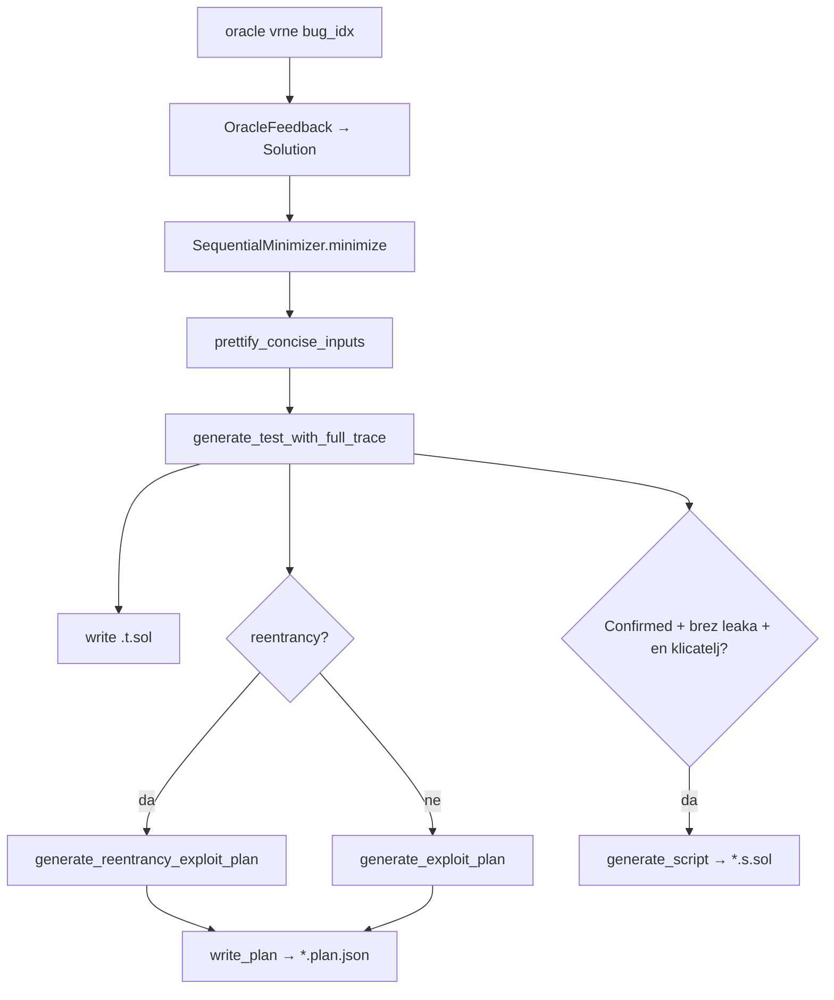

# PLAN_JSON — referenca sheme `*.plan.json`

> Samostojen dokument. Sorodno: [OZICENJE_RUST_PYTHON.md](OZICENJE_RUST_PYTHON.md),
> [ATTACKWALLET.md](ATTACKWALLET.md), [ORAKLI.md](ORAKLI.md).

Shema je določena v `src/evm/solution/script_generator.rs` (strukturi
`ExploitPlan` in `PlanMeta`, `write_plan`) ter `PlanStep`. Vsak `*.plan.json`
je izpisan s `serde_json::to_writer_pretty` (lepo oblikovan JSON).

---

## 1. Mesto in ime

* Mapa: `<work_dir>/vulnerabilities/`
* Ime: `{contract_name}.plan.json`, kjer je `contract_name` iz
  `src/evm/solution/mod.rs::TemplateArgs::new`
  (`format!("{}_{}", make_contract_name(cli_args), BUG_COUNTER.fetch_add(1, ...))`).

`make_contract_name(cli_args)` izpelje osnovno ime iz naslova/poti tarče;
`BUG_COUNTER` je globalni `AtomicU64`, ki poskrbi, da ime ni podvojeno.

---

## 2. Vrhunjska shema (`ExploitPlan`)

```json
{
  "contract_name": "C1Bac_3",
  "kind": "flat",
  "needs_funding": false,
  "total_value": "0",
  "steps": [ /* PlanStep[] */ ],
  "full_trace_steps": [ /* PlanStep[] */ ],
  "repeat_step": null,
  "bug_types": ["Unauthorized ERC20 Transfer"],
  "confidence": "sim-confirmed",
  "confirmed_exploitable": true,
  "atomic_replayable": true,
  "requires_control_leak": false,
  "distinct_callers": 1,
  "callers": ["0x…"],
  "owner_impersonation": false,
  "owner_impersonation_detail": [],
  "owner_gated": false,
  "owner_gated_detail": [],
  "step_count": 2,
  "target": "0x…",
  "chain": "sepolia"
}
```

Polja iz `#[serde(flatten)] meta: PlanMeta` so na istem nivoju kot
`contract_name`/`kind`/... (zato `bug_types`, `confidence`, ... niso
ugnježdeni).

---

## 3. Polja — opis in vir

| Polje | Tip | Vir v kodi | Opis |
|-------|-----|-----------|------|
| `contract_name` | str | `TemplateArgs::contract_name` | ime z unikatnim števcem |
| `kind` | `"flat"` \| `"reentrancy"` | `generate_exploit_plan`/`generate_reentrancy_exploit_plan` | oblika napada |
| `needs_funding` | bool | `TemplateArgs::needs_funding` | ali sled nosi `value > 0` |
| `total_value` | str | vsota `Tx::value` | skupna vrednost (wei, kot niz) |
| `steps` | PlanStep[] | `Tx::from` na minimizirani sledi | minimalni dokaz |
| `full_trace_steps` | PlanStep[] | neminimizirana sled | za združevanje |
| `repeat_step` | PlanStep \| null | `split_reentrant_trace` | ponovljeni klic za `receive()` |
| `bug_types` | str[] | `parse_bug_report(&args.solution)` | vsi bug tipi najdbe |
| `confidence` | `"sim-confirmed"` \| `"sim-review"` | `build_plan_meta` | nivo zaupanja |
| `confirmed_exploitable` | bool | `is_confirmed_exploitable_bug` | ali je izvedljiva |
| `atomic_replayable` | bool | `!requires_control_leak` | ali jo AttackWallet lahko ponovi |
| `requires_control_leak` | bool | `trace_depends_on_control_leak` | odvisnost od faked returna |
| `distinct_callers` | int | `callers.len()` | število različnih klicateljev |
| `callers` | str[] | unikatni `Tx::caller` | urejeni, deduplicirani |
| `owner_impersonation` | bool | `is_harvested_storage_address` (any) | klicatelj iz storage tarče |
| `owner_impersonation_detail` | ImpersonatedCaller[] | `harvested_address_origin` | poreklo |
| `owner_gated` | bool | `is_harvested_sender_for` (per step) | semantični owner-gated test |
| `owner_gated_detail` | ImpersonatedCaller[] | `is_harvested_sender_for` | poreklo |
| `step_count` | int | `trace.len()` | število korakov |
| `target` | str | `CliArgs::target` | naslov/pot tarče |
| `chain` | str | `CliArgs::chain` | ime verige |

---

## 4. `PlanStep`

```json
{
  "contract": "0x…",
  "calldata": "0x…",
  "value": "0",
  "caller": "0x…",
  "fn_selector": "0x23b872dd",
  "stolen_asset": null,
  "call_leak": 4294967295
}
```

| Polje | Tip | Opis |
|-------|-----|------|
| `contract` | str | naslov cilja klica |
| `calldata` | str | calldata (hex, `0x`) |
| `value` | str | vrednost (wei, kot niz) |
| `caller` | str | `msg.sender`, s katerim je bil korak zabeležen |
| `fn_selector` | str | 4-bajtni selektor (hex, `0x`) |
| `stolen_asset` | str \| null | naslov ERC-20, če je korak prepoznan money-mover (`erc20_token_touched`) |
| `call_leak` | u32 | `4294967295` (`u32::MAX`) = brez control leaka; drugo = odkrit z faked returnom |

---

## 5. `ImpersonatedCaller`

```json
{
  "caller": "0x…",
  "harvested_from_contract": "0x…",
  "harvested_from_slot": "0x000…000"
}
```

Če poreklo ni bilo zabeleženo, se uporabijo oznake `"unknown"`.

---

## 6. Pravila, ki jih shema kodira

1. **`confidence` = `sim-review`, če `requires_control_leak`** — ne glede na
   bug_type (`build_plan_meta`, FAZA 2.3). `bug_types` je še vedno izpolnjen
   kot pošten dokaz.
2. **`atomic_replayable` = `!requires_control_leak`** — AttackWallet ne more
   ponoviti faked returna.
3. **`owner_impersonation`** je `any`, ne `all` — zadostuje en harvestan
   klicatelj (dokumentiran realni primer je imel dva klicatelja).
4. **`owner_gated`** je strožji od `owner_impersonation`: zahteva, da je
   klicatelj harvestan iz **iste** pogodbe, ki se kliče.
5. **`plan.json` se izpiše za vsako najdbo**, tudi Review-tier in
   multi-caller; odločitev "izvesti ali ne" je na Python strani.

---

## 7. Polja, ki jih Python doda (povratna zanka)

Po branju plana `auto_pipeline.main` **prepiše** `plan.json` in doda:

| Polje | Vir |
|-------|-----|
| `gas_estimate` | `estimate_plan_gas_on_fork` (največji posamezni korak) |
| `fits_block_gas_limit` | `gas_fit` |
| `gas_headroom_pct` | `gas_fit` |
| `block_gas_limit` | fork `eth.get_block("latest")["gasLimit"]` |
| `gas_used` | dejansko porabljene enote plina (ali fork ocena, če ni bilo poslano) |

Ta polja **niso** prisotna v izvornem Rust izpisu.

---

## 8. Razlika med `steps` in `full_trace_steps`

* `steps` je izhod `SequentialMinimizer` — najmanjše zaporedje, ki ponovno
  sproži oracle. Primerno za `forge test` reprodukcijo.
* `full_trace_steps` je **neminimizirana** sled (`generate_test_with_full_trace`
  prejme `full_trace`). Minimizator odstrani zgodnje nastavitvene klice
  (approve, prenos lastništva), ki jih sestavljen napad potrebuje.
* `strategy_layer._steps_of` da prednost `full_trace_steps`.
* Metapodatki (`step_count`, `distinct_callers`) opisujejo **isto** sled, kot
  jo plan serializira (`build_plan_meta` prejme `meta_source`, ki je
  `full_trace` kadar obstaja).

---

## 9. Diagram: nastanek plan.json



---

## 10. Odprto / neizmerjeno

* **Nepreverjeno:** ali kateri koli potrošnik bere polje
  `composed_from` (doda ga šele `strategy_layer.compose_plan` v Pythonu, ne
  Rust). V Rust shemi ga ni.
* **Neizmerjeno:** ta dokument ne navaja velikosti planov niti števila
  planov na tek.
* Polje `evidence` v `vuln_info.jsonl` (ne v `plan.json`) je
  `"replayable_transaction_trace"` (`src/evm/oracle.rs::EVMBugResult::to_value`).
