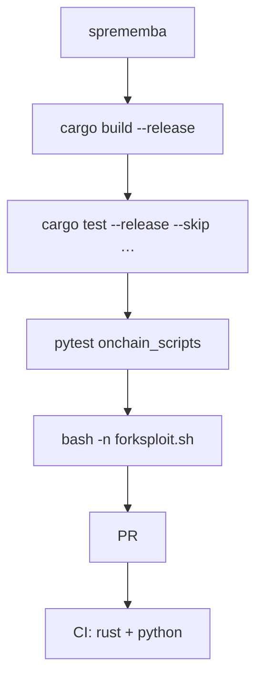

# RAZVOJNI VODNIK — kako prispevati, konvencije, R1

> Samostojen dokument. Sorodno: [GRADNJA_IN_NAMESTITEV.md](GRADNJA_IN_NAMESTITEV.md),
> [TESTI.md](TESTI.md), [ODVISNOSTI.md](ODVISNOSTI.md), [OMEJITVE.md](OMEJITVE.md).

---

## 1. Pravilo R1 — dokaz pred trditvijo

Nikoli ne napiši "narejeno", "popravljeno" ali "deluje" v commit sporočilu,
dokumentaciji ali opisu PR brez **ponovljivega dokaza**: test, meritev ali
izpis ukaza. Kar ni izmerjeno, je v dokumentaciji označeno kot **neizmerjeno**.

To pravilo je zapisano v `CONTRIBUTING.md` in `AGENTS.md` ter je izhodišče
te dokumentacije.

---

## 2. Postavitev okolja

```bash
# Sistemski predpogoji (Debian/Ubuntu)
sudo apt-get install -y libz3-dev pkg-config clang cmake build-essential

rustup toolchain install          # prebere rust-toolchain.toml
cargo build --release
pip install -r onchain_scripts/requirements.txt
```

Rust je piniran na `nightly-2026-10-15` (`rust-toolchain.toml`).

---

## 3. Preden odpreš PR

Enaki ukazi, kot jih teče CI (`.github/workflows/ci.yml`):

```bash
# Rust (10 omrežno/stanjsko odvisnih testov je preskočenih)
cargo test --release -- \
  --skip onchain_pair_discovery \
  --skip uniswap::tests::test_get_pair \
  --skip uniswap::tests::test_fetch_uniswap_path \
  --skip endpoints::tests::test_get_balance

# Python (brez omrežja; brez anvil/solc)
cd onchain_scripts && python -m pytest -q

# Lupina
bash -n forksploit.sh
bash -n onchain_scripts/server_run.sh
```

`cargo build --release` mora ostati **brez opozoril** (dovoljeno je le
third-party `libafl`/`nom` future-incompat obvestilo). `cargo fmt` /
`cargo clippy` **niso** CI vrata; če se dotakneš Rusta, ohrani okoliški slog
in ne dodajaj novih clippy opozoril.

---

## 4. Konvencije kode

Iz `CONTRIBUTING.md`:

* **Ujemaj okoliški slog**; naj bodo spremembe minimalne in osredotočene.
* **Komentarji**: samo za resnično ne-očitne invariante, delovne rešitve ali
  kompromise. Ne pripoveduj diffa, ne ponavljaj kode, ne opisuj zgodovine —
  to spada v commit sporočilo / opis PR.
* **Nikoli** `.unwrap()`/`.expect()` na podatkih od zunaj procesa (RPC
  odgovori, solc/forge artefakti, ABI-ji, storage, uporabniški preseti).
  Vrni tipiziran `Result` ali varen privzetek. Preostali `.unwrap()` so
  `.parse().unwrap()` na statičnih literalih, `lock().unwrap()` ali v
  `#[cfg(test)]`.

### Rust slog (`rustfmt.toml`)
`max_width = 120`, `fn_params_layout = "Tall"`,
`group_imports = "StdExternalCrate"`, `imports_layout = "HorizontalVertical"`,
`wrap_comments = true`, `reorder_imports = true`,
`imports_granularity = "Crate"`, `binop_separator = "Back"`,
`trailing_comma = "Vertical"`, `use_field_init_shorthand = true`,
`format_code_in_doc_comments = true`.

### Testi
* Dokazni testi živijo v `#[cfg(test)] mod tests` poleg modula, ki ga
  pokrivajo, in so označeni s fazo (npr. `FAZA 6.1`).
* Python testi so v `onchain_scripts/test_*.py` in poganjajo **realno** kodo
  (brez mokov), kjer je mogoče.

---

## 5. Kje kaj spada

| Sprememba | Kam |
|-----------|-----|
| Nov oracle | `src/evm/oracles/<ime>.rs` + `mod.rs` + `OracleType` v `src/evm/mod.rs` + `Config` polje + `evm_fuzzer.rs` |
| Nova zastavica Rust | `EvmArgs` (`src/evm/mod.rs`) + `Config` |
| Nova zastavica Python | argparse v `auto_pipeline.py` / `batch_pipeline.py` |
| Nova veriga | `src/evm/onchain/endpoints.rs::Chain` + `chains.py::DEFAULT_RPC`/`CHAIN_IDS` |
| Nova shema plana | `src/evm/solution/script_generator.rs::PlanMeta` + `PLAN_JSON.md` |
| Nova pogodba | `onchain_scripts/contracts/` |

---

## 6. Dokumentacija

* `README.md` je glavni vstop za uporabnike.
* `AGENTS.md` je trajni spomin za agente (repozitorijsko specifično znanje).
* `CLAUDE.md` opisuje arhitekturo.
* `docs/` (ta mapa) je popolna tehnična dokumentacija.
* `OMEJITVE.md` in `BLOKATORJI.md` naštevata, česa sistem ne zna.
* Vsaka trditev v dokumentaciji mora imeti sklic `pot/do/datoteke.rs::simbol`
  ali ponovljiv ukaz.

---

## 7. Diagram: prispevkovni tok



---

## 8. Odprto / neizmerjeno

* **Nepreverjeno:** ta dokument ne navaja postopka izdaje različice (glej
  `.github/workflows/release.yml` in `.github/scripts/*`).
* **Neizmerjeno:** časi in uspešnost CI niso del tega dokumenta.
