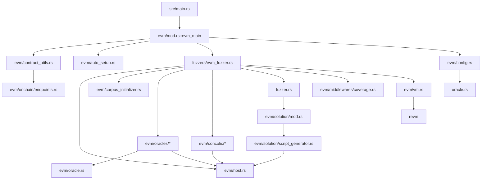

# RUST JEDRO — modul po modul

> Samostojen dokument. Sorodno: [ARHITEKTURA.md](ARHITEKTURA.md),
> [ORAKLI.md](ORAKLI.md), [PLAN_JSON.md](PLAN_JSON.md),
> [ODVISNOSTI.md](ODVISNOSTI.md).

Vse poti so relativne na koren repozitorija. Vsaka trditev je preverjena v
kodi (`src/**/*.rs`).

---

## 1. Vstopna točka in konstante

### `src/main.rs`
* `Cli` (clap `Parser`), `Commands` (podukaz `Evm`).
* `main`: `logger::init()`, `Cli::parse()`, nato `evm_main(args)`.
* Različica: `version=env!("GIT_VERSION_INFO")`, ki jo nastavi `src/build.rs`.

### `src/build.rs`
* Ob buildu zažene `git rev-parse HEAD` in izpiše
  `cargo:rustc-env=GIT_VERSION_INFO=<hash>[<features>]`.
* Deklarira `cargo:rustc-check-cfg` za tuje feature (`serdeany_autoreg`,
  `introspection`), da lint ne javi napak v makroih odvisnosti.

### `src/const.rs`
Globalne konstante (izbrano; vse vrednosti iz kode):

| Konstanta | Vrednost | Pomen |
|-----------|----------|-------|
| `MAX_CONCOLIC_THREADS` | `2` | trdi strop concolic solverjev za celo kampanjo |
| `max_concolic_threads()` | `min(2, cores)` | dejanski strop |
| `INFANT_STATE_INITIAL_VOTES` | `3` | začetni glasovi infant stanja |
| `CORPUS_INITIAL_VOTES` | `3` | začetni glasovi korpusa |
| `MAX_STACK_POW` | `7` | globina libafl stack mutatorja (2^7) |
| `MAX_HAVOC_ATTEMPTS` | `32` | poskusi havoc mutacije |
| `KNOWN_STATE_MAX_SIZE` | `1000` | — |
| `KNOWN_STATE_SKIP_SIZE` | `500` | — |
| `DROP_THRESHOLD` | `4000` | prag obrezovanja korpusa |
| `PRUNE_AMT` | `1000` | koliko se obreže naenkrat |
| `VISIT_IGNORE_THRESHOLD` | `2` | ignoriraj pri obrezovanju |
| `ACCOUNT_AMT` | `8` | število naključnih računov/klicateljev |
| `CONTRACT_AMT` | `8` | število naključnih pogodb |
| `MAX_INPUT_SIZE` | `64` | največja velikost vhodnih podatkov |
| `SAMPLE_MAX` | `100` | — |
| `MUTATE_CHOICE_MAX` | `80` | — |
| `EXPAND_CHOICE_MAX` | `90` | — |
| `RANDOM_ADDRESS_CHOICE` | `90` | — |
| `MULTI_ADDR_CHOICE` | `35` | verjetnost skupne nastavitve naslovov |
| `UNKNOWN_SIGS_DIVISOR` | `30` | prag za EVMole dekompilacijo |
| `MUTATOR_SAMPLE_MAX` | `100` | — |
| `EXPLOIT_PRESET_CHOICE` | `20` | — |
| `ABI_MUTATE_CHOICE` | `96` | — |
| `HAVOC_CHOICE` | `60` | — |
| `HAVOC_MAX_ITERS` | `10` | — |
| `MUTATE_CALLER_CHOICE` | `20` | — |
| `TURN_TO_STEP_CHOICE` | `60` | — |
| `RANDOMNESS_CHOICE` | `33` | — |
| `LIQUIDATE_CHOICE` | `5` | — |
| `LIQ_PERCENT_CHOICE` | `80` | — |
| `LIQ_PERCENT` | `10` | — |
| `RANDOMNESS_CHOICE_2` | `6` | — |
| `MUTATION_RETRIES` | `20` | — |
| `POWER_MULTIPLIER` | `32.0` | razporejevalnik |
| `MAX_POWER` | `3200.0` | — |
| `MIN_POWER` | `32.0` | — |

---

## 2. `src/evm/mod.rs` — CLI in sestavljanje konfiguracije

### `EvmArgs` (clap)
Vse zastavice so v `EvmArgs`. Kratek povzetek (natančna referenca v
[CLI_REFERENCA.md](CLI_REFERENCA.md)):

| Zastavica | Kratka | Polje | Privzeto |
|-----------|--------|-------|----------|
| `--target` | `-t` | `target` | `"none"` |
| `--fetch-tx-data` | — | `fetch_tx_data` | `false` |
| `--proxy-address` | — | `proxy_address` | `http://localhost:5001/data` |
| `--constructor-args` | — | `constructor_args` | `""` |
| `--target-type` | — | `target_type` | `None` |
| `--chain-type` | `-c` | `chain_type` | `None` |
| `--onchain-block-number` | `-b` | `onchain_block_number` | `None` |
| `--onchain-url` | `-u` | `onchain_url` | `None` |
| `--onchain-chain-id` | `-i` | `onchain_chain_id` | `None` |
| `--onchain-explorer-url` | `-e` | `onchain_explorer_url` | `None` |
| `--onchain-chain-name` | `-n` | `onchain_chain_name` | `None` |
| `--onchain-etherscan-api-key` | `-k` | `onchain_etherscan_api_key` | `None` |
| `--onchain-storage-fetching` | — | `onchain_storage_fetching` | `"onebyone"` |
| `--concolic` | — | `concolic` | `false` |
| `--concolic-caller` | — | `concolic_caller` | `false` |
| `--concolic-timeout` | — | `concolic_timeout` | `1000` |
| `--concolic-memory-mb` | — | `concolic_memory_mb` | `2048` |
| `--concolic-num-threads` | — | `concolic_num_threads` | `0` |
| `--flashloan` | `-f` | `flashloan` | `false` |
| `--panic-on-bug` | — | `panic_on_bug` | `false` |
| `--detectors` | `-d` | `detectors` | `"all"` |
| `--invariants` | — | `invariants` | `None` |
| `--auto-setup` | — | `auto_setup` | `false` |
| `--state-comp-file` | — | `state_comp_file` | `None` |
| `--state-comp-matching` | — | `state_comp_matching` | `"Exact"` |
| `--replay-file` | `-r` | `replay_file` | `None` |
| `--work-dir` | `-w` | `work_dir` | `"work_dir"` |
| `--write-relationship` | — | `write_relationship` | `false` |
| `--run-forever` | — | `run_forever` | `false` |
| `--max-call-depth` | — | `max_call_depth` | `32` |
| `--seed` | — | `seed` | `1667840158231589000` |
| `--jobs` | — | `jobs` | `1` |
| `--fuzz-seconds` | — | `fuzz_seconds` | `0` |
| `--sha3-bypass` | — | `sha3_bypass` | `false` |
| `--only-fuzz` | — | `only_fuzz` | `""` |
| `--base-path` | — | `base_path` | `""` |
| `--spec-id` | — | `spec_id` | `"Latest"` |
| `--onchain-builder` | — | `onchain_builder` | `""` |
| `--onchain-replacements-file` | — | `onchain_replacements_file` | `""` |
| `--builder-artifacts-url` | — | `builder_artifacts_url` | `""` |
| `--builder-artifacts-file` | — | `builder_artifacts_file` | `""` |
| `--offchain-config-url` | — | `offchain_config_url` | `""` |
| `--offchain-config-file` | — | `offchain_config_file` | `""` |
| `--load-corpus` | — | `load_corpus` | `""` |
| `--setup-file` | — | `setup_file` | `""` (deprecated alias) |
| `--deployment-script` | `-m` | `deployment_script` | `""` |
| `--force-abi` | — | `force_abi` | `""` |
| `--base-directory` | — | `base_directory` | `""` |
| `--preset-file-path` | — | `preset_file_path` | feature `use_presets` |
| `build_command` (pozicijski) | — | `build_command` | `[]` |

Opomba: privzeti feature set (`Cargo.toml`) je
`cmp dataflow evm print_txn_corpus full_trace force_cache real_balance`.
`use_presets`, `print_logs`, `debug`, `z3_debug`, `flashloan_debug`,
`ondisk_corpus`, `fuzz_static`, `evaluation`, `deployer_is_attacker`,
`print_infant_corpus`, `no_etherscan` so izklopljeni.

### `OracleType`
* `enum OracleType` z `as_str()`/`from_str()`/`from_strs()`.
* `from_strs` podpira dva preseta:
  * `"all"` → 47 oraklov (vključno z `Invariant`);
  * `"high_confidence"` → ožji seznam (brez Review-tier oraklov; vključuje
    `SelfReferral`).
* Neznano ime → `panic!("Invalid detector type: {}", s)`.

### `evm_main`
* Če `args.jobs > 1` in `FORKSPLOIT_JOB` ni nastavljen → `multicore::run_supervisor`.
* `validate_spec_id` opozori na neznano `--spec-id`.
* `resolve_setup_file(setup_file, deployment_script)` — deterministično
  združi `--setup-file` in `--deployment-script` (slednji zmaga ob konfliktu).
* Sestavi `onchain` iz `--chain-type` ali `--onchain-*`; če je podan
  `--onchain-url` skupaj z `--chain-type`, se nastavi `ETH_RPC_URL`.
* `solution::init_cli_args(target, work_dir, &onchain)`.
* Zgradi seznam `oracles` po `oracle_types` (glej [ORAKLI.md](ORAKLI.md)).
* `--invariants` naloži `InvariantSpec::from_file`; napaka pri branju je
  viden `error!` (ne tiho).
* Naložitelj tarče glede na `target_type` (glej `contract_utils.rs`).
* `--auto-setup` izpelje `SetupSpec` prek `auto_setup::derive_setup_spec`.
* Sestavi `Config` in pokliče `evm_fuzzer(config, &mut state)`.
* Zapiše `work_dir/abis.json`.

### `resolve_concolic_num_threads`
Strop `min(2, cores)`; `0` = strop, manjše se upošteva, večje se omeji z
opozorilom.

### Testi v `mod.rs`
`concolic_threads_are_bounded_by_the_campaign_cap`,
`concolic_cap_never_exceeds_two_or_cores`,
`setup_file_flag_is_not_silently_discarded`, `test_parse_constructor_args_string`.

---

## 3. `src/evm/config.rs`

`Config<VS, Addr, Code, By, Loc, SlotTy, Out, I, S, CI, E>` nosi vse, kar
fuzzer potrebuje: `contract_loader`, `only_fuzz`, `onchain`, concolic polja,
`oracle`, `producers`, `flashloan`, zastavice oraklov (`typed_bug`,
`arbitrary_external_call`, `math_calculate_oracle`, ...), `work_dir`,
`run_forever`, `max_call_depth`, `sha3_bypass`, `spec_id`, `load_corpus`,
`etherscan_api_key`.

`StorageFetchingMode` (`FromStr`): `dump`, `onebyone`.

---

## 4. `src/evm/contract_utils.rs` — naložitev tarče

| Simbol | Namen |
|--------|-------|
| `ContractLoader` | nosi `contracts`, `setup_spec`, `base_path`, ... |
| `ContractInfo` | naslov, ime, ABI, bajtkod |
| `ABIConfig`, `ABIInfo` | razčlenjen ABI |
| `from_glob(path, state, proxy_deploy_codes, constructor_args_map, target, base_path)` | lokalna mapa z `.bin`/`.abi` |
| `from_address(onchain, addresses, builder)` | že nameščene pogodbe + `expand_proxy_targets` |
| `from_fork(offchain_artifacts, onchain, targets)` | Anvil fork + `expand_proxy_targets` |
| `from_config(offchain_artifacts, offchain_config)` | iz `--offchain-config-*` |
| `from_setup(offchain_artifacts, setup_file, work_dir, etherscan_api_key)` | iz pogodbe za razporeditev |
| `expand_proxy_targets(onchain, addresses)` | doda implementacije proxyjev |
| `proxy_implementations_of(onchain, addr)` | EIP-1967 impl/beacon, EIP-1822 UUPS, EIP-1167, EIP-7702 |
| `force_abi(mapping)` | vsili ABI iz `--force-abi` |
| `extract_combined_json`, `extract_sig_from_contract`, `compute_address`, `to_hex_string` | pomožno |

Slot konstante so v `src/evm/mod.rs`: `EIP1967_IMPLEMENTATION_SLOT`,
`EIP1967_ADMIN_SLOT`. Test
`contract_utils::tests::test_proxy_slot_constants_match_keccak` preveri, da
se ujemajo s keccak.

---

## 5. `src/evm/vm.rs` in `src/generic_vm/*`

* `EVMState` (`src/evm/vm.rs`): `state` (storage po naslovu), `balance`,
  `post_execution`, `trace`, `swap_data`.
* `EVMExecutor<VS, CI, SC>`: `new(fuzz_host, deployer)`, `execute_from_pc`,
  `reexecute_with_middleware`.
* `SinglePostExecution`, `PostExecutionCtx`, `Constraint` (za concolic).
* `is_reverted_or_control_leak(ret)`.
* `src/generic_vm/vm_state.rs`: `VMStateT` trait, `SwapInfo`.
* `src/generic_vm/vm_executor.rs`: `MAP_SIZE`, generični izvajalec.

---

## 6. `src/evm/host.rs` — FuzzHost

Ključni globalni elementi:

| Simbol | Namen |
|--------|-------|
| `JMP_MAP`, `READ_MAP`, `WRITE_MAP`, `CMP_MAP`, `ABI_MAX_SIZE` | `RacyCell` mape za povratne informacije |
| `CALL_UNTIL` | `AtomicU32`; kdaj naj se sproži control leak (u32::MAX = nikoli) |
| `CONCOLIC_NO_CONTROL_LEAK` | `AtomicBool`; med concolic iskanjem izklopi leak |
| `control_leak_bypassed()` | `CALL_UNTIL != u32::MAX` ali concolic zastavica |
| `CallUntilGuard` | RAII za varno nastavljanje `CALL_UNTIL` |
| `MAX_ANALYSIS_CALL_DEPTH` | `AtomicU64`, privzeto `15` |
| `HARVESTED_STORAGE_ADDRESSES` | naslovi, prebrani iz storage katere koli tarče |
| `HARVESTED_ADDRESS_ORIGINS` | (contract, slot) poreklo vsakega harvestanega naslova |
| `HARVESTED_SENDER_GUARDS` | (contract, caller) pari, kjer je klicatelj iz **iste** pogodbe |
| `record_harvested_storage_address(addr, contract, slot)` | zabeleži harvest |
| `is_harvested_storage_address(checksummed)` | ali je naslov harvestan |
| `harvested_address_origin(checksummed)` | (contract, slot) |
| `is_harvested_sender_for(contract, addr)` | semantični owner-gated test |
| `FuzzHost<SC>` | sam izvajalec klicev |
| `call_allow_control_leak` | dovoli faked return po `CALL_UNTIL` |
| `call_forbid_control_leak` | realni klic (uporablja se pri concolic) |
| `CONTROL_LEAK_THRESHOLD` | `200` |

`control_leak` je mehanizem, ki ga fuzzer uporablja za raziskovanje (npr.
reentrancy). Plan, ki je odkrit z njim, je označen `call_leak != u32::MAX`
in posledično `atomic_replayable = false`.

---

## 7. `src/evm/oracle.rs` — nivo zaupanja

* `enum ConfidenceTier { Confirmed, Review }`; `as_str()` → `"sim-confirmed"`
  / `"sim-review"` (nikoli gola `"confirmed"`).
* `classify_confidence(bug_type) -> ConfidenceTier` — preslika `bug_type`
  v nivo. Seznam Confirmed-tier tipov je v tej funkciji.
* `effective_confidence(base, call_leak)` — če `call_leak != u32::MAX`,
  vsili `Review`.
* `EVMBugResult { bug_type, bug_info, input, issue_source, sourcemap, bug_idx,
  confidence }`; `to_value()` izpiše JSON z `confidence` (po
  `effective_confidence`) in `evidence: "replayable_transaction_trace"`.
* `new(...)`, `new_simple(...)`, `push_to_output()` (v `ORACLE_OUTPUT`).
* Testi: `effective_confidence_tests`.

Podroben seznam Confirmed-tier `bug_type` vrednosti je v
[ORAKLI.md](ORAKLI.md) in [PLAN_JSON.md](PLAN_JSON.md).

---

## 8. `src/evm/oracles/*` — detektorji

Vsak oracle implementira `Oracle` trait (`src/oracle.rs`):
`oracle(&mut self, ctx: EVMOracleCtx<...>) -> Vec<u64>` vrne `bug_idx`.
`EVMBugResult::push_to_output` zapiše v `ORACLE_OUTPUT`.

`bug_idx` konstante so v `src/evm/oracles/mod.rs` (`ERC20_BUG_IDX = 0`,
... `INVARIANT_BUG_IDX = 50`). Celoten katalog je v [ORAKLI.md](ORAKLI.md).

Pomožni makro: `oracle_should_skip!` (preveri `BugMetadata::known_bugs`).

---

## 9. `src/evm/middlewares/*`

`Middleware<SC>` trait (`middleware.rs`): `on_step`, `on_goal`, ...
`MiddlewareType` enum: `OnChain`, `Concolic`, `Flashloan`, `InstructionCoverage`,
`BranchCoverage`, `Sha3Bypass`, `Sha3TaintAnalysis`, `CallPrinter`,
`Reentrancy`, `IntegerOverflow`, `DelegatecallInjection`, `EcrecoverZero`,
`StorageCollision`, `DelegatecallTarget`, `UninitializedMemory`,
`UncheckedCall`, `TxOrigin`, `ArbitraryStorageWrite`, `Cheatcode`.

| Modul | Namen |
|-------|-------|
| `coverage.rs` | `Coverage`, `CoverageReport`, `dump_file` (piše `coverage.txt`) |
| `sha3_bypass.rs` | `Sha3TaintAnalysis`, `Sha3Bypass` |
| `reentrancy.rs` | `ReentrancyTracer` |
| `overflow.rs` | `IntegerOverflowTracer` |
| `delegatecall.rs` | `DelegatecallInjectionTracer` |
| `delegatecall_target.rs` | `DelegatecallTargetTracer` |
| `ecrecover.rs` | `EcrecoverZeroTracer` |
| `arbitrary_storage_write.rs` | `ArbitraryStorageWriteTracer` |
| `storage_collision.rs` | `StorageCollisionTracer` |
| `uninitialized_memory.rs` | `UninitializedMemoryTracer` |
| `unchecked_call.rs` | `UncheckedCallTracer` |
| `tx_origin.rs` | `TxOriginTracer` |
| `call_printer.rs` | `CallPrinter` (izpis sledi) |
| `cheatcode/*` | Foundry cheatcode (trenutno **komentiran** v `evm_fuzzer.rs`) |

---

## 10. `src/evm/concolic/*`

| Modul | Namen |
|-------|-------|
| `concolic_stage.rs` | `ConcolicStage` (libafl Stage), `ConcolicFeedbackWrapper` |
| `concolic_host.rs` | `ConcolicHost`, `Solution`, `threaded_solve`, `ALL_WORKER_THREADS`, `ALL_SOLUTIONS` |
| `expr.rs` | Simbolični izrazi |
| `mod.rs` | modul |

`ConcolicStage::perform`:
* logira `concolic: testcase #N (i/total) -- bounded pool of M Z3 solver(s)`;
* preskoči testcase brez vhoda in testcase z neinicializiranim staged stanjem
  (`StagedVMState::new_uninitialized` → prazno world stanje);
* med izvajanjem nastavi `CONCOLIC_NO_CONTROL_LEAK = true`;
* uporablja `threaded_solve` z omejeno delovno skupino.

---

## 11. `src/fuzzer.rs` — ForkSploitFuzzer

* `ForkSploitFuzzer<...>` implementira libafl `Fuzzer`/`Evaluator`.
* `RUN_FOREVER: AtomicBool`, `ORACLE_OUTPUT: Mutex<Vec<serde_json::Value>>`.
* `vuln_file_base(bug_idxs)` — omeji ime datoteke najdbe na 120 bajtov +
  stabilen hash, da `--run-forever` ne povzroči "File name too long".
* `evaluate_input_events` — jedro zanke:
  * ob `ExecuteInputResult::Solution`: minimizacija,
    `generate_test_with_full_trace`, pisanje `vuln_info.jsonl`,
    `vulnerabilities/<idxs>` in `<idxs>_replayable`;
  * brez `--run-forever` → `exit(0)`; sicer `ORACLE_OUTPUT.clear()` in
    nadaljuje.
* `add_input` — libafl pogodba.
* Testi: `vuln_file_base_tests`.

---

## 12. `src/fuzzers/evm_fuzzer.rs` — sestavljanje kampanje

* `evm_fuzzer(config, state)` (glej [TOK_PODATKOV.md](TOK_PODATKOV.md) §3).
* `exit(1)`, če `fuzz_loop` vrne napako.
* Sestavi `OracleFeedback` (objective), `ConcolicFeedbackWrapper`,
  `Sha3WrappedFeedback`, `CmpFeedback`, `DataflowFeedback`.
* `EVMMinimizer` in `SequentialMinimizer`.

---

## 13. `src/evm/solution/*` — plan.json in Solidity

| Simbol | Namen |
|--------|-------|
| `init_cli_args(target, work_dir, onchain)` | nastavi globalne `CLI_ARGS` |
| `generate_test` / `generate_test_with_full_trace` | zapiše `.t.sol` in plan |
| `Tx` | en korak (caller, contract, value, calldata, fn_selector, call_leak, ...) |
| `TemplateArgs` | podatki za predloge |
| `is_reentrancy_bug`, `split_reentrant_trace` | reentrancy razčlenitev |
| `has_multiple_distinct_callers`, `trace_depends_on_control_leak` | kvalifikatorji za `.s.sol` |
| `parse_bug_report`, `is_confirmed_bug_type`, `is_confirmed_exploitable_bug` | klasifikacija |
| `CONFIRMED_EXPLOITABLE_BUG_TYPES` | seznam za atomični `.s.sol` |
| `BUG_COUNTER` | unikaten števec v imenu |
| `foundry_test.hbs`, `foundry_script.hbs`, `foundry_script_reentrancy.hbs` | predloge |

`src/evm/solution/script_generator.rs`:

| Simbol | Namen |
|--------|-------|
| `PlanStep` | korak plana (contract, calldata, value, caller, fn_selector, stolen_asset, call_leak) |
| `PlanMeta` | metapodatki plana (glej [PLAN_JSON.md](PLAN_JSON.md)) |
| `ExploitPlan` | celoten plan (contract_name, kind, needs_funding, total_value, steps, full_trace_steps, repeat_step, + meta) |
| `build_plan_meta` | zgradi metapodatke |
| `generate_exploit_plan` | plan `kind="flat"` |
| `generate_reentrancy_exploit_plan` | plan `kind="reentrancy"` |
| `generate_script`, `generate_reentrancy_script` | `.s.sol` |
| `write_plan` | zapiše `{contract_name}.plan.json` |

`erc20_token_touched(tx)` določi polje `stolen_asset`.

Testi: `plan_meta_confidence_tests::control_leak_trace_is_never_sim_confirmed`,
`classify_confidence_matches_confirmed_exploitable_list`.

---

## 14. `src/evm/onchain/*`, `tokens/*`, `producers/*`, `presets/*`

### `src/evm/onchain/`
* `endpoints.rs`: `enum Chain` (24 omrežij + `local`), `from_str`, `to_lowercase`,
  `get_chain_id`, `get_chain_rpc` (bere `ETH_RPC_URL`),
  `get_chain_etherscan_base`, `OnChainConfig`, `RpcResponseError`,
  `is_blockscout_api`.
* `mod.rs`: `ChainConfig` trait, `OnChain` middleware, `BLACKLIST_ADDR`,
  `WHITELIST_ADDR`, `register_borrow_txn`.
* `flashloan.rs`: `Flashloan` middleware.
* `offchain.rs`: `OffChainConfig`.
* `abi_decompiler.rs`: `fetch_abi_evmole` (EVMole dekompilacija).

### `src/evm/tokens/`
`mod.rs` (`SWAP_DEPOSIT`, `SWAP_WITHDRAW`, `BoxedABI` transformacije),
`uniswap.rs`, `v2_transformer.rs`, `v3_transformer.rs`, `weth_transformer.rs`,
`aave_transformer.rs`, `balancer_transformer.rs`, `constant_pair.rs`,
`onchain_pair_discovery.rs`.

### `src/evm/producers/`
`erc20.rs` (`ERC20Producer`), `pair.rs`, `mod.rs` (`Producer` trait v
`src/oracle.rs`).

### `src/evm/presets/`
`mod.rs`, `pair.rs` — predloge za znane ranljivosti (feature `use_presets`).

### `src/evm/blaz/*`
Graditelj pogodb (`builder.rs`), `linking.rs`, `offchain_artifacts.rs`,
`offchain_config.rs`.

### `src/evm/srcmap/mod.rs`, `abi.rs`, `bytecode_analyzer.rs`,
`bytecode_iterator.rs`, `types.rs`, `utils.rs`, `cov_stage.rs`, `mutator.rs`,
`minimizer.rs`, `scheduler.rs`, `feedbacks.rs`, `multicore.rs`, `setup.rs`,
`auto_setup.rs`, `corpus_initializer.rs`, `input.rs`

| Modul | Namen |
|-------|-------|
| `abi.rs` | ABI razčlenjevanje, `BoxedABI`, mutacije argumentov |
| `bytecode_analyzer.rs`, `bytecode_iterator.rs` | analiza bajtkoda |
| `types.rs` | `EVMAddress`, `EVMU256`, `EVMFuzzState`, `EVMQueueExecutor` |
| `utils.rs` | `prettify_concise_inputs`, `parse_pretty_wei`, `try_write_file` |
| `cov_stage.rs` | `CoverageStage` (pisanje sledi) |
| `mutator.rs` | `FuzzMutator` |
| `minimizer.rs` | `EVMMinimizer` |
| `scheduler.rs` | `PowerABIScheduler`, `PowerABIMutationalStage` |
| `feedbacks.rs` | `Sha3WrappedFeedback`, `Feedback` |
| `multicore.rs` | `run_supervisor`, `spawn_job`, `per_job_concolic_threads`, `clamp_jobs_to_cores`, `filter_overridden_flags`, `derive_job_seed` |
| `setup.rs` | `SetupSpec`, `SetupCall` (`setup.json`) |
| `auto_setup.rs` | `derive_setup_spec`, `scan_embedded_addresses` |
| `corpus_initializer.rs` | `EVMCorpusInitializer` |
| `input.rs` | `EVMInput`, `ConciseEVMInput`, `EVMInputTy`, `SolutionTx` |

---

## 15. Ostali korenski moduli

| Modul | Namen |
|-------|-------|
| `src/oracle.rs` | `Oracle`/`Producer` trait, `OracleCtx`, `BugMetadata` |
| `src/state.rs` | `FuzzState`, `HasCurrentInputIdx`, `InfantStateState` |
| `src/state_input.rs` | `StagedVMState` (`new_uninitialized`) |
| `src/input.rs` | `ConciseSerde`, `SolutionTx`, `VMInputT` |
| `src/feedback.rs` | `CmpFeedback`, `DataflowFeedback`, `OracleFeedback`, `CmpMetadata` |
| `src/scheduler.rs` | `SortedDroppingScheduler`, `HasReportCorpus` |
| `src/power_sched.rs` | močnostni razporejevalnik |
| `src/minimizer.rs` | `SequentialMinimizer` |
| `src/mutation_utils.rs` | pomožno za mutacije |
| `src/executor.rs`, `src/tracer.rs`, `src/indexed_corpus.rs`, `src/cache.rs`, `src/logger.rs`, `src/sync_utils.rs` | infrastruktura |
| `src/generic_vm/*` | generična VM abstrakcija |

`src/sync_utils.rs`: `RacyCell` — procesno globalne mape, ki so varne le ob
predpostavki enovitosti; zato `--jobs` uporablja **procese**, ne niti.

---

## 16. Diagram odvisnosti modulov

---

## 17. Odprto / neizmerjeno

* **Nepreverjeno:** ali `--onchain-builder` (`BuildJob`) dejansko deluje na
  vseh verigah — koda jo podpira (`blaz/builder.rs`), a ta dokument tega ni
  zagnal.
* **Neizmerjeno:** zmogljivost (`exec/s`, globina dosega) ni del tega
  dokumenta.
* Cheatcode middleware (`middlewares/cheatcode/*`) obstaja v kodi, a je
  **komentiran** v `src/fuzzers/evm_fuzzer.rs` (TODO: zksync-era#4581).
  Zato `Cheatcode` ni aktiven v privzeti kampanji.
* `src/evm/mod.rs::test_evm_offchain_setup` je ročni harness (komentiran
  `#[test]`), ne del privzetih testov.
