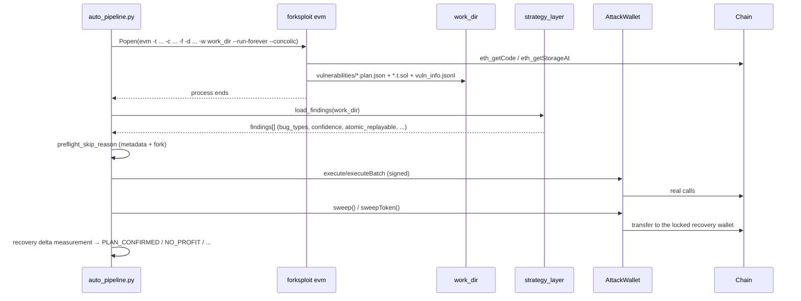
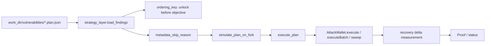

# RUST ↔ PYTHON WIRING — the contract between the two layers

> Standalone document. Related: [ARCHITECTURE.md](ARCHITECTURE.md),
> [DATA_FLOW.md](DATA_FLOW.md), [PLAN_JSON.md](PLAN_JSON.md),
> [TROUBLESHOOTING.md](TROUBLESHOOTING.md).

This document describes **every point of contact** between the Rust and Python
layers, with an exact reference to the code. Every claim is verified in code.

---

## 1. Contract summary

| Contact | Direction | Mechanism | Code |
|------|------|-----------|------|
| Launch the fuzzer | Python → Rust | `subprocess.Popen` with argv | `onchain_scripts/auto_pipeline.py::run_fuzzer` |
| RPC address | Python → Rust | environment variable `ETH_RPC_URL` | `src/evm/onchain/endpoints.rs::Chain::get_chain_rpc` |
| Working directory | Python → Rust | `-w <work_dir>` | `src/evm/mod.rs::EvmArgs::work_dir` |
| Findings (plans) | Rust → Python | `work_dir/vulnerabilities/*.plan.json` | `src/evm/solution/script_generator.rs::write_plan` |
| Reproduction | Rust → Python | `work_dir/vulnerabilities/*.t.sol` | `src/evm/solution/mod.rs::generate_test_with_full_trace` |
| Atomic PoC | Rust → Python | `work_dir/vulnerabilities/*.s.sol` | `src/evm/solution/script_generator.rs::generate_script` |
| Combined findings log | Rust → Python | `work_dir/vuln_info.jsonl` | `src/fuzzer.rs::evaluate_input_events` |
| Coverage | Rust → Python | `work_dir/coverage.txt` | `src/evm/middlewares/coverage.rs::dump_file` |
| Feedback loop (gas) | Python → Rust | Python writes fields back into `plan.json` | `onchain_scripts/auto_pipeline.py::main` |

---

## 2. How Python launches the Rust binary

Function: `onchain_scripts/auto_pipeline.py::run_fuzzer(target_address, chain,
detectors, fuzz_seconds, work_dir, tee, extra_targets)`.

Binary: `REPO_ROOT / "target" / "release" / "forksploit"`, where
`REPO_ROOT = onchain_scripts/../` (`auto_pipeline.py:78-79`).

The built argv (literally from the code, `run_fuzzer`):

```
target/release/forksploit evm
    -t  <target_address>[,<impl1>,<impl2>...]     # -t / --target
    -c  <chain>                                    # -c / --chain-type
    -f                                             # --flashloan  (short `-f` from the `flashloan` field)
    -d  <detectors>                                # -d / --detectors
    -w  <work_dir>                                 # -w / --work-dir
    --run-forever
    --concolic
    --concolic-caller
    [--spec-id Shanghai]                           # only for chain in ("etc","mordor")
```

Then the environment is added: `env["ETH_RPC_URL"] = get_rpc_url(chain)`.

Notes, verified in code:

* `-t` is **one** value that is a comma-joined list. `all_targets =
  [target_address] + extra_targets`, then `",".join(all_targets)`.
  `extra_targets` are the proxy implementations from
  `proxy_resolver.resolve_proxy_chain` (`auto_pipeline.py::main`).
* `--run-forever` is essential, because without it the binary would stop at the
  **first** finding (`src/fuzzer.rs`: `if !RUN_FOREVER.load(...) { exit(0); }`).
  That is why `work_dir/vulnerabilities/` gets more than one `*.plan.json` per
  run.
* `--concolic` and `--concolic-caller` are an explicit choice of precision (Z3)
  over speed.
* `--spec-id Shanghai` is added **only** for `etc` and `mordor`; the other
  chains use the default `Latest` (`src/evm/mod.rs::EvmArgs::spec_id`).

The process is launched with `cwd=str(REPO_ROOT)`; stdout+stderr are merged
(`stderr=subprocess.STDOUT`) and streamed line by line into the log with the
prefix `[fuzzer]`.

### 2.1 Timeout

`run_fuzzer` measures elapsed time and, on `time.time() - start > fuzz_seconds`,
sends `proc.terminate()` (then `proc.kill()` after 10 s). It returns the
**actual** duration (`time.time() - start`), which `determine_negative_result_verdict`
uses instead of the requested budget.

### 2.2 How Python detects fuzzer success/failure

Python does **not** interpret the Rust binary's exit code as a signal about a
finding:

* `run_fuzzer` reads the output stream and returns the duration; it does not
  check `proc.returncode` for success.
* The presence of findings is determined from **files** on disk:
  `strategy_layer.load_findings(work_dir)` reads
  `work_dir/vulnerabilities/*.plan.json`; `vuln_info.jsonl` is read in
  `report_unexecuted_findings`.
* If the Rust process dies early, this leads to a missing `coverage.txt` →
  `determine_negative_result_verdict` returns `insufficient_coverage`
  (`onchain_scripts/auto_pipeline.py`).

Rust binary exit codes (from the code):

| Place | Code | Condition |
|-------|------|-------|
| `src/fuzzer.rs::evaluate_input_events` | `exit(0)` | vulnerability found without `--run-forever` |
| `src/fuzzers/evm_fuzzer.rs` | `exit(1)` | `fuzz_loop` returns an error (e.g. empty corpus) |
| `src/evm/multicore.rs::run_supervisor` | returned `i32` | supervisor of a multi-job run (`--jobs`) |
| `src/evm/mod.rs::evm_main` | `std::process::exit(code)` | when `--jobs > 1` (the supervisor) |

---

## 3. File contract: what Rust writes

All under `work_dir` (default `work_dir`, while Python uses
`onchain_scripts/auto_work/<run_id>`).

### 3.1 `work_dir/vulnerabilities/*.plan.json`

Written by `src/evm/solution/script_generator.rs::write_plan`. The file name is
`{contract_name}.plan.json`, where `contract_name` includes a unique counter
(`{make_contract_name}_{N}`, `src/evm/solution/mod.rs::BUG_COUNTER`), so that
different findings on the same target do not overwrite each other's proofs.

The schema is documented in [PLAN_JSON.md](PLAN_JSON.md). Fields Python reads
(`strategy_layer.load_findings` + `auto_pipeline`):

| Field | Type | Source in Rust | Use in Python |
|-------|-----|-------------|-------------------|
| `contract_name` | str | `TemplateArgs::contract_name` | identifier, `ordering_key` |
| `kind` | `"flat"` \| `"reentrancy"` | `generate_exploit_plan` / `generate_reentrancy_exploit_plan` | execution-path choice |
| `needs_funding` | bool | `TemplateArgs::needs_funding` | informational; `execute_plan` computes the sum itself |
| `total_value` | str (wei) | sum of `Tx::value` | informational |
| `steps[]` | seq. PlanStep | minimized trace | actual execution steps |
| `full_trace_steps[]` | seq. PlanStep | unminimized trace | `_steps_of` preference when merging |
| `repeat_step` | PlanStep \| null | `split_reentrant_trace` | reentrancy arm |
| `bug_types[]` | seq. str | `parse_bug_report` | unlock/objective classification |
| `confidence` | `sim-confirmed`/`sim-review` | `build_plan_meta` | `ordering_key`, filter |
| `confirmed_exploitable` | bool | `is_confirmed_exploitable_bug` | `metadata_skip_reason` |
| `atomic_replayable` | bool | `!requires_control_leak` | `metadata_skip_reason`, `_is_chainable` |
| `requires_control_leak` | bool | `trace_depends_on_control_leak` | triage |
| `distinct_callers` | int | `callers.len()` | `metadata_skip_reason` |
| `callers[]` | seq. str | `Tx::caller` | triage |
| `owner_impersonation` | bool | `is_harvested_storage_address` | `metadata_skip_reason` |
| `owner_impersonation_detail[]` | seq. `{caller, harvested_from_contract, harvested_from_slot}` | `harvested_address_origin` | report |
| `owner_gated` | bool | `is_harvested_sender_for` | `metadata_skip_reason`, `build_proof` |
| `owner_gated_detail[]` | seq. ImpersonatedCaller | `is_harvested_sender_for` | report |
| `step_count` | int | `trace.len()` | `ordering_key` |
| `target` | str | `CliArgs::target` | report |
| `chain` | str | `CliArgs::chain` | report |

PlanStep fields (`src/evm/solution/script_generator.rs::PlanStep`):
`contract`, `calldata`, `value`, `caller`, `fn_selector`, `stolen_asset`
(nullable), `call_leak` (u32; `u32::MAX` = no control leak).

### 3.2 `work_dir/vulnerabilities/*.t.sol`

A reproduction Foundry test. Written by
`src/evm/solution/mod.rs::generate_test_with_full_trace` via the template
`src/evm/solution/foundry_test.hbs`. It uses `vm.prank`/`vm.deal`
(Foundry-only cheatcode), so it is not executable on a real chain.

### 3.3 `work_dir/vulnerabilities/*.s.sol`

An atomic `forge script` PoC. Written by
`src/evm/solution/script_generator.rs::generate_script` (template
`foundry_script.hbs`) or `generate_reentrancy_script`
(`foundry_script_reentrancy.hbs`). It is produced **only** when the finding is
`Confirmed`-tier, the trace does not depend on a control leak, and it has a
single caller (`src/evm/solution/mod.rs::generate_test_with_full_trace`).

### 3.4 `work_dir/vuln_info.jsonl`

Each line is JSON `EVMBugResult::to_value`
(`src/evm/oracle.rs`): `bug_type`, `bug_info`, `input`, `sourcemap`,
`issue_source`, `bug_idx`, `confidence`, `evidence`. Written by
`src/fuzzer.rs::evaluate_input_events`.

### 3.5 `work_dir/coverage.txt`

Written by `src/evm/middlewares/coverage.rs::dump_file`. It contains lines
`Instruction Coverage: X/Y (Z%)` and `Branch Coverage: ...`, which
`report_coverage` (`auto_pipeline.py`) parses.

### 3.6 Other

* `work_dir/abis.json` — address → ABI mapping (`src/evm/mod.rs::evm_main`).
* `work_dir/traces/` — corpus traces (`src/evm/cov_stage.rs`, field
  `trace_dir`).
* `work_dir/vulnerabilities/<idxs>` and `<idxs>_replayable` — raw trace
  (feature `print_txn_corpus`, `src/fuzzer.rs::vuln_file_base`).

---

## 4. Where Python reads a plan

`onchain_scripts/strategy_layer.py::load_findings(work_dir)`:

```python
vulnerabilities_dir = work_dir / "vulnerabilities"
for plan_path in sorted(vulnerabilities_dir.glob("*.plan.json")):
    plan = json.loads(plan_path.read_text())
    ...
```

It returns a list of dictionaries with the metadata Python actually uses:

| Field in `findings[i]` | Source in plan.json | Default if missing |
|-----------------------|-----------------|----------------------|
| `contract_name` | `contract_name` | (required) |
| `plan_path` | file path | — |
| `plan` | the whole dictionary | — |
| `bug_types` | `bug_types` | fallback: read `{contract_name}.t.sol` |
| `kind` | `kind` | `None` |
| `needs_funding` | `needs_funding` | `False` |
| `atomic_replayable` | `atomic_replayable` | `True` |
| `distinct_callers` | `distinct_callers` | `1` |
| `step_count` | `step_count` | `len(steps)` |
| `confirmed_exploitable` | `confirmed_exploitable` | `True` |

Fallback for `bug_types`: if the plan lacks the field, `load_findings` parses
`{contract_name}.t.sol` with the regular expression
`_CONFIRMED_BUG_TYPE_RE = re.compile(r"^\[(.+?)\]\s*\((?:sim-)?confirmed\):", re.MULTILINE)`
— tolerant of both spellings (`confirmed` and `sim-confirmed`).

---

## 5. How it decides whether to execute a plan

Two lines of gates, both in `onchain_scripts/auto_pipeline.py`.

### 5.1 Pre-flight gate (metadata + fork)

`preflight_skip_reason(finding, fork_w3, acct, attack_wallet, recovery_wallet,
chain, tee, native_symbol)`:

1. **Layer 1 — metadata** (`metadata_skip_reason`, no network):
   * `confirmed_exploitable == False` and `kind != "reentrancy"` → skip
     (Review-tier heuristic, no executable step).
   * `owner_gated == True` → skip (the trace calls the target as an identity
     read from its own storage; a `require(msg.sender == owner)` shape).
   * `owner_impersonation == True` → skip (the caller is an identity read from
     storage).
   * `atomic_replayable == False` → skip (dependency on a control leak).
   * `distinct_callers > 1` → skip (a single signer cannot reproduce it).
2. **Layer 2 — fork simulation** (`simulate_plan_on_fork`), only if anvil is
   available. It returns `(delta, gas_spent, reverted, gained_tokens)`.
   Skip if the replay reverts or if `delta <= gas_spent` (unprofitable).
   A plan that brings tokens is not skipped (comparing gas vs. token is not
   like-for-like).

The status that follows (`skip_status_for`): `metadata:` →
`skipped_not_extractable`; `gas:` → `oversized_gas`; otherwise →
`skipped_unprofitable`.

### 5.2 Gas gate

`gas_oversized_reason(plan)` uses the field `fits_block_gas_limit`, which is
stamped by `estimate_plan_gas_on_fork` (the node's own `eth_estimateGas` against
the real `block.gasLimit`). If the field is missing, it does not guess (`None`).

---

## 6. Feedback loop: Python writes fields back into plan.json

In `auto_pipeline.py::main` the plan is **rewritten** to disk after the fork
measures gas and after the plan is executed/run:

```python
plan["gas_estimate"] = gas_fit_info["gas_estimate"]
plan["fits_block_gas_limit"] = gas_fit_info["fits_block_gas_limit"]
plan["gas_headroom_pct"] = gas_fit_info["gas_headroom_pct"]
plan["block_gas_limit"] = gas_fit_info["block_gas_limit"]
...
finding["plan_path"].write_text(json.dumps(plan, indent=2))
```

and after execution:

```python
plan["gas_used"] = gas_units
plan_path.write_text(json.dumps(plan, indent=2))
```

Thus `plan.json` ultimately carries **both** fields: `gas_estimate` (fork
estimate) and `gas_used` (actually spent, or the fork estimate if nothing was
sent).

---

## 7. Diagram: sequence Rust → Python → chain



---

## 8. Exit codes and statuses Python returns

`execute_plan` returns a 4-tuple `(status, recovery_delta_wei, gas_spent_wei,
net_profit_wei)` (or a 5-tuple with `return_units=True`). The statuses are
constants in `auto_pipeline.py`:

| Constant | Value | Meaning |
|-----------|----------|-------|
| `PLAN_CONFIRMED` | `"confirmed"` | the recovery wallet **measurably** increased |
| `PLAN_NOT_CONFIRMED` | `"not_confirmed"` | a step reverted against real state |
| `PLAN_INCONCLUSIVE` | `"inconclusive"` | it could not be executed (e.g. unfunded) |
| `PLAN_EXECUTED_NO_PROFIT` | `"executed_no_profit"` | all steps OK, but nothing was transferred |
| `PLAN_SKIPPED_UNPROFITABLE` | `"skipped_unprofitable"` | pre-flight proved unprofitability |
| `PLAN_SKIPPED_NOT_EXTRACTABLE` | `"skipped_not_extractable"` | no executable step (heuristic/leak/multi-caller) |
| `PLAN_OVERSIZED_GAS` | `"oversized_gas"` | the measured gas does not fit in a block |

`chain-verified` is not a stored label, but is derived:
`is_chain_verified(status, recovery_delta_wei)` returns `True` only when
`status == PLAN_CONFIRMED` **and** `recovery_delta_wei > 0`.

---

## 9. Diagram: where Python reads a plan and what it uses



---

## 10. Open / unmeasured

* **Unverified:** whether Python ever reads the `evidence` field
  (`"replayable_transaction_trace"`) of `EVMBugResult::to_value`. There is no
  reference to it on the Python side in the code (searching for `evidence` in
  `onchain_scripts/` finds no use). Recorded as a fact from the code.
* **Unmeasured:** the actual numbers of how many plans arise per run are not part
  of this document — those are observations from code comments (e.g. 1945 plans
  from 1022 hits in `strategy_layer.py`), which this document does not repeat as
  a measurement.
* The `stolen_asset` field is `null` for every step that is not a recognised
  ERC-20 money-mover (see `src/evm/solution/mod.rs::erc20_token_touched`).
* **Discrepancy:** `auto_pipeline.run_fuzzer` describes `-f` in a comment as
  `--fetch-tx-data`, but in `EvmArgs` (`src/evm/mod.rs`) `-f` is the short form
  of the `flashloan` field; `fetch_tx_data` has no short form. The code is the
  source of truth: `-f` enables the flashloan. Recorded in
  [TROUBLESHOOTING.md](TROUBLESHOOTING.md) §3.13.
