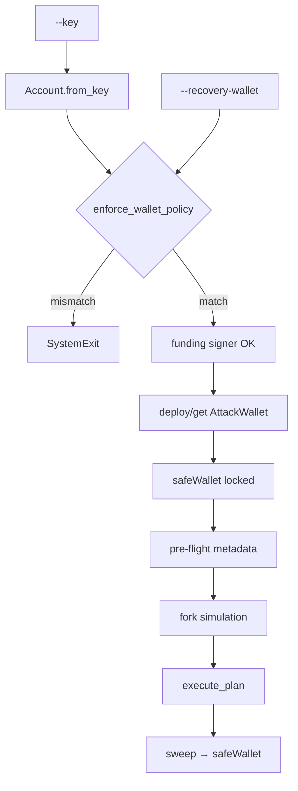

# SECURITY MODEL — operator control, locked profit, wallet policy

> **⚠️ USE AT YOUR OWN RISK — THE AUTHORS ACCEPT NO LIABILITY.**
> **ForkSploit is provided "AS IS", without warranty of any kind. It signs and
> sends real transactions and can move real funds. You use it entirely at your
> own risk and under your own full responsibility; the authors and copyright
> holders accept NO liability whatsoever for any consequences of its use, misuse
> or inability to use it. See [`DISCLAIMER.md`](../DISCLAIMER.md).**

> Standalone document. Related: [ATTACKWALLET.md](ATTACKWALLET.md),
> [CONFIGURATION.md](CONFIGURATION.md), [CHAINS_AND_RPC.md](CHAINS_AND_RPC.md).

This document describes who has control, what is locked, and which controls
prevent dangerous mistakes. Every claim is verified in code.

---

## 1. Wallet roles

The system has exactly three roles (documented in `wallet_policy.py`):

| Role | Who | Where it is used |
|-------|-----|------------------|
| **Funding** | the signer that pays for everything (gas, deploys, execution) | `--key`, `auto_pipeline.acct` |
| **Target** | the contract under test | `--target` |
| **Recovery / safe** | where everything extracted goes | `--recovery-wallet` / `--safe-wallet` |

---

## 2. Wallet policy (`wallet_policy.py`)

* `wallets.json` (gitignored) binds **exactly one** funding and **one** recovery
  address per chain.
* `enforce_wallet_policy(chain, signer_address, recovery_or_safe_wallet)` is
  called after loading the key, **before** every signature. On a mismatch it
  raises `SystemExit` (not a warning).
* `register_policy` requires `--confirm-chain`, which must equal `--chain`
  (protection against the `eth` ↔ `etc` typo). Pre-registration is refused
  without `--force`.
* `register_contract` maintains `contracts.json` — a log of all contracts.

Where it is called:
* `auto_pipeline.main` (after `Account.from_key`).
* `monitor.watch_target` (when `acct` and `--safe-wallet` are given).
* `batch_pipeline.main` once for the whole series.

---

## 3. Locked profit (`AttackWallet.safeWallet`)

`safeWallet` is set **once** (`setSafeWallet`, `require(safeWallet ==
address(0))`). All `sweep*` functions have **no** destination argument — they
send exclusively to the locked `safeWallet`:

* `sweep()` — all ETH.
* `sweepWithBuilderTip(tipBps)` — a tip to the builder (`block.coinbase`), the
  rest to `safeWallet`.
* `sweepToken(token, amount)` — tokens to `safeWallet`.

Consequence: even a compromised `owner` key cannot redirect payouts.
`get_or_deploy_attack_wallet` refuses to reuse an instance with a different
locked `safeWallet` (`SystemExit`).

---

## 4. Operator control

### What the operator determines
* The chain (`--chain`), the RPC (via `rpc_overrides.json` or `ETH_RPC_URL`).
* The target (`--target`), the budget (`--fuzz-seconds`), the oracle set
  (`--detectors`).
* Whether to enable the pre-flight (`--no-preflight`), the gas oracle
  (`--no-gas-oracle`).
* The recovery wallet (locked per chain).

### What the operator **cannot** do
* Cannot change whether a pattern is a vulnerability — Rust decides that
  (`classify_confidence`).
* Cannot redirect the profit past the locked `safeWallet` without deploying a new
  `AttackWallet`.
* Cannot sign without a registered wallet policy.

---

## 5. The pre-flight gate as security

`preflight_skip_reason` prevents unnecessary spending:

1. **Metadata layer** (no network): it skips plans AttackWallet cannot replay at
   all (`atomic_replayable=False`), plans with multiple callers
   (`distinct_callers>1`), Review-tier heuristics
   (`confirmed_exploitable=False`), and owner-impersonation plans
   (`owner_gated`/`owner_impersonation`).
2. **Fork layer** (`simulate_plan_on_fork`): it replays on a throwaway anvil
   fork; it skips if the replay reverts or the net is negative.

Recorded in the code: ETC mainnet, 10 of 11 plans in one run had no effect, one
spent 7,878,136 gas (~0.0206 ETC) — all of it was knowable in advance from free
measurements.

---

## 6. Locked gas

* `gas_utils.MAX_GAS_LIMIT = 8_000_000` — a hard gas limit per transaction on
  any chain. No code may sign above this limit.
* `GasBudget` limits spending per plan: `gas_cap_wei` from `eth_estimateGas` ×
  the number of calls × `GAS_BUDGET_MARGIN`.
* `GasExceedsBlockLimitError` fires only when `eth_estimateGas` exceeds the real
  `block.gasLimit` **and** `eth_call` at that limit also reverts.

---

## 7. Front-running protection

* If `total_value >= FLASHBOTS_THRESHOLD_ETH` (10) and the chain has a relay, the
  whole protected sequence is submitted as **one** Flashbots bundle
  (`flashbots_bundle.py`), atomically.
* Otherwise, on `bsc` above the threshold, a private mempool redirect is used.
* For smaller values the ordinary public path is used.

---

## 8. Limitations of the security model

* **One signer.** `execute_plan` drives every step from one signer through one
  `AttackWallet`; multi-caller traces are skipped.
* **Owner impersonation.** The fuzzer can "become" an address from the target's
  storage (`require(msg.sender == owner)`); such plans are skipped and tagged
  (`owner_impersonation`, `owner_gated`), because no external signer can
  reproduce them.
* **Control leak.** A plan found with a faked return is not atomically
  replayable (`atomic_replayable=False`) and is skipped.
* **Unverified contract without an ABI.** If no ABI is available, Rust uses
  EVMole decompilation; the quality depends on the decompiler.
* **Pre-flight is "best-effort".** If anvil is not installed, the fork layer is
  skipped (the metadata layer remains). So the pre-flight never stops a run, it
  only reduces spending.

---

## 9. Diagram: the decision and control path

---

## 10. Open / unmeasured

* **Unverified:** whether the `AttackWallet` `owner` key is ever rotated in
  practice; `transferOwnership` exists, but this document does not state who
  uses it in which run.
* **Unmeasured:** how much the pre-flight actually saved is not part of this
  document (the code describes observed cases, not systematic measurements).
* **Unverified:** the security of `PRIVACY_REDIRECT_RPC` for BSC is described in
  the code as "confirmed live"; this document does not repeat that as proof.
