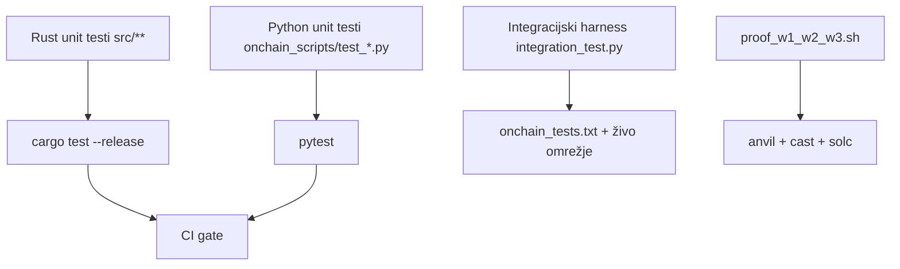

# TESTI — testna mapa: kaj teče, kaj je preskočeno in zakaj

> Samostojen dokument. Sorodno: [GRADNJA_IN_NAMESTITEV.md](GRADNJA_IN_NAMESTITEV.md),
> [ZDRAVLJENJE_NAPAK.md](ZDRAVLJENJE_NAPAK.md).

---

## 1. Sklopi testov

| Sklop | Lokacija | Kaj teče |
|-------|----------|----------|
| Rust unit/integracijski | `src/**` (`#[cfg(test)] mod tests`) | `cargo test --release` |
| Rust primerjalni | `benches/forksploit.rs` | criterion (dev-dependency) |
| Python | `onchain_scripts/test_*.py` (22 datotek) | `python -m pytest onchain_scripts` |
| Integracijski (onchain) | `integration_test.py` | ločen harness |
| Fixture-i | `tests/evm/*` (62 map), `tests/evm_never_pass/*`, `tests/evm_manual/*` | vhod za fuzzer |

---

## 2. Rust testi

### 2.1 Znane neuspešne (niso napake kode)

Iz `AGENTS.md` (baseline): `cargo test --release` javi **140 passed, 10
failed**. Vseh 10 je odvisnih od živega javnega RPC endpointa **ali** od
pripetega živega stanja in ne uspejo **tudi z omrežjem**:

* `evm::tokens::onchain_pair_discovery::tests::*` (8 testov),
* `evm::tokens::uniswap::tests::{test_get_pair, test_fetch_uniswap_path}`,
* `evm::onchain::endpoints::tests::test_get_balance` (primerja hardcoded
  živo stanje, ki se je spremenilo).

CI preskoči natanko te (`ci.yml`):

```
--skip onchain_pair_discovery
--skip uniswap::tests::test_get_pair
--skip uniswap::tests::test_fetch_uniswap_path
--skip endpoints::tests::test_get_balance
```

Vsaka **druga** napaka je regresija.

### 2.2 Pomembni Rust testi (iz kode)

| Test | Kaj dokazuje |
|------|--------------|
| `evm::test::concolic_threads_are_bounded_by_the_campaign_cap` | strop concolic niti |
| `evm::test::concolic_cap_never_exceeds_two_or_cores` | strop ≤ 2 in ≤ cores |
| `evm::test::setup_file_flag_is_not_silently_discarded` | `--setup-file` ni tiho zavržen |
| `evm::multicore::tests::per_job_concolic_threads_never_multiplies_the_cap` | `--jobs` deli, ne množi |
| `evm::multicore::tests::jobs_are_clamped_to_core_count` | `--jobs` omejen na jedra |
| `fuzzer::vuln_file_base_tests` | ime dump datoteke omejeno |
| `evm::solution::plan_meta_confidence_tests::control_leak_trace_is_never_sim_confirmed` | control leak → `sim-review` |
| `evm::solution::tests::generated_exploit_scripts_use_full_gas_call_not_transfer` | W3 poln-gas `call` |
| `evm::oracle::effective_confidence_tests` | downgrade ob `call_leak` |
| `evm::concolic::concolic_host::concolic_memory_cap_tests` | Z3 memory cap |
| `evm::concolic::concolic_host::return_data_tests` | FAZA 2.5 symbolic CALL |
| `host::control_leak_bypass_tests::concolic_flag_forces_control_leak_bypass` | FAZA 2.4 |
| `evm::contract_utils::tests::test_proxy_slot_constants_match_keccak` | proxy sloti |
| `evm::solution::mod.rs::classify_confidence_matches_confirmed_exploitable_list` | skladnost seznamov |

---

## 3. Python testi

Ukaz (iz `AGENTS.md` in `ci.yml`):

```bash
cd onchain_scripts && python -m pytest -q
```

**Meritev (ta repozitorij, ta okolje, brez nameščenega Rust binarija):**

```
python -m pytest -q -p no:cacheprovider
→ 24 failed, 212 passed, 14 skipped in ~39 s
```

Zbrano število testov: `250` (`pytest --collect-only`).

Vseh 24 neuspehov je v **`test_forksploit_wizard.py`** in je posledica
**okolja**, ne kode: testi poganjajo `forksploit.sh --dry-run --no-install`,
ki v `check_env` preveri tudi `target/release/forksploit`. V tem okolju Rust
ni nameščen in binarij ne obstaja, zato `check_env` vrne 1 in `main` konča z
`exit 1` **pred** glavnim menijem — zato v izhodu manjkajo `GLAVNI MENI`,
`PREDLETNO PREVERJANJE OKOLJA` itd.

Dokaz:

```bash
$ bash forksploit.sh --doctor --no-install; echo "EXIT=$?"
...
! binarij   /workspace/project/ForkSploit/target/release/forksploit ni zgrajen
Binarij '…/target/release/forksploit' še vedno manjka -- brez njega pipeline ne more teči.
EXIT=0     # --doctor sam vrne 0
$ printf 'q\n' | bash forksploit.sh --dry-run --no-install | tail -3
Binarij '…/target/release/forksploit' še vedno manjka -- brez njega pipeline ne more teči.
```

`--doctor` sam vrne 0 (kot zahteva `test_doctor_reports_and_exits_zero`), a
izpiše opozorila za manjkajoča orodja. Ostalih 23 testov pričakuje glavni
meni, ki ga `check_env || exit 1` prepreči, ker binarij manjka. Ko je
`cargo build --release` izveden, ti testi preidejo (v `AGENTS.md` je
zabeleženo **232 passed** v polnem okolju — to je vrednost iz tistega okolja,
ne iz tega).

### 3.1 Pomembne Python testne datoteke

| Datoteka | Kaj pokriva |
|----------|-------------|
| `test_forksploit_wizard.py` | interaktivni čarovnik (17 testov) |
| `test_invariant_oracle.py` | invariantni oracle E2E (pozitivno/negativno/sonda) |
| `test_multistep_planner.py` | večstopenjski plan |
| `test_auto_setup.py` | `--auto-setup` |
| `test_proxy_resolver.py` | proxy sloti, cross-check z Rust |
| `test_network_profile.py`, `test_chain_verified.py` | verige/identiteta |
| `test_preflight_gate.py`, `test_gas_oversized_gate.py` | pre-flight vrata |
| `test_gas_fit.py`, `test_gas_ledger.py`, `test_gas_limit_cap.py`, `test_gas_oracle.py` | plin |
| `test_execute_plan_net.py` | klasifikacija izvedbe (X2) |
| `test_send_call_reprice.py` | zamenjava cene |
| `test_triage_findings.py`, `test_materialize_plan.py` | triage/materializacija |
| `test_dashboard_ui.py` | pogodba GUI (pogledi, ključi, kontrole) |
| `test_server_run.py` | zagon GUI |
| `test_monitor_cli.py` | CLI monitorja |
| `test_pipeline_resilience.py` | odpornost pipeline |
| `test_proof.py` | strukturiran dokaz |
| `test_network_profile.py` | `NetworkProfile` |

---

## 4. Integracijski test (`integration_test.py`)

* Bere `onchain_tests.txt` (tabela `ime<TAB>veriga<TAB>blok<TAB>naslovi`).
* Poganja `test_one(path)` z `OFFCHAIN_POOL_SIZE = min(6, cpu_count())`
  procesi.
* Concolic strop deli med delavce:
  `OFFCHAIN_CONCOLIC_CAP = min(2, cpu_count())`,
  `OFFCHAIN_CONCOLIC_THREADS = max(1, OFFCHAIN_CONCOLIC_CAP // OFFCHAIN_POOL_SIZE)`.
* `_find_solc` vrne `~/.svm/0.8.24/solc-0.8.24` ali `solc`.
* Zahteva `timeout`/`gtimeout` in živo omrežje za nekatere fixture-e.

---

## 5. Dokazni skript `onchain_scripts/contracts/proof_w1_w2_w3.sh`

Dokazuje W1–W3 proti vržečemu anvilu (zahteva `anvil` + `cast` + `solc`).
Po `AGENTS.md`: 7/7 uspešnih.

---

## 6. Fixture-i

* `tests/evm/*` — 62 map (pozitivni primeri po bug tipu, npr. `reentrancy`,
  `erc4626`, `concolic-1`, `concolic-2`, `two_step`, `proxy_collision`).
* `tests/evm_never_pass/*` — negativni primeri: `invariant_safe`,
  `concolic_uninit_state`, `concolic_retval_unsat`, `out-of-memory`.
* `tests/evm_manual/*` — ročni fixture-i z Foundry podmoduli
  (`foundry`, `foundry1`); podmoduli `forge-std` in `openzeppelin-contracts`
  so git submoduli (`.gitmodules`).
* `tests/evm_real_balance`, `tests/presets` — dodatni.

---

## 7. Diagram: testna piramida



---

## 8. Odprto / neizmerjeno

* **Neizmerjeno v tem okolju:** `cargo test --release` ni bil pognan (Rust ni
  nameščen). Številka "140 passed, 10 failed" je iz `AGENTS.md`, ne iz tega
  dokumenta.
* **Neizmerjeno:** "232 passed" za Python je iz `AGENTS.md` (polno okolje z
  zgrajenim binarijem). V tem okolju je izmerjeno **212 passed, 24 failed,
  14 skipped** — neuspehi so vsi v `test_forksploit_wizard.py` zaradi
  manjkajočega binarija.
* **Nepreverjeno:** `integration_test.py` in `proof_w1_w2_w3.sh` v tem
  okolju nista bila pognana (zahtevata anvil/cast/solc oz. omrežje).
* `ci.py` je pomožni skript za objavo komentarja v PR (S3/aws), ne del
  testnega niza.
