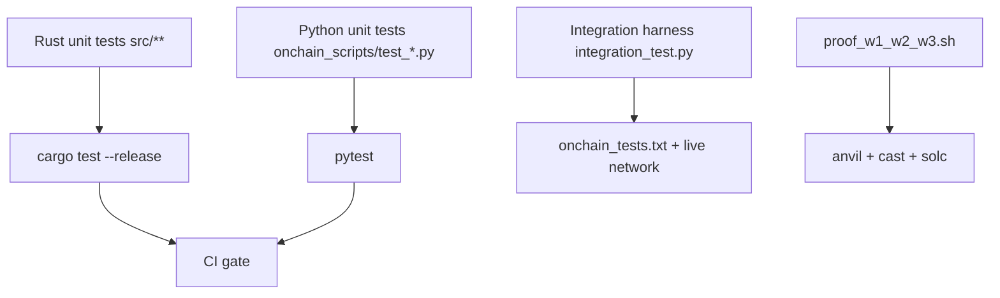

# TESTS — the test map: what runs, what is skipped and why

> **⚠️ USE AT YOUR OWN RISK — THE AUTHORS ACCEPT NO LIABILITY.**
> **ForkSploit is provided "AS IS", without warranty of any kind. It signs and
> sends real transactions and can move real funds. You use it entirely at your
> own risk and under your own full responsibility; the authors and copyright
> holders accept NO liability whatsoever for any consequences of its use, misuse
> or inability to use it. See [`DISCLAIMER.md`](../DISCLAIMER.md).**

> Standalone document. Related: [BUILD_AND_INSTALL.md](BUILD_AND_INSTALL.md),
> [TROUBLESHOOTING.md](TROUBLESHOOTING.md).

---

## 1. Test suites

| Suite | Location | What runs |
|-------|----------|----------|
| Rust unit/integration | `src/**` (`#[cfg(test)] mod tests`) | `cargo test --release` |
| Rust benchmarks | `benches/forksploit.rs` | criterion (dev-dependency) |
| Python | `onchain_scripts/test_*.py` (22 files) | `python -m pytest onchain_scripts` |
| Integration (onchain) | `integration_test.py` | a separate harness |
| Fixtures | `tests/evm/*` (62 dirs), `tests/evm_never_pass/*`, `tests/evm_manual/*` | fuzzer input |

---

## 2. Rust tests

### 2.1 Known failures (not code bugs)

From `AGENTS.md` (baseline): `cargo test --release` reports **140 passed, 10
failed**. All 10 depend on a live public RPC endpoint **or** on pinned live
state and fail **even with network access**:

* `evm::tokens::onchain_pair_discovery::tests::*` (8 tests),
* `evm::tokens::uniswap::tests::{test_get_pair, test_fetch_uniswap_path}`,
* `evm::onchain::endpoints::tests::test_get_balance` (compares hardcoded live
  state that has since changed).

CI skips exactly these (`ci.yml`):

```
--skip onchain_pair_discovery
--skip uniswap::tests::test_get_pair
--skip uniswap::tests::test_fetch_uniswap_path
--skip endpoints::tests::test_get_balance
```

Any **other** failure is a regression.

### 2.2 Important Rust tests (from the code)

| Test | What it proves |
|------|--------------|
| `evm::test::concolic_threads_are_bounded_by_the_campaign_cap` | the concolic thread cap |
| `evm::test::concolic_cap_never_exceeds_two_or_cores` | the cap ≤ 2 and ≤ cores |
| `evm::test::setup_file_flag_is_not_silently_discarded` | `--setup-file` is not silently dropped |
| `evm::multicore::tests::per_job_concolic_threads_never_multiplies_the_cap` | `--jobs` shares, does not multiply |
| `evm::multicore::tests::jobs_are_clamped_to_core_count` | `--jobs` clamped to cores |
| `fuzzer::vuln_file_base_tests` | the dump file name is bounded |
| `evm::solution::plan_meta_confidence_tests::control_leak_trace_is_never_sim_confirmed` | control leak → `sim-review` |
| `evm::solution::tests::generated_exploit_scripts_use_full_gas_call_not_transfer` | W3 full-gas `call` |
| `evm::oracle::effective_confidence_tests` | downgrade on `call_leak` |
| `evm::concolic::concolic_host::concolic_memory_cap_tests` | Z3 memory cap |
| `evm::concolic::concolic_host::return_data_tests` | PHASE 2.5 symbolic CALL |
| `host::control_leak_bypass_tests::concolic_flag_forces_control_leak_bypass` | PHASE 2.4 |
| `evm::contract_utils::tests::test_proxy_slot_constants_match_keccak` | proxy slots |
| `evm::solution::mod.rs::classify_confidence_matches_confirmed_exploitable_list` | list consistency |

---

## 3. Python tests

The command (from `AGENTS.md` and `ci.yml`):

```bash
cd onchain_scripts && python -m pytest -q
```

**Measurement (this repository, this environment, without a built Rust binary):**

```
python -m pytest -q -p no:cacheprovider
→ 24 failed, 212 passed, 14 skipped in ~39 s
```

The collected test count: `250` (`pytest --collect-only`).

All 24 failures are in **`test_forksploit_wizard.py`** and are a consequence of
the **environment**, not the code: the tests run `forksploit.sh --dry-run
--no-install`, which in `check_env` also checks `target/release/forksploit`. In
this environment Rust is not installed and the binary does not exist, so
`check_env` returns 1 and `main` exits with `exit 1` **before** the main menu —
which is why `MAIN MENU`, `PRE-FLIGHT ENVIRONMENT CHECK` etc. are missing from
the output.

Proof:

```bash
$ bash forksploit.sh --doctor --no-install; echo "EXIT=$?"
...
! binary   /workspace/project/ForkSploit/target/release/forksploit is not built
Binary '…/target/release/forksploit' is still missing -- without it the pipeline cannot run.
EXIT=0     # --doctor itself returns 0
$ printf 'q\n' | bash forksploit.sh --dry-run --no-install | tail -3
Binary '…/target/release/forksploit' is still missing -- without it the pipeline cannot run.
```

`--doctor` itself returns 0 (as `test_doctor_reports_and_exits_zero` requires),
but prints warnings for the missing tools. The other 23 tests expect the main
menu, which `check_env || exit 1` prevents because the binary is missing. Once
`cargo build --release` has run, these tests pass (in `AGENTS.md` **232 passed**
is recorded for the full environment — that is a value from that environment,
not from this one).

### 3.1 Important Python test files

| File | What it covers |
|----------|-------------|
| `test_forksploit_wizard.py` | the interactive wizard (17 tests) |
| `test_invariant_oracle.py` | the invariant oracle E2E (positive/negative/probe) |
| `test_multistep_planner.py` | multi-step planning |
| `test_auto_setup.py` | `--auto-setup` |
| `test_proxy_resolver.py` | proxy slots, cross-check with Rust |
| `test_network_profile.py`, `test_chain_verified.py` | chains/identity |
| `test_preflight_gate.py`, `test_gas_oversized_gate.py` | the pre-flight gate |
| `test_gas_fit.py`, `test_gas_ledger.py`, `test_gas_limit_cap.py`, `test_gas_oracle.py` | gas |
| `test_execute_plan_net.py` | execution classification (X2) |
| `test_send_call_reprice.py` | price replacement |
| `test_triage_findings.py`, `test_materialize_plan.py` | triage/materialization |
| `test_dashboard_ui.py` | the GUI contract (views, keys, controls) |
| `test_server_run.py` | GUI launch |
| `test_monitor_cli.py` | the monitor CLI |
| `test_pipeline_resilience.py` | pipeline resilience |
| `test_proof.py` | the structured proof |
| `test_network_profile.py` | `NetworkProfile` |

---

## 4. Integration test (`integration_test.py`)

* Reads `onchain_tests.txt` (a table `name<TAB>chain<TAB>block<TAB>addresses`).
* Runs `test_one(path)` with `OFFCHAIN_POOL_SIZE = min(6, cpu_count())`
  processes.
* It shares the concolic cap among workers:
  `OFFCHAIN_CONCOLIC_CAP = min(2, cpu_count())`,
  `OFFCHAIN_CONCOLIC_THREADS = max(1, OFFCHAIN_CONCOLIC_CAP // OFFCHAIN_POOL_SIZE)`.
* `_find_solc` returns `~/.svm/0.8.24/solc-0.8.24` or `solc`.
* It requires `timeout`/`gtimeout` and a live network for some fixtures.

---

## 5. The proof script `onchain_scripts/contracts/proof_w1_w2_w3.sh`

It proves W1–W3 against a throwaway anvil (requires `anvil` + `cast` + `solc`).
Per `AGENTS.md`: 7/7 successful.

---

## 6. Fixtures

* `tests/evm/*` — 62 directories (positive cases per bug type, e.g. `reentrancy`,
  `erc4626`, `concolic-1`, `concolic-2`, `two_step`, `proxy_collision`).
* `tests/evm_never_pass/*` — negative cases: `invariant_safe`,
  `concolic_uninit_state`, `concolic_retval_unsat`, `out-of-memory`.
* `tests/evm_manual/*` — manual fixtures with Foundry submodules (`foundry`,
  `foundry1`); the `forge-std` and `openzeppelin-contracts` submodules are git
  submodules (`.gitmodules`).
* `tests/evm_real_balance`, `tests/presets` — additional.

---

## 7. Diagram: the test pyramid



---

## 8. Open / unmeasured

* **Unmeasured in this environment:** `cargo test --release` was not run (Rust is
  not installed). The figure "140 passed, 10 failed" is from `AGENTS.md`, not
  from this document.
* **Unmeasured:** "232 passed" for Python is from `AGENTS.md` (the full
  environment with a built binary). In this environment the measured value is
  **212 passed, 24 failed, 14 skipped** — the failures are all in
  `test_forksploit_wizard.py` because the binary is missing.
* **Unverified:** `integration_test.py` and `proof_w1_w2_w3.sh` were not run in
  this environment (they require anvil/cast/solc or a network).
* `ci.py` is a helper script for posting a PR comment (S3/aws), not part of the
  test suite.
