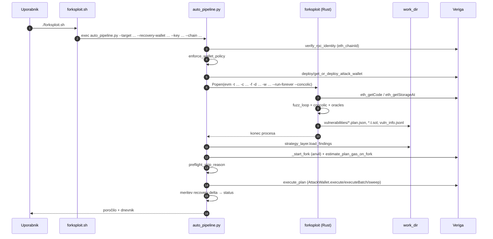

# TOK PODATKOV — od ukaza do dokaza na verigi

> Samostojen dokument. Sorodno: [ARHITEKTURA.md](ARHITEKTURA.md),
> [OZICENJE_RUST_PYTHON.md](OZICENJE_RUST_PYTHON.md),
> [ATTACKWALLET.md](ATTACKWALLET.md), [PLAN_JSON.md](PLAN_JSON.md).

Ta dokument nariše celoten potek izvajanja od vstopne točke do merjenega
dokaza na verigi. Za vsak korak je naveden `datoteka::simbol` in kdo koga
kliče. Vsaka trditev je preverjena v kodi.

---

## 0. Pregledna shema toka

```
[1] CLI vstop
     │  forksploit.sh  ──(exec)──▶  auto_pipeline.py / batch_pipeline.py
     │  ALI neposredno:  target/release/forksploit evm …
     ▼
[2] Naložitev tarče + proxy + setup
     │  chains.verify_rpc_identity → wallet_policy.enforce_wallet_policy
     │  proxy_resolver.resolve_proxy_chain
     │  Rust: ContractLoader::from_address/from_glob/from_fork/from_setup
     │  Rust: auto_setup::derive_setup_spec (--auto-setup)
     ▼
[3] Fuzz kampanja (Rust)
     │  evm_fuzzer → corpus_initializer → fuzz_loop
     │  ena transakcija na EVMInput; genealogija korpusa; concolic
     ▼
[4] Orakel zadene → dump
     │  ForkSploitFuzzer::evaluate_input_events
     │  → vulnerabilities/*.plan.json + *.t.sol (+ *.s.sol)
     │  → vuln_info.jsonl, coverage.txt, traces/
     ▼
[5] Python bere plane
     │  strategy_layer.load_findings → ordering_key
     ▼
[6] Pre-flight vrata
     │  metadata_skip_reason → estimate_plan_gas_on_fork → simulate_plan_on_fork
     ▼
[7] Izvedba prek AttackWallet
     │  execute_plan: deploy/get_or_deploy_attack_wallet, execute/executeBatch,
     │  armCallback (reentrancy), Aave flashloan, Flashbots bundle
     ▼
[8] Pobiranje + dokaz
     │  sweep() / sweepToken() → recovery denarnica
     │  meritev recovery delta → PLAN_CONFIRMED / NO_PROFIT / ...
```

---

## 1. CLI vstop

Dve poti:

### 1.1 Interaktivni vstop — `forksploit.sh`

* `forksploit.sh::main` (konec datoteke): preveri okolje
  (`check_env`), pokaže glavni meni (`main_menu`), nato `run_wizard`.
* `run_wizard` izvede 7 korakov (`step_chain`, `step_rpc`, `step_key`,
  `step_targets`, `step_recovery`, `step_policy`, `step_mainnet`), nato
  `summary` in `choose_pipeline`.
* Na koncu zgradi `RUN_CMD` in `exec`-a `auto_pipeline.py` ali
  `batch_pipeline.py` (v `$SCRIPTS_DIR`).
* Zastavice: `--doctor` (samo preflight), `--dry-run` (izpiše ukaz),
  `--no-install` (nikoli ne namešča).

### 1.2 Neposredni vstop

* Rust: `target/release/forksploit evm <args>` → `src/main.rs::main` →
  `Commands::Evm(args)` → `src/evm/mod.rs::evm_main`.
* Python: `python3 onchain_scripts/auto_pipeline.py --target … --recovery-wallet
  … --key … --chain …` → `auto_pipeline.py::main`.

### 1.3 Začetne kontrole v `auto_pipeline.main`

Po `build_parser().parse_args()`:

1. `require_mainnet_confirmation(args.chain, args.confirm_mainnet)`
   (`chains.py`) — če `--chain` ni v `TESTNET_CHAINS` in ni `--confirm-mainnet`,
   `SystemExit`.
2. Ustvari `Tee(LOGS_DIR / f"auto_pipeline_{run_id}.log")`.
3. Prebere ključ (`Path(args.key)`), zgradi `w3 = make_w3(args.chain)`.
4. `verify_rpc_identity(args.chain, tee, w3=w3)` — prebere **realni**
   `eth_chainId` in primerja z `chains.CHAIN_IDS`; neujemanje → `SystemExit`.
5. `acct = Account.from_key(...)`; `enforce_wallet_policy(chain, acct.address,
   args.recovery_wallet)` (`wallet_policy.py`) — če ni registrirane politike ali
   se ključ/denarnica ne ujemata, `SystemExit`.
6. Preveri stanje podpisnika; če 0, napaka.

---

## 2. Naložitev tarče, proxy razširitev, setup

### 2.1 Python stran

* Če je `--target` že naslov (`0x…`, dolžina 42), se uporabi neposredno.
  Sicer se `.sol`/`.bin` prevede (`compile_contract`) in razporedi (`deploy`).
* `register_contract(...)` v `contracts.json`.
* Če je `--fund-eth > 0` in je tarča prazna, `send_call(..., "Fund target", ...)`.
* `attack_wallet = get_or_deploy_attack_wallet(...)` — enkrat na verigo.
* `proxy_info = resolve_proxy_chain(w3, target_address)` (`proxy_resolver.py`)
  — odkrije implementacije prek EIP-1967/1822/1167/7702. `extra_targets =
  proxy_info["implementations"]`.

### 2.2 Rust stran

`evm_main` izbere `target_type` (`EVMTargetType`):

| Vrednost | Kdaj | Naložitelj |
|----------|------|-----------|
| `Glob` | `--target` ni naslov | `ContractLoader::from_glob` |
| `Address` | `--target 0x…` | `ContractLoader::from_address` |
| `AnvilFork` | `--chain-type` + builder/artefakti | `ContractLoader::from_fork` |
| `Config` | `--offchain-config-*` | `ContractLoader::from_config` |
| `Setup` | `--deployment-script`/`--setup-file` | `ContractLoader::from_setup` |

`from_address` in `from_fork` kličeta `expand_proxy_targets`, ki prek
`proxy_implementations_of` sledi EIP-1967 (impl/beacon), EIP-1822 (UUPS),
EIP-1167 (minimalni proxy) in EIP-7702 (`0xef0100 || delegate`).

`--auto-setup` (`src/evm/auto_setup.rs::derive_setup_spec`) izpelje
`setX(address)` povezave med razporejenimi pogodbe; eksplicitni `setup.json`
vedno zmaga (`src/evm/mod.rs::evm_main`).

`setup.json` (`src/evm/setup.rs::SetupSpec`) se izvede **enkrat**, pred
fuzzingom, na sveže razporejenem stanju.

---

## 3. Fuzz kampanja

Vstop: `src/fuzzers/evm_fuzzer.rs::evm_fuzzer(config, state)`.

Koraki v `evm_fuzzer`:

1. Ustvari `SimpleEventManager`, `SortedDroppingScheduler` (infant),
   `PowerABIScheduler`.
2. `FuzzHost::new(scheduler, work_dir)`; nastavi `spec_id`.
3. Doda middleware glede na `Config` (onchain, flashloan, sha3 taint/bypass,
   reentrancy, overflow, delegatecall, ecrecover, arbitrary-storage-write,
   storage-collision, delegatecall-target, uninitialized-memory,
   unchecked-call, tx-origin).
4. `EVMQueueExecutor::new(fuzz_host, deployer)`.
5. `EVMCorpusInitializer::new(...)` + `initialize(&mut contract_loader)` —
   razporedi pogodbe, izračuna začetni korpus.
6. Doda `Coverage` middleware.
7. Zgradi `oracles` po `Config` zastavicah (glej [ORAKLI.md](ORAKLI.md)).
8. `ForkSploitFuzzer::new(scheduler, infant_scheduler, wrapped_feedback,
   infant_feedback, infant_result_feedback, objective, minimizer, work_dir)`.
9. Če je `--replay-file`/`--load-corpus`, naloži testcases iz datotek.
10. `fuzzer.fuzz_loop(&mut stages, &mut executor, state, &mut mgr)`.

**Ena transakcija na `EVMInput`** (`src/evm/input.rs::EVMInput`):
`input_type`, `caller`, `contract`, `data` (ABI), `sstate` (staged VM stanje),
`txn_value`, `env`, `repeat`, `randomness`, `swap_data`.

**Genealogija korpusa**: vsaka izvedba zabeleži `TxnTrace::from_idx`
(nadrejeni) in strnjen zapis v `src/fuzzer.rs` (funkcionalnosti
`full_trace` + `print_txn_corpus`); `cov_stage`/`minimizer` ponovno predvajata
zaporedje (root → setup → attack). To omogoča doseganje večstopenjskih
napak, čeprav je `EVMInput` ena transakcija.

**Concolic** (`src/evm/concolic/*`): `ConcolicStage::perform` teče nad
korpusom; vsak testcase dobi Z3 reševanje na omejeni delovni skupini
(`src/const.rs::MAX_CONCOLIC_THREADS = 2`,
`src/evm/mod.rs::resolve_concolic_num_threads`). Med reševanjem se dvigne
`CONCOLIC_NO_CONTROL_LEAK` (`src/evm/host.rs`), da se vsak klic usmeri na
`call_forbid_control_leak`. Neinicializirana staged stanja se preskočijo.

---

## 4. Sprožitev orakla → zapis plan.json + .t.sol

Mesto: `src/fuzzer.rs::ForkSploitFuzzer::evaluate_input_events`.

1. Orakel vrne `bug_idx`; `OracleFeedback` (v `src/oracle.rs`) označi rezultat
   kot `ExecuteInputResult::Solution`.
2. Ob `Solution`:
   * `BugMetadata::register_corpus_idx`.
   * `sequential_minimizer.minimize(...)` → minimizirana sled.
   * `prettify_concise_inputs(&minimized)` → berljiv izpis.
   * Izpiše poročilo (Description + Trace).
   * `solution::generate_test_with_full_trace(cur_report, minimized,
     Some(full_trace_inputs))`.
   * Doda `ORACLE_OUTPUT` (Mutex<Vec<serde_json::Value>>) v
     `work_dir/vuln_info.jsonl`.
   * Zapiše `work_dir/vulnerabilities/<idxs>` in `<idxs>_replayable`
     (`vuln_file_base` omeji ime).
   * Brez `--run-forever` → `exit(0)`.

`generate_test_with_full_trace` (`src/evm/solution/mod.rs`):

* Zapiše `{contract_name}.t.sol` (predloga `foundry_test.hbs`).
* Če je reentrancy (`is_reentrancy_bug`) in `split_reentrant_trace` uspe:
  `generate_reentrancy_script` + `generate_reentrancy_exploit_plan`.
* Sicer: `generate_exploit_plan`.
* Če je `Confirmed`-tier **in** ni control leaka **in** en klicatelj:
  `generate_script` (`.s.sol`).

`write_plan` (`src/evm/solution/script_generator.rs`) zapiše
`{contract_name}.plan.json` (glej [PLAN_JSON.md](PLAN_JSON.md)).

---

## 5. Python: branje planov, združevanje, pre-flight

V `auto_pipeline.main`:

```python
findings = strategy_layer.load_findings(work_dir)
findings.sort(key=strategy_layer.ordering_key)
plan_files = [f["plan_path"] for f in findings]
```

* `ordering_key`: unlock-class najprej, nato dvoumni, nato objective, nato
  neklasificirani; znotraj nivoja bogatejše sledi prej; numerični tiebreak.
* `report_coverage(work_dir, tee)` vrne `(min_instr_pct, min_branch_pct)`.
* `report_unexecuted_findings`, `report_surface_triage`.
* Pre-flight fork: `_start_fork(args.chain, tee)` (če `--no-preflight` ni podan).
* Za vsak finding: `estimate_plan_gas_on_fork` → stempljanje plinskih polj →
  `gated_execute_plan`.

`gated_execute_plan` (`auto_pipeline.py`):

* Če `--no-preflight`: neposredno `execute_plan`.
* Sicer sestavi `finding_` in pokliče `preflight_skip_reason`; ob preskočitvi
  vrne `(skip_status_for(reason), 0, 0, 0, 0)`.

---

## 6. Izvedba prek AttackWallet

`execute_plan(w3, acct, nonce_box, attack_wallet, plan, recovery_wallet, tee,
chain)`:

1. `GasLedger()`, `recovery_balance_before`.
2. `total_value = sum(parse_pretty_wei(step["value"]))`.
3. Izbere pot zaščite:
   * `bundle_relay = bundle_relay_for(chain)`; `use_bundle` če
     `total_value >= FLASHBOTS_THRESHOLD_ETH` in veriga ima relay.
   * `use_privacy_redirect` če `PRIVACY_REDIRECT_RPC` ima verigo in
     `total_value >= threshold_native`.
4. Če `total_value > 0` in je `AttackWallet` premalo financiran:
   * če podpisnik ima dovolj → `send_call(..., "Fund AttackWallet", ...)`;
   * sicer, za `flat` plan na verigi z Aave V3 + WETH →
     `execute_flat_plan_via_flashloan`;
   * sicer → `PLAN_INCONCLUSIVE`.
5. Izvedba:
   * **Bundle pot**: vsak zaščiten klic se predpodpiše (`sign_step`), nato
     `call_bundle` (simulacija) + `submit_bundle_and_wait`.
   * **Sekvenčna pot**: `use_batch = (kind == "flat" and len(steps) > 1)` →
     `executeBatch` v eni transakciji; sicer korak-po-korak `execute`.
     Reentrancy plan vstavi `armCallback` pred zadnji korak in `disarmCallback`
     za njim.
6. Plinski proračun: `GasBudget(gas_cap_wei)`, kjer je `gas_cap_wei` odvisen od
   `eth_estimateGas` prvega koraka (`estimate_gas_limit`), števila klicev in
   `GAS_BUDGET_MARGIN`.

Zahteve AttackWallet (glej [ATTACKWALLET.md](ATTACKWALLET.md)):
`execute(target, data, value)`, `executeBatch(targets, datas, values)`,
`armCallback`/`disarmCallback`, `startFlashLoan`, `sweep`,
`sweepWithBuilderTip`, `sweepToken`.

---

## 7. Pobiranje + dokaz

Na koncu `execute_plan`:

1. `bal = w3.eth.get_balance(attack_wallet)`; če `> 0`, `sweep()` na
   zaklenjeno `safeWallet`.
2. Za vsak `stolen_asset` v korakih: `erc20_balance_of` AttackWallet,
   `sweepToken(token, amount)` na recovery denarnico; zabeleži delta.
3. `recovery_balance_after = w3.eth.get_balance(recovery_checksum)`;
   `delta = after - before`.
4. Če `delta > 0` ali je bil pridobljen token → `PLAN_CONFIRMED`.
5. Sicer → `PLAN_EXECUTED_NO_PROFIT` (in opozorilo, da token morda sploh ni
   bil preverjen, če ni bilo prepoznanega ERC-20 koraka).

Dokaz je torej **merjenje stanja recovery denarnice** (`is_chain_verified`),
ne oznaka iz simulacije.

---

## 8. Povratna zanka in končno poročilo

* Po vsakem planu se `plan["gas_used"]` zapiše nazaj v `plan.json`.
* `results` zbira po eno vrstico na plan (status, delta, gas, neto, proof).
* Faza 2: `strategy_layer.run_chain_attempts` poskusi sestavljene plane
  (unlock → objective), preskoči tiste, katerih objective je že potrjen sam.
* Končni povzetek izpiše števce po statusu in vsoto potrjenih dvigov
  (bruto in neto po odbitku plina).

---

## 9. Diagram zaporedja (celoten tok)



---

## 10. Odprto / neizmerjeno

* **Neizmerjeno:** dejanske vrednosti trajanja, števila izvedb in globine
  dosega niso del tega dokumenta. Za meritve glej
  `AGENTS.md` in `BLOKATORJI.md`; ta dokument opisuje pot, ne zmogljivosti.
* **Nepreverjeno:** vrstni red izvajanja korakov znotraj `fuzz_loop` je
  odvisen od libafl razporejevalnika (`PowerABIScheduler`); ta dokument
  navaja le, da se zanka izvaja, ne pa determinističnega vrstnega reda
  posameznih mutacij.
* `-f` v `run_fuzzer` je `--flashloan` (kratka oblika iz polja `flashloan`),
  ne `--fetch-tx-data`. `--fetch-tx-data` v `run_fuzzer` **ni** vklopljen;
  Rust bi ga uporabil za nalaganje transakcij z lokalnega proxy endpointa
  (`src/evm/mod.rs::evm_main`, `args.proxy_address`), a ga pipeline ne
  nastavi. V CLI referenci je zato `-f` naveden pri `--flashloan`.
