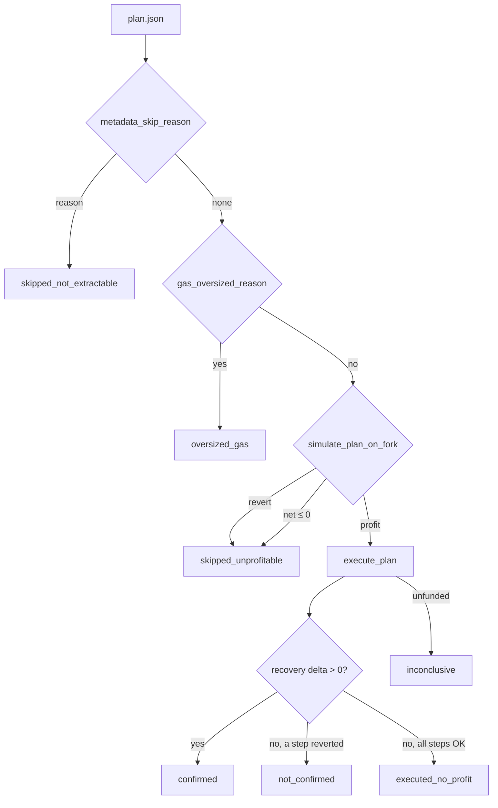

# TROUBLESHOOTING — statuses, exit codes, typical errors

> Standalone document. Related: [RUST_PYTHON_WIRING.md](RUST_PYTHON_WIRING.md),
> [TESTS.md](TESTS.md), [LIMITATIONS.md](LIMITATIONS.md).

---

## 1. Execution statuses (`auto_pipeline.py`)

Constants and their meaning (from the code):

| Constant | Value | Meaning | Who sets it |
|-----------|----------|-------|----------------|
| `PLAN_CONFIRMED` | `"confirmed"` | the recovery wallet **measurably** increased (ETH and/or tokens) | `execute_plan` |
| `PLAN_NOT_CONFIRMED` | `"not_confirmed"` | a step reverted against real state | `execute_plan` |
| `PLAN_INCONCLUSIVE` | `"inconclusive"` | execution was not possible (e.g. unfunded) | `execute_plan` |
| `PLAN_EXECUTED_NO_PROFIT` | `"executed_no_profit"` | all steps OK, but nothing was transferred | `execute_plan` |
| `PLAN_SKIPPED_UNPROFITABLE` | `"skipped_unprofitable"` | the pre-flight fork proved unprofitability | `skip_status_for` |
| `PLAN_SKIPPED_NOT_EXTRACTABLE` | `"skipped_not_extractable"` | no executable step (heuristic/leak/multi-caller) | `skip_status_for` |
| `PLAN_OVERSIZED_GAS` | `"oversized_gas"` | the measured gas does not fit in one block | `skip_status_for` |

"No findings" verdicts (`determine_negative_result_verdict`):
`SCAN_NO_BUG_BOUNDED = "no_bug_found_bounded"`,
`SCAN_INSUFFICIENT_COVERAGE = "insufficient_coverage"`.

`chain-verified` is not a stored label, but `is_chain_verified(status, delta)`
returns `True` only when `status == PLAN_CONFIRMED` **and** `delta > 0`.

---

## 2. Exit codes

### Rust binary
| Code | Where | Condition |
|------|-----|-------|
| `0` | `src/fuzzer.rs::evaluate_input_events` | vulnerability found without `--run-forever` |
| `0` | `src/evm/mod.rs::evm_main` | the `--jobs>1` supervisor finishes with the `run_supervisor` result |
| `1` | `src/fuzzers/evm_fuzzer.rs` | `fuzz_loop` returns an error |
| `i32` | `src/evm/multicore.rs::run_supervisor` | the supervisor code (an aggregate of the workers) |

### Python (`auto_pipeline.main`)
| Code | Condition |
|------|-------|
| `1` | the key does not exist; the signer has no funds; the target does not exist |
| `0` | normal completion |

`SystemExit` (via `chains`/`wallet_policy`): an unknown chain, an RPC identity
mismatch, a wallet mismatch, an unconfirmed mainnet chain.

---

## 3. Typical errors and causes

### 3.1 RPC identity mismatch
* Message: `RPC identity mismatch: --chain '<x>' expects chain id <N>, but
  the configured RPC … is actually serving …`.
* Cause: a wrong `--chain` or a stale `rpc_overrides.json`.
* Fix: correct `--chain` or clear the override
  (`chains.clear_rpc_override` / `DELETE /api/rpc-override/{chain}`).

### 3.2 No wallet policy registered
* Message: `Refusing to sign anything on chain '<x>': no wallet policy
  registered for it yet.`
* Fix: `python3 wallet_policy.py register --chain <x> --confirm-chain <x>
  --funding-wallet 0x… --recovery-wallet 0x… --confirm`.

### 3.3 Key / recovery wallet mismatch
* Messages: `Refusing to sign on chain …: the loaded key resolves to … but
  the wallet registered … is …` or `… --recovery-wallet/--safe-wallet is …,
  but the wallet registered as this chain's recovery wallet is …`.
* Fix: correct the argument or re-register the policy with `--force`.

### 3.4 Mainnet without confirmation
* Message: `Refusing to sign transactions on '<x>': it is not in
  TESTNET_CHAINS (…)`.
* Fix: `--confirm-mainnet` (or use a testnet).

### 3.5 Gas does not fit in a block (oversized_gas)
* Symptom: a plan tagged `fits_block_gas_limit=false`; status `oversized_gas`.
* Cause: the revm model has no gas metering; a trace valid in the idealized
  simulation does not fit in a real block.
* See `gas_oversized_reason` and `estimate_plan_gas_on_fork`.

### 3.6 `eth_estimateGas` returns a huge number
* `estimate_gas_limit` cross-checks with `eth_call` at `block.gasLimit`.
  `GasExceedsBlockLimitError` fires only if **also** `eth_call` reverts (a real
  infeasibility, not just "a large estimate").

### 3.7 AttackWallet is locked to another recovery wallet
* Message: `AttackWallet … is LOCKED to safe wallet …, but this run expects
  … -- refusing to proceed.`
* Fix: delete the entry in `attack_wallets.json` and deploy a new instance.

### 3.8 Finding file name too long
* Previously `File::create(...).unwrap()` panicked ("File name too long") under
  `--run-forever`. Now `vuln_file_base` bounds the name to 120 bytes + a hash.

### 3.9 The fuzzer stops after the first finding
* Cause: without `--run-forever` the binary calls `exit(0)` on the first
  finding.
* Fix: `auto_pipeline.run_fuzzer` always adds `--run-forever`.

### 3.10 `anvil` is not installed
* The pre-flight fork layer is silently skipped (the metadata layer remains);
  this does **not** stop a run.

### 3.11 `solc` is not 0.8.24
* `_find_solc` checks that the pin really reports 0.8.24; otherwise it warns and
  falls back to `solc` from `PATH`. `_solc_extra_flags` picks `--evm-version`
  from `_SOLC_EVM_FALLBACKS = ["cancun","shanghai","paris","london"]`.

### 3.12 The Solidity template mentions non-existent flags
* The generated `.t.sol`/`.s.sol` contain the comment
  `forksploit evm -o -t … -f -i -p …`, where `-o` and `-p` **do not exist** in
  `EvmArgs`. The command in the comment is stale. This is
  **unmeasured/unverified** as a bug, but recorded as a discrepancy between the
  template and the code.

### 3.13 `-f` is `--flashloan`, not `--fetch-tx-data`
* `EvmArgs` assigns the short form `-f` to the `flashloan` field (`#[arg(short,
  long, default_value = "false")]` in `src/evm/mod.rs`), because clap derives the
  short form from the field name. `fetch_tx_data` has **no** short form.
* `auto_pipeline.run_fuzzer` therefore actually enables the **flashloan** with
  `-f`, not `--fetch-tx-data`. This is recorded as a fact from the code; in this
  document `-f` is always interpreted as `--flashloan`.
* Recorded as a discrepancy with existing documentation/comments that describe
  `-f` as "fetch tx data". The code is the source of truth.

### 3.14 Stale constant name in a comment
* `onchain_scripts/auto_pipeline.py` mentions `FUND_EXTRACTION_BUG_TYPES
  (src/evm/solution/mod.rs)` in a comment, but that constant does **not** exist
  in Rust — there it is `CONFIRMED_EXPLOITABLE_BUG_TYPES`
  (`src/evm/solution/mod.rs:361`). Python's `FUND_EXTRACTION_BUG_TYPES` is a
  smaller subset (6 types). The comment is stale; the code does not match it.
  Recorded as a discrepancy, not fixed (the task forbids changing code).

### 3.14 `test_forksploit_wizard.py` failures without the binary
* `check_env || exit 1` in `forksploit.sh` prevents the main menu if
  `target/release/forksploit` does not exist. This is not a code bug, but a
  missing build. See [TESTS.md](TESTS.md) §3.

---

## 4. How to read the output

* Every `tee.log` line goes both to the terminal and to
  `onchain_scripts/logs/auto_pipeline_<run_id>.log`.
* `[fuzzer] …` lines are the raw output of the Rust binary (the simulation
  level). The `CONFIRMED`/`NOT CONFIRMED`/`EXECUTED, NO PROFIT`/`INCONCLUSIVE`
  lines are Python's and mean a real measurement.
* The dashboard filters `[fuzzer]` lines out of `recent_logs`
  (`dashboard_server.api_state`).

---

## 5. Diagram: the status decision flow

---

## 6. Open / unmeasured

* **Unverified:** the exact `run_supervisor` exit codes for various worker
  failure scenarios are not broken down (the code returns an aggregate).
* **Unmeasured:** the frequency of individual errors in practice is not part of
  this document.
* The statuses are constants; if Python ever adds a new status, this table will
  not be updated automatically — read `auto_pipeline.py`.
