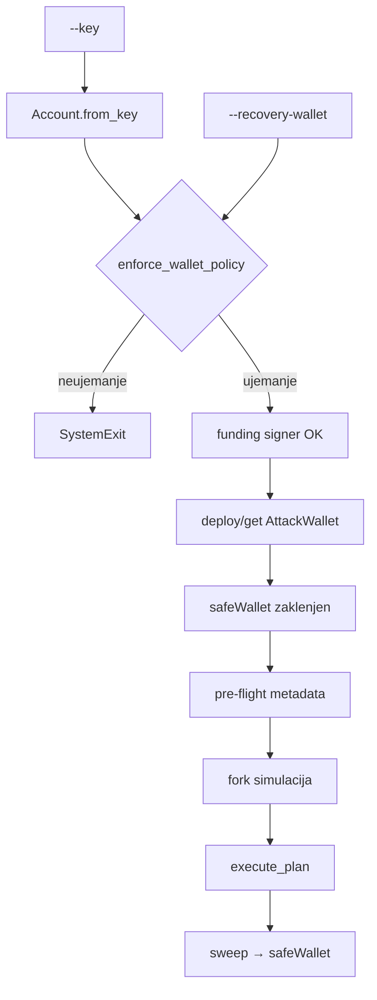

# VARNOSTNI MODEL — nadzor operaterja, zaklenjen profit, politika denarnic

> Samostojen dokument. Sorodno: [ATTACKWALLET.md](ATTACKWALLET.md),
> [KONFIGURACIJA.md](KONFIGURACIJA.md), [VERIGE_IN_RPC.md](VERIGE_IN_RPC.md).

Ta dokument opisuje, kdo ima nadzor, kaj je zaklenjeno, in katere kontrole
preprečujejo nevarne napake. Vsaka trditev je preverjena v kodi.

---

## 1. Vloge denarnic

Sistem ima natanko tri vloge (dokumentirano v `wallet_policy.py`):

| Vloga | Kdo | Kje se uporablja |
|-------|-----|------------------|
| **Funding** | podpisnik, ki plača vse (plin, razporeditve, izvedbo) | `--key`, `auto_pipeline.acct` |
| **Target** | pogodba pod testom | `--target` |
| **Recovery / safe** | kam gre vse pobrano | `--recovery-wallet` / `--safe-wallet` |

---

## 2. Politika denarnic (`wallet_policy.py`)

* `wallets.json` (gitignored) veže **natanko en** funding in **en** recovery
  naslov na verigo.
* `enforce_wallet_policy(chain, signer_address, recovery_or_safe_wallet)` se
  kliče po nalaganju ključa, **pred** vsakim podpisom. Ob neujemanju vrže
  `SystemExit` (ne opozorila).
* `register_policy` zahteva `--confirm-chain`, ki mora biti enak `--chain`
  (zaščita pred tipkarsko napako `eth` ↔ `etc`). Pre-registracija je
  zavrnjena brez `--force`.
* `register_contract` vodi `contracts.json` — dnevnik vseh pogodb.

Kje se kliče:
* `auto_pipeline.main` (po `Account.from_key`).
* `monitor.watch_target` (ko je `acct` in `--safe-wallet`).
* `batch_pipeline.main` enkrat za celo serijo.

---

## 3. Zaklenjen profit (`AttackWallet.safeWallet`)

`safeWallet` se nastavi **enkrat** (`setSafeWallet`, `require(safeWallet ==
address(0))`). Vse `sweep*` funkcije **nimajo** argumenta cilja — pošljejo
izključno na zaklenjeni `safeWallet`:

* `sweep()` — ves ETH.
* `sweepWithBuilderTip(tipBps)` — napitnina builderju (`block.coinbase`),
  ostalo na `safeWallet`.
* `sweepToken(token, amount)` — token na `safeWallet`.

Posledica: tudi kompromitiran `owner` ključ ne more preusmeriti izplačil.
`get_or_deploy_attack_wallet` zavrne ponovno uporabo instance z drugačnim
zaklenjenim `safeWallet` (`SystemExit`).

---

## 4. Nadzor operaterja

### Kaj operater določa
* Verigo (`--chain`), RPC (prek `rpc_overrides.json` ali `ETH_RPC_URL`).
* Cilj (`--target`), proračun (`--fuzz-seconds`), oracle set
  (`--detectors`).
* Ali vklopi pre-flight (`--no-preflight`), gas oracle
  (`--no-gas-oracle`).
* Recovery denarnico (zaklenjeno na verigo).

### Kaj operater **ne** more
* Ne more spremeniti, ali je vzorec ranljivost — to odloči Rust
  (`classify_confidence`).
* Ne more preusmeriti profita mimo zaklenjenega `safeWallet`, ne da bi
  razporedil novo `AttackWallet`.
* Ne more podpisati brez registrirane politike denarnic.

---

## 5. Pre-flight vrata kot varnost

`preflight_skip_reason` prepreči nepotrebno porabo:

1. **Metadata sloj** (brez omrežja): preskoči plane, ki jih AttackWallet
   sploh ne more ponoviti (`atomic_replayable=False`), plane z več
   klicatelji (`distinct_callers>1`), Review-tier heuristike
   (`confirmed_exploitable=False`), in owner-impersonation plane
   (`owner_gated`/`owner_impersonation`).
2. **Fork sloj** (`simulate_plan_on_fork`): predvaja na vržečem anvil forku;
   preskoči, če reverza ali če je neto negativen.

Zapisano v kodi: ETC mainnet, 10 od 11 planov v enem teku je teklo brez
učinka, eden je porabil 7.878.136 gas (~0.0206 ETC) — vse je bilo mogoče
vedeti vnaprej iz zastonj meritev.

---

## 6. Zaklenjeni plin

* `gas_utils.MAX_GAS_LIMIT = 8_000_000` — trda meja plina na transakcijo na
  kateri koli verigi. Nobena koda ne sme podpisati nad to mejo.
* `GasBudget` omeji porabo na plan: `gas_cap_wei` iz `eth_estimateGas` ×
  število klicev × `GAS_BUDGET_MARGIN`.
* `GasExceedsBlockLimitError` se sproži le, ko `eth_estimateGas` preseže
  realni `block.gasLimit` **in** `eth_call` pri tej meji prav tako reverza.

---

## 7. Zaščita pred front-running

* Če je `total_value >= FLASHBOTS_THRESHOLD_ETH` (10) in veriga ima relay,
  se celotno zaščiteno zaporedje pošlje kot **en** Flashbots bundle
  (`flashbots_bundle.py`), atomično.
* Sicer se na `bsc` nad pragom uporabi zasebni mempool redirect.
* Za manjše vrednosti se uporabi običajna javna pot.

---

## 8. Omejitve varnostnega modela

* **En podpisnik.** `execute_plan` poganja vsak korak iz enega podpisnika
  prek ene `AttackWallet`; večklicateljske sledi se preskočijo.
* **Owner-impersonation.** Fuzzer lahko "postane" naslov iz storage tarče
  (`require(msg.sender == owner)`); taki plani se preskočijo in označijo
  (`owner_impersonation`, `owner_gated`), ker jih noben zunanji podpisnik ne
  more reproducirati.
* **Control leak.** Plan, odkrit s faked returnom, ni atomično ponovljiv
  (`atomic_replayable=False`) in se preskoči.
* **Neatestirana pogodba brez ABI-ja.** Če ABI ni na voljo, Rust uporabi
  EVMole dekompilacijo; kakovost je odvisna od dekompilatorja.
* **Pre-flight je "best-effort".** Če anvil ni nameščen, se fork sloj
  preskoči (metadata sloj ostane). Zato pre-flight nikoli ne ustavi teka,
  le zmanjša porabo.

---

## 9. Diagram: pot odločitev in nadzora

---

## 10. Odprto / neizmerjeno

* **Nepreverjeno:** ali je `owner` ključ `AttackWallet`-a kadar koli rotiran
  v praksi; `transferOwnership` obstaja, a ta dokument ne navaja, kdo ga
  uporablja v katerem teku.
* **Neizmerjeno:** koliko je pre-flight dejansko prihranil, ni del tega
  dokumenta (v kodi so opisani opaženi primeri, ne sistematične meritve).
* **Nepreverjeno:** varnost `PRIVACY_REDIRECT_RPC` za BSC je opisana v kodi
  kot "confirmed live"; ta dokument tega ne ponavlja kot dokaz.
