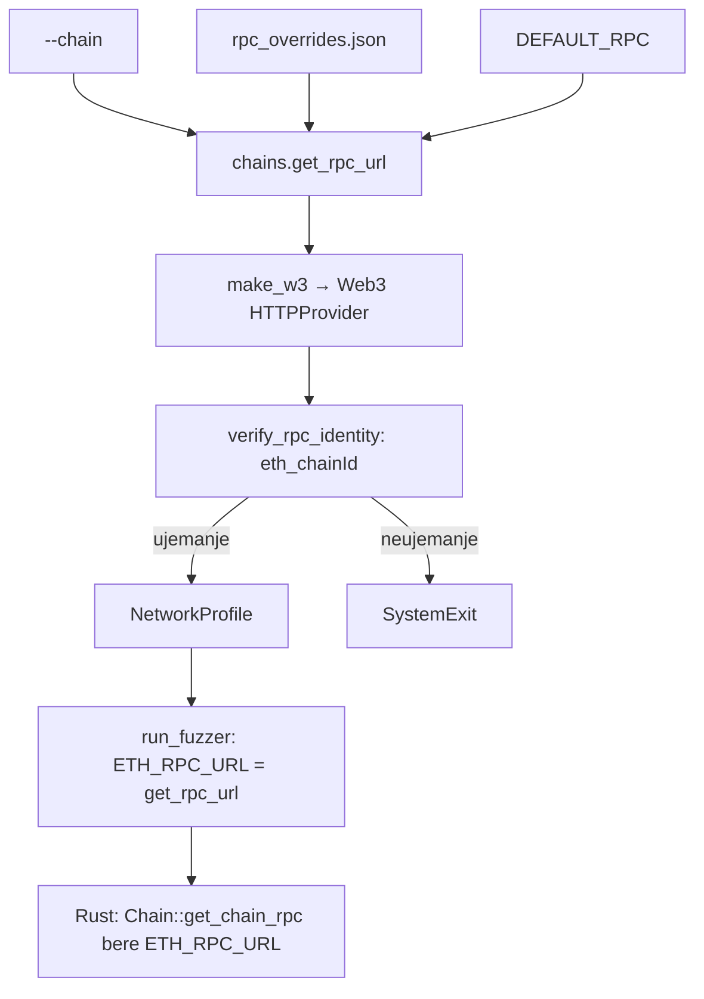

# VERIGE IN RPC — verige, RPC, identiteta omrežja

> Samostojen dokument. Sorodno: [KONFIGURACIJA.md](KONFIGURACIJA.md),
> [VARNOSTNI_MODEL.md](VARNOSTNI_MODEL.md), [PYTHON_PLAST.md](PYTHON_PLAST.md).

Vsaka trditev je preverjena v kodi (`src/evm/onchain/endpoints.rs`,
`onchain_scripts/chains.py`).

---

## 1. Dva neodvisna vira resnice

| Plast | Tabela | Datoteka |
|-------|--------|----------|
| Rust | `enum Chain` + `get_chain_id` + `get_chain_rpc` | `src/evm/onchain/endpoints.rs` |
| Python | `DEFAULT_RPC` + `CHAIN_IDS` | `onchain_scripts/chains.py` |

`ETH_RPC_URL` (okoljska spremenljivka) **prepiše** RPC za vsako verigo:
`Chain::get_chain_rpc` jo bere brezpogojno. Python jo nastavi v
`run_fuzzer`, tako da morebitni `rpc_overrides.json` doseže Rust.

---

## 2. Seznam verig (Rust `Chain`)

`Chain::from_str` sprejema naslednja imena (iz kode):

| Ime (`--chain-type`) | chain id |
|----------------------|----------|
| `eth` / `mainnet` | 1 |
| `goerli` | 5 |
| `sepolia` | 11155111 |
| `bsc` | 56 |
| `chapel` | 97 |
| `polygon` | 137 |
| `mumbai` | 80001 |
| `fantom` | 250 |
| `avalanche` | 43114 |
| `optimism` | 10 |
| `arbitrum` | 42161 |
| `gnosis` | 100 |
| `base` | 8453 |
| `celo` | 42220 |
| `zkevm` | 1101 |
| `zkevm_testnet` | 1442 |
| `blast` | 81457 |
| `linea` | 59144 |
| `local` | 31337 |
| `iotex` | 4689 |
| `scroll` | 534352 |
| `vana` | 1480 |
| `story` | 1514 |
| `etc` / `ethereumclassic` / `ethereum_classic` | 61 |
| `mordor` | 63 |

`Chain::to_lowercase()` vrne kanonično ime (npr. `ethereumclassic` →
`etc`).

---

## 3. Testnet/mainnet delitev

`chains.py::TESTNET_CHAINS = {"sepolia", "chapel", "mordor"}`.

Vsaka veriga, ki **ni** v tem nizu, zahteva `--confirm-mainnet`
(`require_mainnet_confirmation`). To velja za vse, kar podpisuje:
`auto_pipeline`, `batch_pipeline`, `monitor` (ko je rešitev omogočena).

Posebej: `chain_banner` izpiše opozorilo za `eth` in `etc`, ker sta eno črko
narazen in oba prava mainneta.

---

## 4. Privzeti RPC (Python `DEFAULT_RPC`)

Iz kode `chains.py`:

| Veriga | RPC |
|--------|-----|
| `sepolia` | `https://ethereum-sepolia.publicnode.com` |
| `eth` | `https://ethereum-rpc.publicnode.com` |
| `bsc` | `https://bsc-rpc.publicnode.com` |
| `polygon` | `https://polygon-bor-rpc.publicnode.com` |
| `arbitrum` | `https://arb1.arbitrum.io/rpc` |
| `optimism` | `https://mainnet.optimism.io` |
| `base` | `https://mainnet.base.org` |
| `etc` | `https://geth-at.etc-network.info` |
| `avalanche` | `https://api.avax.network/ext/bc/C/rpc` |
| `fantom` | `https://rpc.fantom.network` |
| `gnosis` | `https://rpc.gnosischain.com` |
| `celo` | `https://forno.celo.org` |
| `scroll` | `https://rpc.scroll.io` |
| `blast` | `https://rpc.blast.io` |
| `linea` | `https://rpc.linea.build` |
| `iotex` | `https://babel-api.mainnet.iotex.io` |
| `vana` | `https://rpc.vana.org` |
| `story` | `https://mainnet.storyrpc.io` |
| `zkevm` | `https://zkevm-rpc.com` |
| `chapel` | `https://bsc-testnet-rpc.publicnode.com` |
| `mordor` | `https://rpc.mordor.etccooperative.org` |

Rust `Chain::get_chain_rpc` ima svojo tabelo; za nekatere verige se od
Python tabele razlikuje (npr. `celo`, `iotex`, `goerli`, `mumbai`,
`zkevm_testnet` uporabljajo ankr RPC-je). Python `known_chains()` vrne unijo
`DEFAULT_RPC` in `rpc_overrides.json`; **`goerli`, `mumbai`, `zkevm_testnet`
niso v `DEFAULT_RPC`** (v komentarju je zapisano, da so mrtve testne mreže).

---

## 5. Preverjanje identitete omrežja

`chains.verify_rpc_identity(chain, tee, w3)`:

1. `expected = CHAIN_IDS.get(chain)`; neznana veriga → `SystemExit`.
2. `actual = w3.eth.chain_id`.
3. Če `actual != expected` → `SystemExit` z jasnim sporočilom.
4. Sicer vrne `NetworkProfile`.

`NetworkProfile` (`_profile_from_id`): `chain`, `chain_id`, `family`
(`network_family`: `"eth"` za id 1, `"etc"` za 61/63, sicer `"other"`),
`is_testnet`, `native_symbol`, `supports_flashbots` (`chain_id == 1`).

---

## 6. Flashbots in zasebnost mempoola

* `flashbots_bundle.RELAY_URLS` pokriva **samo** `eth` in `sepolia`.
* `auto_pipeline.bundle_relay_for(chain)` vrne relay iz te tabele ali `None`.
* `PRIVACY_REDIRECT_RPC` ima vnos le za `bsc`
  (`https://bsc.rpc.blxrbdn.com`, prag 50 BNB). To je eno-transakcijski
  redirect, ne atomični bundle.
* Arbitrum je namenoma odsoten: njegov sekvencer že privzeto nudi zasebni
  mempool.

---

## 7. Aave V3 in WETH

`chains.AAVE_V3_POOLS` (veriga → pool): `sepolia`, `eth`, `polygon`,
`arbitrum`, `optimism`, `avalanche`, `base`, `gnosis`, `scroll`, `bsc`.
`chains.WETH_ADDRESSES` (veriga → WETH): samo `eth` in `sepolia`.

Flashloan-funding pot je omejena na `kind == "flat"` in verige, ki so v
**obeh** tabelah (`auto_pipeline.execute_plan`). ETC/Mordor sta namenoma
odsotna (Aave na ETC ne obstaja).

---

## 8. `rpc_overrides.json`

`chains.set_rpc_override(chain, url)` zapiše `{chain: url}`;
`get_rpc_url` vrne override, sicer `DEFAULT_RPC`, sicer `KeyError`.
`clear_rpc_override(chain)` izbriše vnos.

`forksploit.sh` "Nastavitve" omogoča nastavitev override-a; dashboard ima
`POST /api/rpc-override` in `DELETE /api/rpc-override/{chain}`.

---

## 9. Diagram: izbira RPC in preverjanje

---

## 10. Odprto / neizmerjeno

* **Nepreverjeno:** ali vse Rust privzete RPC poti delujejo v praksi. Koda
  vsebuje komentarje o "verified live" datumih, a ta dokument teh meritev ne
  ponavlja kot dokaz.
* **Nepreverjeno:** `goerli`, `mumbai`, `zkevm_testnet` so v Rust `Chain`
  enum in `CHAIN_IDS`, a **ne** v Python `DEFAULT_RPC`; posledica je, da
  Python orodja ne morejo uporabiti teh verig brez override-a.
* **Neizmerjeno:** latenca in zanesljivost posameznih RPC endpointov nista
  del tega dokumenta.
