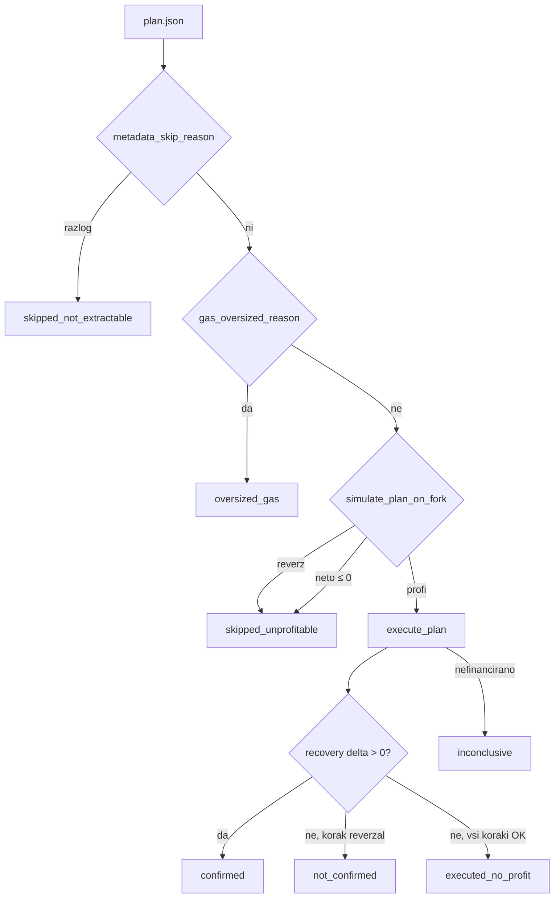

# ZDRAVLJENJE NAPAK — statusi, izhodne kode, tipične napake

> Samostojen dokument. Sorodno: [OZICENJE_RUST_PYTHON.md](OZICENJE_RUST_PYTHON.md),
> [TESTI.md](TESTI.md), [OMEJITVE.md](OMEJITVE.md).

---

## 1. Statusi izvedbe (`auto_pipeline.py`)

Konstante in njihov pomen (iz kode):

| Konstanta | Vrednost | Pomen | Kdo jo postavi |
|-----------|----------|-------|----------------|
| `PLAN_CONFIRMED` | `"confirmed"` | recovery denarnica se je **merljivo** povečala (ETH in/ali token) | `execute_plan` |
| `PLAN_NOT_CONFIRMED` | `"not_confirmed"` | korak je reverzal na realnem stanju | `execute_plan` |
| `PLAN_INCONCLUSIVE` | `"inconclusive"` | izvedba ni bila mogoča (npr. nefinancirano) | `execute_plan` |
| `PLAN_EXECUTED_NO_PROFIT` | `"executed_no_profit"` | vsi koraki OK, a nič ni bilo preneseno | `execute_plan` |
| `PLAN_SKIPPED_UNPROFITABLE` | `"skipped_unprofitable"` | pre-flight fork je dokazal neprofitabilnost | `skip_status_for` |
| `PLAN_SKIPPED_NOT_EXTRACTABLE` | `"skipped_not_extractable"` | ni izvedbenega koraka (heuristika/leak/multi-caller) | `skip_status_for` |
| `PLAN_OVERSIZED_GAS` | `"oversized_gas"` | izmerjen plin ne gre v en blok | `skip_status_for` |

Presoje "ni najdb" (`determine_negative_result_verdict`):
`SCAN_NO_BUG_BOUNDED = "no_bug_found_bounded"`,
`SCAN_INSUFFICIENT_COVERAGE = "insufficient_coverage"`.

`chain-verified` ni shranjena oznaka, ampak `is_chain_verified(status, delta)`
vrne `True` samo, ko `status == PLAN_CONFIRMED` **in** `delta > 0`.

---

## 2. Izhodne kode

### Rust binarij
| Koda | Kje | Pogoj |
|------|-----|-------|
| `0` | `src/fuzzer.rs::evaluate_input_events` | najdena ranljivost brez `--run-forever` |
| `0` | `src/evm/mod.rs::evm_main` | nadzornik `--jobs>1` zaključi z `run_supervisor` rezultatom |
| `1` | `src/fuzzers/evm_fuzzer.rs` | `fuzz_loop` vrne napako |
| `i32` | `src/evm/multicore.rs::run_supervisor` | koda nadzornika (agregat delavcev) |

### Python (`auto_pipeline.main`)
| Koda | Pogoj |
|------|-------|
| `1` | ključ ne obstaja; podpisnik brez sredstev; tarča ne obstaja |
| `0` | normalen zaključek |

`SystemExit` (prek `chains`/`wallet_policy`): neznana veriga, neujemanje RPC
identitete, neujemanje denarnice, nepotrjena mainnet veriga.

---

## 3. Tipične napake in vzroki

### 3.1 RPC identiteta se ne ujema
* Sporočilo: `RPC identity mismatch: --chain '<x>' expects chain id <N>, but
  the configured RPC … is actually serving …`.
* Vzrok: napačen `--chain` ali star `rpc_overrides.json`.
* Rešitev: popravi `--chain` ali počisti override
  (`chains.clear_rpc_override` / `DELETE /api/rpc-override/{chain}`).

### 3.2 Ni registrirane politike denarnic
* Sporočilo: `Refusing to sign anything on chain '<x>': no wallet policy
  registered for it yet.`
* Rešitev: `python3 wallet_policy.py register --chain <x> --confirm-chain <x>
  --funding-wallet 0x… --recovery-wallet 0x… --confirm`.

### 3.3 Neujemanje ključa / recovery denarnice
* Sporočila: `Refusing to sign on chain …: the loaded key resolves to … but
  the wallet registered … is …` oz. `… --recovery-wallet/--safe-wallet is …,
  but the wallet registered as this chain's recovery wallet is …`.
* Rešitev: popravi argument ali ponovno registriraj politiko z `--force`.

### 3.4 Mainnet brez potrditve
* Sporočilo: `Refusing to sign transactions on '<x>': it is not in
  TESTNET_CHAINS (…)`.
* Rešitev: `--confirm-mainnet` (ali uporabi testnet).

### 3.5 Plin ne gre v blok (oversized_gas)
* Pojav: plan označen `fits_block_gas_limit=false`; status `oversized_gas`.
* Vzrok: revm model nima gas meteringa; sled, veljavna v idealizirani
  simulaciji, ne gre v realni blok.
* Glej `gas_oversized_reason` in `estimate_plan_gas_on_fork`.

### 3.6 `eth_estimateGas` vrne ogromno število
* `estimate_gas_limit` cross-checka z `eth_call` pri `block.gasLimit`.
  `GasExceedsBlockLimitError` se sproži le, če **tudi** `eth_call` reverza
  (resnična neizvedljivost, ne le "velika ocena").

### 3.7 AttackWallet je zaklenjen na drugo recovery denarnico
* Sporočilo: `AttackWallet … is LOCKED to safe wallet …, but this run expects
  … -- refusing to proceed.`
* Rešitev: izbriši vnos v `attack_wallets.json` in razporedi novo instanco.

### 3.8 Ime datoteke najdbe predolgo
* Prej je `File::create(...).unwrap()` panikal ("File name too long") pri
  `--run-forever`. Zdaj `vuln_file_base` omeji ime na 120 bajtov + hash.

### 3.9 Fuzzer se ustavi po prvi najdbi
* Vzrok: brez `--run-forever` binarij kliče `exit(0)` ob prvi najdbi.
* Rešitev: `auto_pipeline.run_fuzzer` vedno doda `--run-forever`.

### 3.10 `anvil` ni nameščen
* Pre-flight fork sloj se tiho preskoči (metadata sloj ostane); to **ne**
  ustavi teka.

### 3.11 `solc` ni 0.8.24
* `_find_solc` preveri, da pin res poroča 0.8.24; sicer opozori in pade na
  `solc` s `PATH`. `_solc_extra_flags` izbere `--evm-version` iz
  `_SOLC_EVM_FALLBACKS = ["cancun","shanghai","paris","london"]`.

### 3.12 Solidity predloga navaja neobstoječe zastavice
* Generirane `.t.sol`/`.s.sol` vsebujejo komentar
  `forksploit evm -o -t … -f -i -p …`, kjer `-o` in `-p` **ne obstajata** v
  `EvmArgs`. Ukaz v komentarju je zastarel. To je **neizmerjeno/nepreverjeno**
  kot napaka, a zabeleženo kot razhajanje med predlogo in kodo.

### 3.13 `-f` je `--flashloan`, ne `--fetch-tx-data`
* `EvmArgs` dodeli kratko obliko `-f` polju `flashloan` (`#[arg(short, long,
  default_value = "false")]` v `src/evm/mod.rs`), ker clap izpelje kratko
  obliko iz imena polja. `fetch_tx_data` kratke oblike **nima**.
* `auto_pipeline.run_fuzzer` zato z `-f` dejansko vklopi **flashloan**, ne
  `--fetch-tx-data`. To je zabeleženo kot dejstvo iz kode; v tem dokumentu
  se `-f` povsod razlaga kot `--flashloan`.
* Zabeleženo kot razhajanje z obstoječo dokumentacijo/komentarji, ki `-f`
  opisujejo kot "fetch tx data". Koda je vir resnice.

### 3.14 Zastarelo ime konstante v komentarju
* `onchain_scripts/auto_pipeline.py` v komentarju navaja
  `FUND_EXTRACTION_BUG_TYPES (src/evm/solution/mod.rs)`, a v Rustu te
  konstante **ni** — tam je `CONFIRMED_EXPLOITABLE_BUG_TYPES`
  (`src/evm/solution/mod.rs:361`). Python `FUND_EXTRACTION_BUG_TYPES` je
  manjša podmnožica (6 tipov). Komentar je zastarel; koda se ne ujema z
  njim. Zabeleženo kot razhajanje, ne popravljeno (nalog prepoveduje
  spreminjanje kode).

### 3.14 `test_forksploit_wizard.py` neuspehi brez binarija
* `check_env || exit 1` v `forksploit.sh` prepreči glavni meni, če
  `target/release/forksploit` ne obstaja. To ni napaka kode, ampak
  manjkajoč build. Glej [TESTI.md](TESTI.md) §3.

---

## 4. Kako brati izhod

* Vsak `tee.log` zapis gre hkrati v terminal in v
  `onchain_scripts/logs/auto_pipeline_<run_id>.log`.
* Vrstice `[fuzzer] …` so surov izpis Rust binarija (simulacijski nivo).
  Vrstice `CONFIRMED`/`NOT CONFIRMED`/`EXECUTED, NO PROFIT`/`INCONCLUSIVE`
  so Python-ove in pomenijo realno meritev.
* Dashboard filtrira `[fuzzer]` vrstice iz `recent_logs` (`dashboard_server.api_state`).

---

## 5. Diagram: tok odločanja o statusu

---

## 6. Odprto / neizmerjeno

* **Nepreverjeno:** točne izhodne kode `run_supervisor` za različne
  scenarije okvare delavcev niso razčlenjene (koda vrne agregat).
* **Neizmerjeno:** pogostnost posameznih napak v praksi ni del tega
  dokumenta.
* Statusi so konstante; če Python kdaj doda nov status, ta tabela ne bo
  samodejno posodobljena — beri `auto_pipeline.py`.
